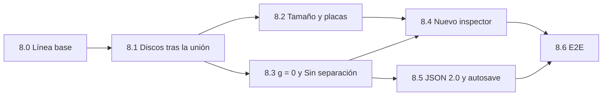

# Plan de Migración — Fase 8: Inspector por secciones y arquitectura Núcleo + Técnica + Unión

> [!IMPORTANT]
> **Instrucción para el agente implementador.** Este documento extiende `MIGRATION_PLAN.md` (Fases 1 a 7, ya implementadas en `./web`). No repite ni reescribe esas fases. Implementa las subfases 8.0 a 8.6 **en orden**. Cada subfase termina con su puerta de calidad: `cd web && npm test` y `cd web && npm run typecheck` en verde, **ningún archivo de `web/golden/` modificado** (`git diff --exit-code web/golden` sale con `0`) y los snapshots de línea base (8.0) idénticos. Si una regla de aquí choca con el código, se detiene y se reporta: no se decide en silencio.

> [!NOTE]
> **Estado verificado al escribir este plan (2026-10-21):** `npx vitest run` → 6 archivos, 38 tests en verde. `npx tsc --noEmit` → código de salida `0`. Último commit: `b6f6870 feat(ui): add loading spinner and overlay…`.

---

## 1. Choques con el plan actual

| # | Regla o archivo existente | Qué pide la Fase 8 | Decisión tomada | Criterio de aceptación |
| :--- | :--- | :--- | :--- | :--- |
| CH-1 | `MIGRATION_PLAN.md` B12 + `validator.ts:61-69` + `validator.test.ts:115`: `validateParams` rechaza `gap = 0`. | Permitir `g = 0` con la unión «Sin separación». | El núcleo (`validateParams`) acepta `gap ∈ [0, 1000]`. El mínimo `0.1` pasa a ser regla de la unión «Con discos» (mismo mensaje de hoy). «Sin separación» exige `gap === 0`. Nueva función `validateBuildParams(params, build)` = núcleo + unión. | `validateBuildParams({ ...DEFAULT_PARAMS, gap: 0 }, DISCS)` lanza `ValidationError` con el mensaje actual; `validateBuildParams({ ...DEFAULT_PARAMS, gap: 0 }, NONE)` no lanza. El test de `validator.test.ts:115` se reescribe con `validateBuildParams` y la unión `discs`. |
| CH-2 | `MIGRATION_PLAN.md` §1.3 y §1.4: inspector con «Corte y escala», acordeón «Hoja de corte» y acordeón «Discos y rotulado». | Nuevo orden: Modelo, Material, Técnica, Aplicar corte, Resultado. | Se reemplaza §1.3/§1.4 solo para `RightInspector`. Los demás HUD no cambian de posición. | E2E 8.6-A verifica el orden de los encabezados. |
| CH-3 | `project.ts:5` (`FORMAT_VERSION = '1.0'` único) y `project.test.ts:62-73` (un JSON `"2.0"` debe rechazarse). | Importar 1.0 y 2.0. | `parseProjectJson` acepta `'1.0'` y `'2.0'`. El caso de `project.test.ts:62-73` se reescribe: ahora se rechaza `"3.0"` con el mensaje nuevo (§3.E.4). `FORMAT_VERSION` se conserva con valor `'1.0'` (alias de `FORMAT_VERSION_V1`). | Test de rechazo de `"3.0"`; test de ida y vuelta de 2.0; golden 1.0 sigue byte a byte. |
| CH-4 | En Python el `ScrapTag` pertenece a cada **placa**: `PlacedPlate.scrap_tag` (`layout.py:67`), generado en `layout.py:392-412` como texto `PLACA i` con flecha sobre el material sobrante junto a esa placa. **No tiene relación con los discos.** (La versión web lo implementa distinto; ver BLOQUEANTE 9.) | Mover «rótulo en sobrante» a las opciones de «Con discos». | **No se mueve a la unión.** Rotula placas, que existen con cualquier unión. Si se ocultara con «Sin separación», su valor seguiría actuando sin control visible. Va en **Material**, **fuera** del bloque «Avanzado» y siempre visible. `diámetro inicial` y `holgura de grabado` sí pasan a «Con discos». | Con «Sin separación», el toggle se ve sin expandir nada y desactivarlo elimina los rótulos de la salida. |
| CH-5 | La función `validatePlateSizes` **no existe**. El único criterio está en línea en `generateLayouts` (`layout.ts:502-507`: `w > usableW \|\| h > usableH`, sin rotar). | Validar el tamaño con «el mismo criterio de `validatePlateSizes`». | Se extrae el predicado a `isWithinUsableArea(w, h, params)` en `layout.ts` y lo usan **ambos**: `generateLayouts` (por placa, mismo mensaje exacto) y la regla de tamaño (sobre la envolvente planar, ver §3.B.6). | Prueba de que `generateLayouts` sigue lanzando el mismo mensaje; prueba de que el máximo calculado cabe y el máximo + 1 placa no cabe en la envolvente. |
| CH-6 | `useSculptureStore.ts:234-245` (copia de `ui.py:265-272`): editar `thickness` copia el valor a `gap` mientras `!gapManuallyEdited`. | `g` lo controla la unión. | La sincronización solo corre si la unión activa tiene `gapPolicy.kind === 'range'` («Con discos»). Con «Sin separación», `gap` se queda en `0`. | Test de store: con `none`, `setParam('thickness', 5)` deja `gap === 0`. Con `discs` el comportamiento es idéntico al de hoy. |
| CH-7 | `MIGRATION_PLAN.md` §2: `core/discs.ts` y las funciones de discos de `core/geometry2d.ts` viven en el núcleo. | Lo de discos sale del núcleo. | Se mueven a `src/core/joints/discs/`. `geometry2d.ts` conserva solo lo genérico. **No se dejan reexportaciones** desde las rutas viejas. | `rg -n "isDiscValidForGap\|DiscManager\|layoutDiscsIntoSheets" src/core/*.ts` no encuentra nada fuera de `src/core/joints/discs/`. |
| CH-8 | `generateLayouts(sliceResult, discs, params)` (`layout.ts:461`) es la API que usan el store y los tests. | El layout del núcleo no conoce discos. | Núcleo: `generateSheetLayouts(sliceResult, params, hooks?)`. La unión «Con discos» expone `generateDiscsLayouts(sliceResult, discs, params)` con la misma salida que hoy. En los tests solo cambian las líneas de `import`; las aserciones no se tocan. | `layout.test.ts` y `exporter.test.ts` pasan con solo cambios de `import`. Los snapshots de 8.0 quedan idénticos. |
| CH-9 | La solicitud menciona `MIGRATION_PLAN_1.md`. | — | Ese archivo no existe. El plan vigente es `MIGRATION_PLAN.md`. Este documento se guarda a su lado. | — |
| CH-10 | `MIGRATION_PLAN.md` A8/DoD-3 da por hecho que las salidas son «compatibles con los golden de Python». | «Layout, SVG y DXF idénticos a los de hoy». | Hoy ningún test compara byte a byte `web/golden/*.svg` ni `*.dxf`. `layout.test.ts` compara con tolerancia `0.1`. La identidad se garantiza con **snapshots de la salida TypeScript actual** tomados en 8.0, antes de tocar código, más una **comprobación manual** contra el DXF con el que se cortó la escultura física (8.0-M). Los golden de Python siguen evaluándose como hoy. | DoD-1, DoD-2 y DoD-12 (§7). |
| CH-13 | `MIGRATION_PLAN.md` §0.0: el JSON solo guarda `plates`, `thickness`, `gap` y `axis`; hoja, kerf, holgura y rótulo «no se guardan». | Definir qué guarda el 2.0. | **El 1.0 no cambia** (compatibilidad con Python). **El 2.0 guarda la configuración completa** (material, hoja, kerf, rótulo y parámetros de la unión), porque es un formato solo web y debe reproducir el corte sin depender del estado local (§3.E.2). | Ida y vuelta 2.0 conserva los 13 campos de §3.E.2. |
| CH-11 | `DiscsDockHUD` se muestra siempre que hay `sliceResult` (§1.4). | Solo con «Con discos». | El dock y `InteractiveDiscsView` se montan solo si `build.jointId === 'discs'`. | E2E 8.6-B. |
| CH-12 | `App.tsx:62-106`: `Ctrl+Z`/`Ctrl+Y`/`Supr` llaman siempre a las acciones de discos. `beforeunload` revisa `discs.length`. | Las acciones de discos son de la unión. | Con una unión distinta de `discs`, esos atajos no hacen nada. `beforeunload` usa `meshGeometry !== null \|\| jointHasUserContent()`. | Test de store: `undoDiscs()` con `none` no cambia el estado. |

---

## 2. Resultado de la lectura del código (mapa real)

Leí completos: `store/useSculptureStore.ts`, `core/params.ts`, `core/validator.ts`, `core/slicer.ts`, `core/layout.ts`, `core/discs.ts`, `core/project.ts`, `core/autosave.ts`, `core/svgExporter.ts`, `core/dxfExporter.ts`, `worker/slicer.worker.ts`, `types/sculpture.ts`, `App.tsx`, `components/hud/{RightInspector,DiscsDockHUD,TopProjectBar}.tsx`, `components/modal/SheetPreviewModal.tsx`, `components/viewport/{InteractiveDiscsView,SlicedPlatesView,Viewport3D}.tsx`, `components/ui/{NumericInput,Collapsible}.tsx`, los 6 archivos de `src/__tests__/` y `e2e/sculpture.spec.ts`.

### 2.1 Archivos y funciones afectados

| Ruta | Símbolos reales | Papel hoy | Cambio en Fase 8 |
| :--- | :--- | :--- | :--- |
| `web/src/types/sculpture.ts` | `SculptureParams`, `Disc`, `PlateEngraveDisc`, `SliceResult`, `PlacedPlate.discs`, `PlacedDisc`, `DiscGroup`, `SheetLayout` (`sheetType: 'plates'\|'discs'`, `discs`, `discGroups`, `engraveClearance`), `WorkerRequest` | Contratos | Se agrega `CoreParams = Omit<SculptureParams, 'discDiameter' \| 'engraveClearance'>`. `SculptureParams` queda **igual** (mismos campos y `DEFAULT_PARAMS`, así `validator.test.ts:79-92` y el `fullParams` del autosave no cambian). Los nombres `discs`/`discGroups`/`sheetType` de `SheetLayout` se conservan (§3.D.5). |
| `web/src/core/params.ts` | `PARAM_BOUNDS`, `DEFAULT_PARAMS`, `getDiscThickness`, `isDiscsSeparateSheet`, `getDiscSheetNotice` | Límites y reglas de hoja de discos | `PARAM_BOUNDS` no cambia (`gap.min` sigue en `0.1`: es el rango de «Con discos»). Las tres funciones de discos se mueven a `core/joints/discs/discParams.ts`. Se agrega `CORE_GAP_BOUNDS = { min: 0, max: PARAM_BOUNDS.gap.max }`. |
| `web/src/core/validator.ts` | `validateParams`, `ValidationError` | Valida todo, incluidos los campos de discos | `validateParams(params: CoreParams)` deja de validar `discDiameter`/`engraveClearance` y acepta `gap ∈ [0, 1000]`. Nueva `validateBuildParams` en `core/build/validateBuild.ts`. |
| `web/src/core/slicer.ts` | `computeCutPositions(plates, thickness, gap)` (`totalHeight = plates * thickness + (plates - 1) * gap`), `AxisSliceCache` (`origHeight`), `sliceMeshFromCache` (`scaleFactor = totalHeight / cache.origHeight`), `sliceMesh` | Técnica «Planos apilados» | `computeCutPositions` llama a `assembledHeight` de `core/sizing.ts` (fórmula única). `sliceMeshFromCache` y `sliceMesh` reciben `CoreParams`. **Sin cambios numéricos.** |
| `web/src/worker/slicer.worker.ts` | `self.onmessage`, `axisCaches` | Wrapper del worker | Sin cambios de lógica. El tipo de `params` en `WorkerRequest` pasa a `CoreParams`. |
| `web/src/core/layout.ts` | `computePlateLabel`, `createEmptySheet`, `finalizeSheetStats`, `layoutDiscsIntoSheets`, `generateLayouts` | Acomodo de placas y discos | `layoutDiscsIntoSheets` y el bloque `layout.ts:576-627` pasan a la unión. Queda `generateSheetLayouts(sliceResult, params, hooks?)` y se exporta `isWithinUsableArea`. |
| `web/src/core/geometry2d.ts` | `pointInPolygonWithHoles`, `distanceToPolygonBoundary` (genéricas); `isDiscInsidePlate`, `isDiscValidForGap`, `projectPointIntoPlate`, `clampDiscPositionToGap` (de discos) | Geometría 2D | Las cuatro de discos se mueven a `core/joints/discs/discGeometry.ts`. |
| `web/src/core/discs.ts` | `DiscManager`, `MAX_HISTORY`, `AddDiscOutcome` | Discos + undo/redo | Se mueve sin cambios a `core/joints/discs/DiscManager.ts`. |
| `web/src/core/project.ts` | `FORMAT_VERSION`, `SerializedProjectFile`, `ParsedProjectData`, `formatPythonFloat`, `serializeProjectJson`, `parseProjectJson`, `checkParamsCompatibility`, `INCOMPATIBLE_PROJECT_CONFIRM_MESSAGE` | JSON 1.0 | Se agregan 2.0 y `build` en `ParsedProjectData`. La rama 1.0 queda intacta. |
| `web/src/core/autosave.ts` | `LOCAL_STORAGE_KEY = 'sculpture_web_autosave_v1'`, `RawAutosaveEnvelope { projectJson, fullParams, meshFileName, savedAt }`, `saveProjectToLocalStorage`, `loadProjectFromLocalStorage` | Autosave | El sobre gana `build`. La clave no cambia. |
| `web/src/core/svgExporter.ts`, `dxfExporter.ts` | `generateSheetSvg`, `generateSheetDxf`, `getSheetFileBaseName`, `exportAllSheetsZip` | Exportan `SheetLayout` | **Sin cambios.** Pintan lo que trae `SheetLayout` y nunca crean discos. |
| `web/src/store/useSculptureStore.ts` | `params`, `gapManuallyEdited`, `discManager`, `discs`, `selectedDiscId`, `modeAddDiscs`, `canUndo/canRedo`, `syncDiscsState`, `setParam`, `runSlice/applySliceOutcome` (reescalado y purga, `useSculptureStore.ts:359-370`), acciones de discos, `restoreAutosaveSession` (con `version: '1.0'` fijo en `:628`), `exportProjectJsonString`, `importProjectFromParsed`, `openSheetPreviewModal` | Estado global | Las acciones de discos se mueven a `store/discsSlice.ts` con **los mismos nombres**. Se agregan `build`, `modelExtents`, `sizeIntent`, `sizeCommitSeq`, `setJoint`, `setPlatesFromDimension`. |
| `web/src/components/hud/RightInspector.tsx` | Secciones «Corte y escala», `Collapsible` «Hoja de corte» y «Discos y rotulado», «Resultado» (`data-testid="stat-discs-total"`, `total-discs-count`) | Inspector | Se reescribe como contenedor de `inspector/*Section.tsx` (§3.A). |
| `web/src/components/hud/DiscsDockHUD.tsx` | Dock (`toggle-add-discs`, `aria-label="Diámetro"`) | UI de discos | Se mueve a `components/joints/discs/DiscsDockHUD.tsx` sin cambiar su contenido. |
| `web/src/components/viewport/InteractiveDiscsView.tsx` | Plano de colocación, cilindro de altura `gap` | Discos 3D | Se mueve a `components/joints/discs/`. Solo se monta con «Con discos». |
| `web/src/components/viewport/SlicedPlatesView.tsx` | `buildPlateExtrudeGeometry`, `buildPlateEdgesBufferGeometry` (privadas) | Placas 3D | Se extraen a `viewport/plateGeometry.ts` (exportadas) y se agrega el inset visual para `gap === 0` (§3.C.4). |
| `web/src/components/modal/SheetPreviewModal.tsx` | Pestañas `Placas`/`Discos` según `sheetType` | Vista previa | Sin cambios. Con «Sin separación» nunca aparece una pestaña «Discos». |
| `web/src/App.tsx` | Atajos de teclado, `beforeunload`, montaje de `DiscsDockHUD` | Shell | El dock pasa por el registro de UI de uniones. Los atajos de discos se condicionan (CH-12). |
| `web/src/components/hud/TopProjectBar.tsx` | `handleProjectFileChange` → `parseProjectJson(text, params)` | Abrir/guardar JSON | Sin cambios de UI. Recibe `ParsedProjectData` con `build`. |

### 2.2 Todo lo que hoy depende de `gap > 0`

1. `validator.ts:61-69`: rechaza `gap < PARAM_BOUNDS.gap.min (0.1)`.
2. `RightInspector.tsx:105-113`: `NumericInput` con `min={PARAM_BOUNDS.gap.min}`.
3. `params.ts:37-54`: `getDiscThickness` devuelve `gap` como grosor de la lámina de discos. Con `gap = 0`, `isDiscsSeparateSheet` daría `true` y `getDiscSheetNotice` mostraría «lámina aparte de 0.0 mm».
4. `layout.ts:576-624`: hoja de discos con `materialThickness = gap`. Solo corre si `discs.length > 0`.
5. `InteractiveDiscsView.tsx:162,178`: `zCenter = zBase + gap * 0.5` y `cylinderGeometry` con altura `gap`. Con `0` el cilindro es degenerado.
6. `useSculptureStore.ts:234-238`: sincronía `thickness → gap`.
7. `useSculptureStore.ts:669-670`: `gapManuallyEdited = |gap − thickness| > 0.01` al importar.
8. `project.ts:43,111`: `serializeProjectJson` y `parseProjectJson` llaman a `validateParams`. Un 1.0 no puede contener `gap = 0`.
9. `autosave.ts:59-60`: `validateParams(baseParams)` y `parseProjectJson` del sobre (hoy siempre 1.0).
10. `SlicedPlatesView.tsx:108-116`: placas de altura `thickness` en `zPositions[i]`. Con `gap = 0` las caras superior e inferior de placas vecinas coinciden (z-fighting).
11. `slicer.ts:14-27` **no** depende de `gap > 0`: con `gap = 0`, `step = thickness` y `totalHeight = N·t`. `scaleFactor` sigue siendo finito porque `t ≥ 0.1` y `N ≥ 2`.
12. `validator.test.ts:115` y el valor documentado `PARAM_BOUNDS.gap.min = 0.1` (`validator.test.ts:96`, se conserva).

---

## 3. Diseño

### 3.A Inspector derecho (UI)

**A.1 Estructura y componentes.** `RightInspector.tsx` conserva el `<aside>` (`w-72`, `hud-surface`, drawer `< 1100px`, botón `SlidersHorizontal` «Parámetros») y pasa a componer:

```text
components/hud/RightInspector.tsx            // contenedor; mismo aside y drawer de hoy
components/hud/inspector/ModelSection.tsx     // MODELO
components/hud/inspector/MaterialSection.tsx  // MATERIAL (+ Collapsible "Avanzado")
components/hud/inspector/TechniqueSection.tsx // TÉCNICA DE CONSTRUCCIÓN (+ eje, placas, unión, opciones de unión)
components/hud/inspector/ApplySliceButton.tsx // [Aplicar corte] (lógica actual de RightInspector.tsx:143-162)
components/hud/inspector/ResultSection.tsx    // RESULTADO + [Vista previa y exportar]
components/ui/SelectField.tsx                 // <select> nativo estilizado
components/joints/registry.ts                 // JOINT_UI
components/joints/discs/DiscsJointOptions.tsx // opciones de "Con discos"
```

```ts
// components/ui/SelectField.tsx
export interface SelectOption<T extends string> {
  value: T;
  label: string;
  disabled?: boolean;
  disabledReason?: string; // se agrega al texto visible: "Waffle (próximamente)"
}
export interface SelectFieldProps<T extends string> {
  label: string;
  value: T;
  options: SelectOption<T>[];
  onChange: (value: T) => void;
  testId?: string;
}
```

```ts
// components/joints/registry.ts
import type { ComponentType } from 'react';
import type { JointId } from '../../core/build/types';
export interface JointUi {
  Options?: ComponentType;        // se monta bajo el dropdown "Unión"
  Dock?: ComponentType;           // se monta en App.tsx
  ViewportLayer?: ComponentType;  // se monta en Viewport3D.tsx junto a SlicedPlatesView
}
export const JOINT_UI: Record<JointId, JointUi>;
// discs: { Options: DiscsJointOptions, Dock: DiscsDockHUD, ViewportLayer: InteractiveDiscsView }
// none:  {}
// rod:   {}
```

**A.2 Reglas de contenido (en este orden exacto):**

| Sección | Encabezado (`h2`, mismo estilo que `RightInspector.tsx:76`) | Controles | Reglas |
| :--- | :--- | :--- | :--- |
| Modelo | `Modelo` | Fila «Tamaño»: tres `NumericInput` (§3.B.5) con etiquetas exactas `Alto (Z)`, `Ancho (X)`, `Largo (Y)` (unidad `mm`, `step 0.1`) y un botón de candado `Lock` (lucide) **deshabilitado**, `aria-pressed="true"`, `title="Escala no uniforme: no disponible"`. La medida ligada a Placas lleva el ícono `Layers` y `aria-describedby` con el texto «Ligada a Placas». Debajo, una línea muted `Máx. garantizado en hoja: N placas · A × B × C mm` (§3.B.7). Si `sizeIntent.kind === 'size'`, otra línea `Objetivo: X mm` bajo el campo objetivo. | Sin malla: los tres campos van `disabled` y se muestra el texto `Carga un modelo para ver sus medidas`. Es la primera sección del aside. |
| Material | `Material` | En este orden: `Grosor` (`thickness`); `Hoja` `Ancho × Alto` (`sheetW`, `sheetH`); toggle `Etiquetar sobrante aprovechable` (`scrapTagEnabled`), **visible sin expandir nada** (CH-4); `Collapsible title="Avanzado"` (cerrado por defecto) con `Margen`, `Sep. piezas` y `Compensación láser (Kerf)`. Con el bloque cerrado, su encabezado muestra el resumen de los valores vigentes: `summary` = `Margen {sheetMargin} · Sep. {partGap} · Kerf {kerf} mm`. | Ningún campo de «Hoja de corte» se pierde: `sheetW`, `sheetH`, `sheetMargin`, `partGap`, `kerf` usan los mismos `PARAM_BOUNDS` y las mismas etiquetas de `RightInspector.tsx:170-218`. Nada que cambie la salida queda oculto sin mostrarse en un resumen. |
| Técnica | `Técnica de construcción` + insignia `Desactualizado` (lógica actual de `RightInspector.tsx:79-83`) | `SelectField` «Técnica» (`Planos apilados`; `Waffle (próximamente)` deshabilitada). Con `stacked`: segmentado `Eje de corte` `Z \| X \| Y` (componente actual de `RightInspector.tsx:121-141`), `NumericInput` «Placas» (`PARAM_BOUNDS.plates`), `SelectField` «Unión» (`Sin separación`, `Con discos`, `Con varilla (próximamente)` deshabilitada) y luego `JOINT_UI[jointId].Options`. | Cada dropdown muestra **solo** los controles de la opción elegida. Las opciones deshabilitadas no se pueden seleccionar (atributo `disabled` del `<option>`). |
| Opciones «Con discos» | (sin encabezado; bloque con `border-l border-white/[0.08] pl-2.5`) | `Separación (grosor del disco)` (`gap`, rango `PARAM_BOUNDS.gap`), aviso `Layers` + `getDiscSheetNotice(params)`, `Diámetro por defecto` (`discDiameter`), `Holgura grabado` (`engraveClearance`). | Solo existe en el DOM si `jointId === 'discs'`. |
| Opciones «Sin separación» | — | Texto muted: `Las placas se apilan pegadas (separación 0 mm).` | No hay campo de `gap`. |
| Aplicar | — | Botón actual (`Play`/`Loader2`, «Aplicar corte» / «Rebanar (actualizar)»). | Igual que hoy. |
| Resultado | `Resultado` | Bloque actual. `Discos totales` (con `data-testid` `stat-discs-total` y `total-discs-count`) solo con `discs`. Agrega la fila `Altura ensamblada: {scaledHeight} mm`. Advertencias y botón «Vista previa y exportar» sin cambios. | — |

**A.3 Sistema visual.** Se reutilizan los tokens de `MIGRATION_PLAN.md` §1.2 (superficie `#121215/95`, pozo `#1C1C21`, acento `#0A84FF`, texto `#F4F4F5`/`#A1A1AA`/`#9CA3AF`, `h-8` y `coarse:min-h-10`). Íconos solo de `lucide-react`: `Lock`, `Layers`, `Ruler` (fila Tamaño), `Package` (Material), `Hammer` (Técnica), `Play`, `Loader2`, `FileOutput`, `AlertTriangle`, `ChevronRight`/`ChevronDown` (de `Collapsible`). Sin emojis ni glifos Unicode. Textos en español neutro.

**A.4 Criterios de aceptación A.**
- A-1: el orden de `h2` en el aside es `Modelo`, `Material`, `Técnica de construcción`, `Resultado`.
- A-2: con `discs` existe un `input` con etiqueta `Diámetro por defecto`; con `none` no existe en el DOM.
- A-3: `option[value="waffle"]` y `option[value="rod"]` tienen `disabled` y su texto termina en `(próximamente)`.
- A-4: el botón de candado tiene `disabled` y `title="Escala no uniforme: no disponible"`.
- A-5: los cinco campos de hoja siguen presentes (tres dentro de «Avanzado» al expandirlo). El toggle de rótulo se ve con «Avanzado» cerrado, y el encabezado de «Avanzado» muestra `Margen 10 · Sep. 5 · Kerf 0.15 mm` con `DEFAULT_PARAMS`.
- A-6: las etiquetas de medida son exactamente `Alto (Z)`, `Ancho (X)` y `Largo (Y)`.

### 3.B Regla de tamaño y placas

**B.1 Módulo único.** Nuevo `web/src/core/sizing.ts` (núcleo, sin React ni store):

```ts
export type ModelDimension = 'alto' | 'ancho' | 'largo';
export interface ModelExtents { x: number; y: number; z: number } // mm sin escalar
export interface FinalSize { alto: number; ancho: number; largo: number; scale: number }
export type SizeIntent =
  | { kind: 'plates' }
  | { kind: 'size'; dim: ModelDimension; targetMm: number };

export const DIMENSION_LABELS: Record<ModelDimension, string> = {
  alto: 'Alto (Z)',
  ancho: 'Ancho (X)',
  largo: 'Largo (Y)',
};
export const TIE_TOLERANCE = 1e-9;

export function assembledHeight(plates: number, thickness: number, gap: number): number;
export function linkedDimension(axis: Axis): ModelDimension;
export function extentOf(extents: ModelExtents, dim: ModelDimension): number;
export function uniformScale(extents: ModelExtents, axis: Axis, plates: number, thickness: number, gap: number): number;
export function finalSize(extents: ModelExtents, axis: Axis, plates: number, thickness: number, gap: number): FinalSize;
export function platesForTargetDimension(
  extents: ModelExtents, axis: Axis, dim: ModelDimension, targetMm: number, thickness: number, gap: number
): { plates: number; clamped: 'min' | 'max' | null };
export function planarEnvelope(extents: ModelExtents, axis: Axis): { w: number; h: number }; // sin escalar, marco de la placa
export function maxFit(
  extents: ModelExtents, axis: Axis, thickness: number, gap: number,
  sheet: Pick<CoreParams, 'sheetW' | 'sheetH' | 'sheetMargin'>
): { plates: number; size: FinalSize } | null;
```

**B.2 Fórmula única.** `assembledHeight` devuelve exactamente `plates * thickness + (plates - 1) * gap`, con ese orden de operaciones para conservar los mismos bits que `slicer.ts:20`. `computeCutPositions` la llama en vez de repetir la expresión. Queda prohibido escribir esa expresión en cualquier otro archivo (DoD-6 lo verifica con `rg`).

**B.3 Etiquetas con letra de eje y relación con `autoScale`.** El marco de referencia es el de la malla cargada (`meshGeometry`, el que muestra la vista «original» con Z arriba):

| Etiqueta exacta en UI | Clave (`ModelDimension`) | Extensión del modelo | `axis = 'z'` | `axis = 'x'` | `axis = 'y'` |
| :--- | :--- | :--- | :--- | :--- | :--- |
| `Alto (Z)` | `alto` | Z | **ligada a Placas** | libre | libre |
| `Ancho (X)` | `ancho` | X | libre | **ligada a Placas** | libre |
| `Largo (Y)` | `largo` | Y | libre | libre | **ligada a Placas** |
| Envolvente planar `(w, h)` de la placa | — | — | `(X, Y)` | `(Z, Y)` | `(X, Z)` |

La envolvente sale de las rotaciones reales de `AxisSliceCache` (`slicer.ts:63-77`): eje X → `x' = −z`, `y' = y`; eje Y → `x' = x`, `y' = −z`. Las rotaciones solo permutan los ejes y cambian signos, así que la extensión a lo largo del eje de corte es igual a `cache.origHeight`. Por eso `uniformScale(...) = assembledHeight(...) / extentOf(extents, linkedDimension(axis))` es **la misma cantidad** que `SliceResult.scaleFactor` (el `autoScale` de los golden). La pantalla no recalcula la escala con otra fórmula: antes de cortar muestra `finalSize` (vista previa) y después, en «Resultado», muestra `sliceResult.scaleFactor`, `scaledBounds` y `scaledHeight`.

- `modelExtents` se calcula **una vez** al cargar la malla, desde `geometry.boundingBox` de la geometría normalizada que devuelve `loadMeshFromBuffer` (la misma cuyas posiciones recibe el worker). **No** se usa `meshMetadata.extents`, que viene del bbox crudo previo al soldado (`validator.ts:203-213`).
- Las etiquetas `Alto (Z)`, `Ancho (X)` y `Largo (Y)` no cambian al cambiar de eje.

**B.4 «Lo último que editaste manda» e intención activa (`sizeIntent`).** El store guarda `params.plates` y `sizeIntent: SizeIntent` (por defecto `{ kind: 'plates' }`). Las tres medidas mostradas se calculan siempre con `finalSize(modelExtents, axis, plates, thickness, gap)` en un selector. Guardar `sizeIntent` define sin ambigüedad qué se mantiene cuando cambia `thickness`, `gap`, `axis` o la unión:

| Acción del usuario | `sizeIntent` resultante | Qué se mantiene y cómo cambia `plates` |
| :--- | :--- | :--- |
| Edita «Placas» con `n` (`setParam('plates', n)`) | `{ kind: 'plates' }` | Se mantiene `plates = n`. Las tres medidas se recalculan con `finalSize`. |
| Edita `Alto (Z)`, `Ancho (X)` o `Largo (Y)` con `v` (`setPlatesFromDimension(dim, v)`) | `{ kind: 'size', dim, targetMm: v }` | `plates ← platesForTargetDimension(extents, axis, dim, v, thickness, gap).plates`. Los tres campos muestran el tamaño **real** resultante para ese entero `plates` y bajo `dim` se muestra `Objetivo: {v.toFixed(1)} mm`. |
| Cambia `thickness`, `gap` (manual o sincronizado), `axis` o `setJoint` | **se conserva el `sizeIntent` vigente** | Si `sizeIntent.kind === 'plates'` (o `modelExtents === null`): se mantiene `plates` y cambia el tamaño final. Si `sizeIntent.kind === 'size'`: se mantiene el objetivo `(dim, targetMm)` y se **recalcula `plates`** con `platesForTargetDimension(extents, nextAxis, sizeIntent.dim, sizeIntent.targetMm, nextThickness, nextGap)`. |
| Carga malla nueva o importa proyecto JSON | `{ kind: 'plates' }` | `plates` se toma del estado o del archivo JSON y las medidas se derivan. |

`platesForTargetDimension`:
1. `x = (targetMm · extentOf(cutDim) / extentOf(dim) + gap) / (thickness + gap)`, donde `cutDim = linkedDimension(axis)`.
2. **Empate con tolerancia `TIE_TOLERANCE = 1e-9`:** sea `f = Math.floor(x + TIE_TOLERANCE)`. Si `Math.abs((x - f) - 0.5) <= TIE_TOLERANCE`, `n = f` (gana el **menor** entero, para que la escultura real nunca supere lo pedido en el empate ni oscile por errores IEEE-754 como `10.499999999999998`). En otro caso, `n = Math.round(x)`.
3. Clamp: `n < 2 → 2` con `clamped: 'min'`; `n > 200 → 200` con `clamped: 'max'`. Con `clamped` distinto de `null`, `statusMessage` muestra `Límite de placas alcanzado (2)` o `(200)`.
4. `targetMm` no finito o `≤ 0`: se ignora sin mutar el store.

**B.5 Borrador local en campos de medida y prevención de bucle.**
- Los tres campos de medida (`Alto (Z)`, `Ancho (X)`, `Largo (Y)`) usan `NumericInput` (`NumericInput.tsx:24-45`), que mantiene un estado local `draft: string` mientras el usuario escribe (`onChange` actualiza solo `draft`) y **solo hace commit al store al pulsar `Enter` o al perder el foco (`onBlur`)** (`Escape` revierte `draft` al valor real).
- Cuando el usuario confirma un valor `v` (p. ej. `50.0` mm) y el tamaño real para el entero `plates` resultante es distinto (p. ej. `48.0` mm), el `useEffect` de `NumericInput` necesitaría actualizar `draft` aunque `value` (`48.0`) no haya cambiado entre antes y después si `plates` ya valía `10`. Por ello se añade a `NumericInputProps` un prop opcional `resetKey?: number` (el store incrementa `sizeCommitSeq` en cada `setPlatesFromDimension`) incluido en las dependencias del `useEffect([value, resetKey])` para que el campo siempre refleje el tamaño real tras `Enter`/`blur`.
- **Cómo se evita el bucle:** (a) Las medidas no son estado independiente y no hay ningún `useEffect` que llame a `setPlatesFromDimension` ni a `setParam`. (b) `commitDraft` solo se ejecuta por evento de usuario (`onBlur` / `Enter`), nunca desde un `useEffect`. (c) `setPlatesFromDimension` y `setParam` hacen **un solo `set`** síncrono. Criterio: un espía sobre `useSculptureStore.subscribe` registra exactamente `1` notificación al confirmar una medida y `1` al cambiar `thickness` con `sizeIntent.kind === 'size'`.

**B.6 Candado.** La proporción siempre está bloqueada. Escala no uniforme: fuera de alcance (§8). El control existe, deshabilitado (A-4).

**B.7 Validación contra la hoja (criterio único y cota superior conservadora).** `layout.ts` exporta:

```ts
export function isWithinUsableArea(w: number, h: number, params: Pick<CoreParams, 'sheetW' | 'sheetH' | 'sheetMargin'>): boolean;
// true  <=>  w <= sheetW - 2*sheetMargin  &&  h <= sheetH - 2*sheetMargin   (sin rotación, igual que layout.ts:503)
```

- `generateSheetLayouts` aplica `isWithinUsableArea` al bounding box 2D real de cada placa cortada y lanza **exactamente el mismo mensaje** de `layout.ts:504-506`.
- `maxFit` aplica el **mismo predicado** `isWithinUsableArea` a la envolvente planar escalada `(env.w · s, env.h · s)` del bounding box 3D completo del modelo: `sMax = min(usableW / env.w, usableH / env.h)`, `Hmax = sMax · extentOf(cutDim)`, `n = floor((Hmax + gap) / (thickness + gap) + 1e-9)`, recortado a `[2, 200]`. Si `n < 2` devuelve `null`.
- **Naturaleza de la cota (documentada en código y UI):** toda sección transversal del modelo está contenida dentro del bounding box 3D proyectado `(env.w · s, env.h · s)`. Por tanto, `maxFit` entrega el **máximo garantizado (cota conservadora sobre el modelo completo / cota superior segura sin rebanar)**: si `plates <= maxFit.plates`, ninguna placa puede exceder el área útil; si `plates > maxFit.plates`, el modelo *podría* seguir cabiendo si ningún plano de corte atraviesa simultáneamente el ancho y alto máximos del bounding box (p. ej. una pirámide o un modelo diagonal). Por eso en la UI se etiqueta `Máx. garantizado en hoja` y actúa como **aviso no bloqueante**:
  - `maxFit === null`: línea ámbar `AlertTriangle` `El modelo completo excede el área útil incluso con 2 placas`.
  - `plates > maxFit.plates`: línea ámbar `Supera el máximo garantizado en hoja (N placas); verifica al exportar`.
  - La validación exacta por placa sigue ocurriendo en `generateSheetLayouts` al abrir la vista previa.

**B.8 Casos borde.**
- Sin malla: `modelExtents = null`. Los campos de medida se deshabilitan; «Placas» se puede editar.
- `extentOf(dim) < 1e-6`: imposible, porque `validator.ts:215` rechaza mallas planas.

**B.9 Criterios de aceptación B.** Tests de §6.1. Además: después de `runSlice`, `|finalSize(...).scale − sliceResult.scaleFactor| ≤ 1e-9 · scaleFactor` en los ejes `x`, `y` y `z` para `test_l_block.obj` y `Hand.OBJ`.

### 3.C Separación `g` dentro de la unión

**C.1 Política por unión.**

```ts
export type GapPolicy =
  | { kind: 'fixed'; value: 0 }                               // none
  | { kind: 'range'; min: number; max: number; step: number }; // discs = PARAM_BOUNDS.gap
```

| Unión | `gap` | Validación | Mensaje si falla |
| :--- | :--- | :--- | :--- |
| Núcleo (`validateParams`) | `[0, 1000]` finito | Siempre | `La separación debe ser mayor o igual a 0 mm y menor o igual a 1000 mm (recibido: X).` |
| `none` «Sin separación» | exactamente `0` | `validateBuildParams` | `La unión «Sin separación» requiere separación 0 mm (recibido: X).` |
| `discs` «Con discos» | `[0.1, 1000]` | `validateBuildParams` | El texto actual de `validator.ts:67`, sin cambios. |

**C.2 Cambio de unión y `gap` (regla determinista bidireccional).**
- `discs → none`: se guarda `discGapMemory = params.gap` (solo en memoria de sesión) y `discGapManuallyEditedMemory = state.gapManuallyEdited`; luego `gap ← 0`, se reaplica `sizeIntent` (§3.B.4) y `isResultDirty ← sliceResult !== null`.
- `none → discs`:
  1. Si `discGapMemory !== null && discGapMemory >= PARAM_BOUNDS.gap.min`: `gap ← discGapMemory` y `gapManuallyEdited ← discGapManuallyEditedMemory`.
  2. Si no existe memoria previa en la sesión (p. ej. tras cargar un proyecto 2.0 `none`): `gap ← Math.max(PARAM_BOUNDS.gap.min, params.thickness)` y `gapManuallyEdited ← false` (queda acoplado a `thickness` igual que al iniciar la app).
  3. Se reaplica `sizeIntent` (§3.B.4) y `isResultDirty ← sliceResult !== null`.
- Con `none`, la sincronía `thickness → gap` está apagada (CH-6).

**C.3 Efecto de `g = 0` en el flujo.**

| Etapa | Comportamiento con `g = 0` |
| :--- | :--- |
| Posiciones de corte | `zPositions[i] = −N·t/2 + i·t + t/2`: un plano en el centro de cada placa, sin huecos. |
| Altura ensamblada | `H = N·t` (`assembledHeight`). `scaledHeight` la muestra. |
| Escala | `scaleFactor = N·t / extentOf(cutDim)`. |
| Visor 3D | Placas pegadas; se evita el z-fighting con C.4. Sin `InteractiveDiscsView`. |
| Layout | Sin hooks de unión: solo hojas `sheetType: 'plates'` con `materialThickness = thickness`. `plate.discs = []` y `discGroups = []`. `computePlateLabel` recibe `localDiscs = []`. |
| Exportación | SVG/DXF solo con contornos `CORTE` (`#FF0000`) y rótulos `P{i}` en `GRABADO` (`#0000FF`), más «SOBRANTE» si está activo. Cero `CIRCLE`/`ARC` en `GRABADO`. |
| Persistencia | JSON 2.0 (§3.E). |

**C.4 Z-fighting.** Solo en la vista y solo si `gap === 0`. `viewport/plateGeometry.ts` exporta:

```ts
export const ZERO_GAP_VISUAL_INSET_RATIO = 0.02;
export function visualPlateDepth(thickness: number, gap: number): number; // gap === 0 ? thickness * (1 - 0.02) : thickness
export function buildPlateExtrudeGeometry(plate: PlateContour, depth: number): THREE.BufferGeometry;      // centrada en ±depth/2
export function buildPlateEdgesBufferGeometry(plate: PlateContour, halfDepth: number): THREE.BufferGeometry;
```

`SlicedPlatesView` usa `visualPlateDepth(thickness, gap)` como profundidad. Cada placa queda `0.01·t` separada de la cara compartida, así que queda una ranura visible de `0.02·t` (`0.06 mm` con `t = 3`). Con `gap > 0` la geometría es **idéntica** a la de hoy. No afecta ningún dato de corte, layout ni exportación.

**C.5 Criterios de aceptación C.**
- C-1: el bbox Z de `buildPlateExtrudeGeometry(plate, visualPlateDepth(3, 0))` mide `2.94 ± 1e-9`, y con `gap = 2` mide `3`.
- C-2: el pipeline completo con `none` sobre `test_l_block.obj` no produce hojas `discs` ni círculos en `GRABADO`.
- C-3: `sliceMesh` con `gap = 0` da `scaledHeight === N·t` y `zPositions[i+1] − zPositions[i] === t` (±1e-12).

### 3.D Arquitectura: núcleo + técnica + unión

**D.1 Capas y carpetas.**

```text
src/core/                      NÚCLEO (no importa nada de core/joints/discs)
  meshLoader.ts validator.ts geometry2d.ts polygonStitcher.ts
  slicer.ts                    técnica "Planos apilados" (única implementación)
  sizing.ts layout.ts svgExporter.ts dxfExporter.ts project.ts autosave.ts params.ts
  build/types.ts               TechniqueId, JointId, RegistryEntry, GapPolicy, BuildConfig, JointDefinition, JointLayoutHooks
  build/registry.ts            TECHNIQUES, JOINTS, getJoint(id), isAvailable(...)
  build/validateBuild.ts       validateBuildParams(params, build)
  joints/none.ts               NONE_JOINT
  joints/discs/                UNIÓN "Con discos"
    index.ts                   DISCS_JOINT (JointDefinition)
    DiscManager.ts             (antes core/discs.ts, sin cambios)
    discGeometry.ts            isDiscInsidePlate, isDiscValidForGap, clampDiscPositionToGap (antes en geometry2d.ts)
    discParams.ts              getDiscThickness, isDiscsSeparateSheet, getDiscSheetNotice, validateDiscsParams
    discLayout.ts              layoutDiscsIntoSheets (movida), createDiscsLayoutHooks, generateDiscsLayouts
    discProject.ts             serializar/parsear la lista de discos (formato "hueco")
src/store/useSculptureStore.ts estado global + build + sizing
src/store/discsSlice.ts        estado y acciones de discos (mismos nombres)
src/components/joints/registry.ts + joints/discs/{DiscsDockHUD,InteractiveDiscsView,DiscsJointOptions}.tsx
```

Regla de dependencias, verificada en DoD-5: ningún archivo de `src/core/*.ts` (nivel raíz) ni de `src/core/build/` importa desde `src/core/joints/discs/`. La única excepción es `build/registry.ts`, que importa `DISCS_JOINT` y `NONE_JOINT` para registrarlos. AGENTS.md: el corte y el layout siguen sin React en `slicer.ts` y `layout.ts`.

**D.2 Registro.**

```ts
export type TechniqueId = 'stacked' | 'waffle';
export type JointId = 'none' | 'discs' | 'rod';
export interface RegistryEntry<Id extends string> {
  id: Id; label: string; available: boolean; unavailableReason?: string;
}
export interface BuildConfig { techniqueId: TechniqueId; jointId: JointId }
export const DEFAULT_BUILD: BuildConfig = { techniqueId: 'stacked', jointId: 'discs' };

export const TECHNIQUES: RegistryEntry<TechniqueId>[] = [
  { id: 'stacked', label: 'Planos apilados', available: true },
  { id: 'waffle',  label: 'Waffle',          available: false, unavailableReason: 'Próximamente' },
];
export const JOINTS: JointDefinition[]; // NONE_JOINT, DISCS_JOINT, ROD_PLACEHOLDER
// ROD_PLACEHOLDER = { id: 'rod', label: 'Con varilla', available: false, unavailableReason: 'Próximamente', gapPolicy: {kind:'fixed', value:0}, validateParams: () => { throw ... } }
```

Reglas: la unión por defecto es `discs` (comportamiento de hoy). Las entradas `available: false` no tienen implementación. Cualquier intento de activarlas (store o importador) lanza `ValidationError('La unión «Con varilla» aún no está disponible.')` o `('La técnica «Waffle» aún no está disponible.')`.

**D.3 Contrato de unión, derivado de lo que «Con discos» usa de verdad.**

| Necesidad real de «Con discos» (dónde está hoy) | Dónde queda |
| :--- | :--- |
| Rango y default de `gap` (`params.ts:9,25`) | `JointDefinition.gapPolicy` |
| Parámetros y defaults `discDiameter = 6.0`, `engraveClearance = 0.3` (`params.ts:32-33`) | Siguen en `SculptureParams`/`DEFAULT_PARAMS` (sin migrar datos). Los valida `validateDiscsParams` con los mensajes de `validator.ts:80-82,133-135`. |
| Validación de parámetros | `JointDefinition.validateParams(params)` |
| Validación física de discos contra placas (`geometry2d.ts:122-161`) | `discGeometry.ts` |
| Reacción a un re-corte: limpiar al cambiar de eje, reescalar por `newScale/oldScale` y purgar (`useSculptureStore.ts:359-370`) | `discsSlice.onSliceApplied({ axisChanged, prevScaleFactor, result })`, llamado desde `applySliceOutcome` solo si la unión es `discs` |
| Limpieza al cargar malla (`useSculptureStore.ts:300`) | `discsSlice.resetDiscs()` (sin snapshot) |
| Marcas de grabado por placa: sólido `gapIndex === i`, punteado `gapIndex === i − 1` (`layout.ts:509-521`) | `JointLayoutHooks.plateEngraveMarks` |
| Bandejas, grupos y hoja aparte si `\|g − t\| > 0.01` (`layout.ts:250-456, 576-624`) | `JointLayoutHooks.placeExtraParts` |
| Serialización `hueco` (`project.ts:44-60, 113-158`) | `discProject.ts` |
| Panel, dock y capa 3D | `JOINT_UI.discs` |
| ¿Tiene contenido del usuario? (`App.tsx:36`) | `discsSlice.discs.length > 0` |

```ts
export interface JointDefinition extends RegistryEntry<JointId> {
  gapPolicy: GapPolicy;
  validateParams(params: SculptureParams): void; // lanza ValidationError
}

export interface JointLayoutCursor {
  sheets: SheetLayout[]; currentSheet: SheetLayout;
  cursorX: number; cursorY: number; rowHeight: number; sheetCounter: number;
}
export interface JointLayoutHooks {
  sheetEngraveClearance: number; // valor que createEmptySheet escribe en SheetLayout.engraveClearance
  plateEngraveMarks(plateIndex: number, boundsMinX: number, boundsMinY: number): PlateEngraveDisc[];
  /** Coloca piezas extra después de las placas. Devuelve true si cerró las hojas (empujó currentSheet);
   *  false si no tenía piezas (el núcleo empuja currentSheet si tiene placas, como layout.ts:625-627). */
  placeExtraParts(cursor: JointLayoutCursor, params: SculptureParams): boolean;
}
export function generateSheetLayouts(sliceResult: SliceResult, params: CoreParams, hooks?: JointLayoutHooks): SheetLayout[];
// sin hooks: sheetEngraveClearance = 0, plateEngraveMarks = () => [], placeExtraParts = () => false
```

`createDiscsLayoutHooks(discs, params)` reproduce **literalmente** el cuerpo actual: `plateEngraveMarks` = mapeo de `layout.ts:509-521`; `placeExtraParts` = `layout.ts:576-624`, que devuelve `false` si `discs.length === 0`. `generateDiscsLayouts(slice, discs, params) = generateSheetLayouts(slice, params, createDiscsLayoutHooks(discs, params))`. El orden de llamadas, el redondeo `toFixed(4)` y el orden de las hojas quedan iguales. Lo prueban los snapshots de 8.0.

**D.4 Store.** `discsSlice.ts` contiene `discManager`, `discs`, `selectedDiscId`, `modeAddDiscs`, `canUndo`, `canRedo`, `discGapMemory` y las acciones con sus nombres actuales: `setModeAddDiscs`, `addDiscAtActiveFloor`, `commitDiscMove`, `selectDisc`, `updateSelectedDiscDiameter`, `deleteSelectedDisc`, `clearActiveFloorDiscs`, `clearAllDiscs`, `undoDiscs`, `redoDiscs`. Cada acción empieza con `if (get().build.jointId !== 'discs') return;` (en `commitDiscMove` devuelve `false`). Se agrega al store:

```ts
build: BuildConfig;
modelExtents: ModelExtents | null;
sizeIntent: SizeIntent;
sizeCommitSeq: number;
setTechnique: (id: TechniqueId) => void;                            // solo acepta 'stacked'
setJoint: (id: JointId, opts?: { confirmed?: boolean }) => { needsConfirmation: boolean; discCount: number };
setPlatesFromDimension: (dim: ModelDimension, mm: number) => void;
```

**D.5 Nombres heredados.** `SheetLayout.discs`, `discGroups`, `PlacedPlate.discs` y `sheetType: 'discs'` se conservan porque son el contrato que leen los exportadores y que mapean los tests de golden. El núcleo **nunca** los llena: solo los hooks de la unión. Renombrarlos queda fuera de esta fase.

**D.6 Técnica.** Solo existe `stacked` = `slicer.ts` + worker, sin cambios. **No** se crea una interfaz `Technique` con métodos: con una sola implementación sería especulativa. La técnica activa solo se usa para el registro, la UI, la validación (`techniqueId === 'stacked'`) y la persistencia.

**D.7 Puntos de extensión conocidos (no se implementan).**
- **Waffle:** corta con **dos familias de planos perpendiculares** y produce piezas con **ranuras** de ancho `t + kerf` hasta media altura en los cruces. Va a tocar: `slicer.ts` (una segunda familia de planos sobre otro eje con el mismo `AxisSliceCache` o uno nuevo; resultado con dos listas de placas), `layout.ts` (piezas con ranuras y quizá rotación para aprovechar la hoja, que hoy está prohibida), `sizing.ts` (el tamaño ya no sale de `N·t + (N−1)·g`; probablemente se fijan las tres medidas y el número de piezas por familia) y la vista 3D (dos orientaciones). En ese momento se extrae la interfaz `Technique` a partir de dos implementaciones reales.
- **Varilla:** probablemente necesita `gap` en rango (separadores), una marca de perforación por placa (encaja con `plateEngraveMarks`, pero en `CORTE`) y quizá piezas extra (separadores) con `placeExtraParts`. No se inventa su API.

**D.8 Criterios de aceptación D.**
- D-1: snapshots de 8.0 idénticos.
- D-2: la regla de dependencias de D.1 se cumple (test estático `architecture.test.ts` que lee los `import` con `fs` y una regex).
- D-3: el registro expone 2 técnicas y 3 uniones; `waffle` y `rod` tienen `available === false` y `unavailableReason === 'Próximamente'`.
- D-4: `setJoint('rod')` lanza `ValidationError` y no cambia `build`.

### 3.E Persistencia y compatibilidad

**E.1 Regla de versión al escribir.**

```ts
export function projectFormatFor(build: BuildConfig, params: SculptureParams): '1.0' | '2.0';
// '1.0'  <=>  build.techniqueId === 'stacked' && build.jointId === 'discs' && params.gap > 0
// '2.0'  en cualquier otro caso
export function serializeProject(params: SculptureParams, build: BuildConfig, discs: Disc[]): string;
// '1.0' -> delega en serializeProjectJson(params, discs) SIN CAMBIOS (byte-compatible con golden/l_block_project.json)
```

**E.2 Esquema 2.0 completo** (indentación de 2 espacios, LF, orden de claves fijo, números con `formatPythonFloat`). A diferencia del 1.0 (que omitía hoja, kerf, holgura y rótulo por compatibilidad con Python; ver CH-13), el **2.0 persiste los 13 parámetros del proyecto** repartidos en `material`, `technique` y `joint`:

```json
{
  "version": "2.0",
  "material": {
    "thickness": 3.0,
    "sheetW": 600.0,
    "sheetH": 400.0,
    "sheetMargin": 10.0,
    "partGap": 5.0,
    "kerf": 0.15,
    "scrapTagEnabled": true
  },
  "technique": {
    "id": "stacked",
    "params": {
      "plates": 10,
      "axis": "z"
    }
  },
  "joint": {
    "id": "none",
    "params": {}
  }
}
```

Variante `discs` (la acepta el importador y los tests; el escritor emite 1.0 cuando `discs` tiene `g > 0`):
```json
"joint": {
  "id": "discs",
  "params": {
    "gap": 2.0,
    "discDiameter": 6.0,
    "engraveClearance": 0.3
  },
  "discs": [
    { "id": 1, "hueco": 0, "x": -7.5, "y": 0.0, "diameter": 5.0 }
  ]
}
```

**E.3 Validación del 2.0, en este orden:**
1. JSON válido y objeto raíz (mensajes actuales de `project.ts:82,86`).
2. `version`: si `obj.version !== '1.0' && obj.version !== '2.0'`, lanza `ValidationError` con el mensaje claro de E.4.
3. Claves raíz exactamente `version`, `material`, `technique`, `joint`.
4. `material`: objeto con claves exactamente `thickness`, `sheetW`, `sheetH`, `sheetMargin`, `partGap`, `kerf` (numéricos) y `scrapTagEnabled` (booleano).
5. `technique.id` en el registro y `available`. `technique.params` con claves exactamente `plates`, `axis`.
6. `joint.id` en el registro y `available`. `joint.params`: `none` → `{}`; `discs` → `{ gap, discDiameter, engraveClearance }`. `joint.discs`: obligatorio con `discs`, prohibido con `none`.
7. Se arma `params: SculptureParams` completo (con `none`, `gap = 0` y se conservan `baseParams.discDiameter`/`engraveClearance`) y se llama `validateBuildParams(params, build)`.
8. Discos: misma validación que `project.ts:120-158`.

`ParsedProjectData` pasa a `{ version: '1.0' | '2.0'; params; discs; build: BuildConfig }`. Un 1.0 da `build = DEFAULT_BUILD` (apilados + con discos) y toma de `baseParams` los campos no incluidos en 1.0 (`sheetW`, `sheetH`, `sheetMargin`, `partGap`, `kerf`, `discDiameter`, `engraveClearance`, `scrapTagEnabled`), igual que hoy.

**E.4 Mensajes de error nuevos (exactos):**

| Caso | Mensaje |
| :--- | :--- |
| Versión desconocida | `Versión de archivo no soportada: 'X' (se esperaba '1.0' o '2.0').` |
| Falta una clave | `Falta el campo obligatorio 'technique' en el archivo JSON.` (patrón actual de `project.ts:99`, con rutas `material.sheetW`, `technique.params.plates`, `joint.params`, etc.) |
| Clave sobrante | `Campo no reconocido 'X' en 'joint.params'.` (o `en la raíz`, `en 'material'`, `en 'technique.params'`) |
| Id desconocido | `Técnica desconocida: 'X'.` / `Unión desconocida: 'X'.` |
| No disponible | `La técnica «Waffle» aún no está disponible.` / `La unión «Con varilla» aún no está disponible.` |
| Discos con `none` | `La unión «Sin separación» no admite discos.` |
| Tipo inválido | `El campo 'technique.params.plates' debe ser numérico.` (o `booleano` para `material.scrapTagEnabled`) |

**E.5 Autosave.** `RawAutosaveEnvelope` gana `build: BuildConfig`. `projectJson` = `serializeProject(...)` (1.0 o 2.0). `LOCAL_STORAGE_KEY` no cambia. Al leer: si falta `build` (sobres escritos antes de la Fase 8), se usa el `build` de `parseProjectJson(projectJson)`. `restoreAutosaveSession` deja de forzar `version: '1.0'` (`useSculptureStore.ts:628`) y pasa el `build` del snapshot. Se guarda el autosave en cada `setJoint`, igual que en `setParam`.

**E.6 Cambio de unión con discos colocados.**
1. `setJoint(id)` con `id !== jointId`, `jointId === 'discs'` y `discs.length > 0` sin `confirmed` → devuelve `{ needsConfirmation: true, discCount }` y **no cambia nada**.
2. El dropdown muestra `window.confirm('Cambiar la unión eliminará los N discos colocados. Esta acción no se puede deshacer. ¿Deseas continuar?')`. Si se cancela, el `<select>` vuelve al valor anterior (es controlado por `build.jointId`).
3. Con `confirmed: true`: `discManager.loadDiscsFromProject([])`, que vacía los discos **y las pilas de undo/redo** (`discs.ts:261-267`). Luego `selectedDiscId = null`, `modeAddDiscs = false`, se aplica C.2 y se guarda el autosave. Así undo/redo no cruzan el cambio.
4. Al volver a `discs`, el historial está vacío (`canUndo === false`).
5. `checkParamsCompatibility` gana `fileBuild` y `currentBuild` opcionales: `build` distinto ⇒ `false`.

**E.7 Criterios de aceptación E.** Tests de §6.5. El golden `l_block_project.json` sigue byte a byte (test existente sin cambios).

---

## 4. Plan de migración por fases

> Puerta común **G** para cada subfase: `cd web && npm test` y `cd web && npm run typecheck` con salida `0`; `git diff --exit-code web/golden` con salida `0`; `baseline.test.ts` en verde **sin regenerar snapshots**. Un commit por subfase, en inglés con formato convencional (AGENTS.md).

### Fase 8.0 — Línea base de salidas actuales y verificación del DXF físico (requisito previo)
- **Objetivo:** congelar la salida actual de TypeScript antes de tocar código (CH-10) y documentar la comprobación manual contra el DXF con el que se cortó la escultura física.
- **Crear:** `web/src/__tests__/baseline.test.ts`, `web/src/__tests__/__baseline__/` y `web/scripts/write-baseline.ts`.
- **Protección contra regeneración accidental:** `write-baseline.ts` NO está registrado como script automático de test/build; exige pasar el flag explícito `--confirm-regenerate` en línea de comandos (`npx vite-node scripts/write-baseline.ts --confirm-regenerate`) y aborta con código `1` si no se incluye. En las fases 8.1 a 8.6 está **prohibido** ejecutarlo.
- **Casos congelados** (entradas fijas deterministas; para cada caso se guarda `layout.json` con `JSON.stringify(sheets, null, 2)` y el texto exacto `.svg` y `.dxf` de cada hoja, comparados con `expect(actual).toBe(expected)` normalizando solo `\r\n` → `\n`):
  1. **Hoja de placas + hoja aparte de discos (`g ≠ t`), círculos sólidos y punteados, rótulo ON:** `test_l_block.obj`, `axis: 'z'`, `plates: 5`, `thickness: 3.0`, `gap: 2.0`, `scrapTagEnabled: true`, discos de `golden/l_block_project.json` (P1 recibe disco sólido `gapIndex === 1` y disco punteado `gapIndex === 0`). Produce 2 hojas (`plates` de `3.0 mm` y `discs` de `2.0 mm`).
  2. **Mismo escenario con rótulo OFF (`scrapTagEnabled: false`):** idénticas entradas que (1) pero con `scrapTagEnabled: false` (`scrapTags: []` en ambas hojas).
  3. **Eje Y asimétrico con hoja aparte de discos:** `test_l_block.obj`, `axis: 'y'`, `plates: 5`, `thickness: 3.0`, `gap: 2.0`, discos de `golden/l_block_project.json`.
  4. **Múltiples hojas de placas + discos en la misma lámina (`g === t`):** `test_l_block.obj`, `axis: 'z'`, `plates: 12`, `thickness: 3.0`, `gap: 3.0`, `sheetW: 120.0`, `sheetH: 90.0`, `sheetMargin: 10.0`, `partGap: 5.0`, discos `[{ id: 1, gapIndex: 0, x: -7.5, y: 0, diameter: 6 }, { id: 2, gapIndex: 1, x: -7.5, y: 0, diameter: 6 }]`. Obliga a paginar en $\ge 3$ hojas de `sheetType: 'plates'` y coloca la bandeja de discos al final.
  5. **Modelo orgánico sin discos:** `Hand.OBJ`, `DEFAULT_PARAMS`, `discs: []`.
  6. **Proyecto JSON 1.0:** salida de `serializeProjectJson` para el caso 1.
- **8.0-M — Comprobación manual con el DXF físico (escultura ya armada):**
  - Comparar las métricas clave (`$EXTMIN`/`$EXTMAX`, conteo de `LWPOLYLINE` en `CORTE`, conteo y radios de `CIRCLE` y `ARC` en `GRABADO` y `CORTE`) entre `web/golden/l_block_hoja_1_placas_python.dxf` / `l_block_hoja_2_discos_python.dxf` (generados por Python) y las hojas del caso 1 generadas por TypeScript, dejando constancia en el mensaje de commit de 8.0.
- **Puerta:** G (con los 6 casos de `baseline.test.ts` en verde tras generar dos veces y comprobar determinismo bit a bit).

### Fase 8.1 — Discos detrás de la interfaz de unión (sin cambiar comportamiento)
- **Objetivo:** D.1 a D.5 con salida idéntica.
- **Crear:** `core/build/{types,registry,validateBuild}.ts`, `core/joints/none.ts`, `core/joints/discs/{index,discParams,discLayout,discProject}.ts`, `store/discsSlice.ts`, `components/joints/registry.ts`.
- **Mover (con `git mv`):** `core/discs.ts` → `core/joints/discs/DiscManager.ts`; `DiscsDockHUD.tsx` e `InteractiveDiscsView.tsx` → `components/joints/discs/`. Las funciones de discos de `geometry2d.ts` → `core/joints/discs/discGeometry.ts`.
- **Modificar:** `layout.ts` (extraer `generateSheetLayouts`, `isWithinUsableArea` y los hooks), `params.ts`, `validator.ts` (`CoreParams`; **en esta fase el rango de `gap` sigue siendo `[0.1, 1000]`**), `useSculptureStore.ts` (componer `discsSlice`, `build = DEFAULT_BUILD`, `openSheetPreviewModal` → `generateDiscsLayouts`), `App.tsx` y `Viewport3D.tsx` (`JOINT_UI`), los imports en `discs.test.ts`, `layout.test.ts` y `exporter.test.ts`.
- **Pasos:** (1) tipos y registro; (2) mover archivos; (3) hooks de layout copiando el código tal cual; (4) slice del store; (5) registro de UI.
- **Tests nuevos:** `joints.test.ts` (registro, D-3); `architecture.test.ts` (D-2); en `layout.test.ts`, `generateSheetLayouts` sin hooks ≡ `generateDiscsLayouts` con `discs = []`.
- **Puerta:** G. Los snapshots no se tocan.

### Fase 8.2 — Regla de tamaño y placas
- **Objetivo:** §3.B en núcleo y store, sin UI nueva todavía.
- **Crear:** `core/sizing.ts` y `__tests__/sizing.test.ts`.
- **Modificar:** `slicer.ts` (`computeCutPositions` usa `assembledHeight`), `NumericInput.tsx` (prop opcional `resetKey`), `useSculptureStore.ts` (`modelExtents` en `loadMeshArrayBuffer`, `sizeIntent`, `sizeCommitSeq`, `setPlatesFromDimension`, recálculo de `plates` en `setParam` cuando `sizeIntent.kind === 'size'` y cambia `thickness`/`gap`/`axis`).
- **Tests:** §6.1 y la igualdad con `scaleFactor`.
- **Puerta:** G. `slicer.test.ts` intacto y en verde.

### Fase 8.3 — `g = 0` y «Sin separación»
- **Objetivo:** §3.C completo y `setJoint` en el store (sin selector visual todavía).
- **Modificar:** `validator.ts` (`CORE_GAP_BOUNDS`), `core/joints/none.ts`, `discParams.validateDiscsParams` (mínimo `0.1`), `validateBuild.ts`, `useSculptureStore.ts` (`setJoint`, C.2 con reaplicación de `sizeIntent`, CH-6, condición de `applySliceOutcome`, `runSlice` que llama a `validateBuildParams` antes de enviar al worker), `discsSlice.ts` (guardas CH-12), `App.tsx` (`beforeunload`).
- **Crear:** `components/viewport/plateGeometry.ts`. **Modificar:** `SlicedPlatesView.tsx`.
- **Reescribir:** `validator.test.ts:115` según CH-1.
- **Tests:** §6.3 y §6.4, más un test de store para E.6 (confirmación y que undo no cruce).
- **Puerta:** G.

### Fase 8.4 — Nuevo inspector
- **Objetivo:** §3.A.
- **Crear:** `components/hud/inspector/*.tsx`, `components/ui/SelectField.tsx`, `components/joints/discs/DiscsJointOptions.tsx`.
- **Modificar:** `RightInspector.tsx` (contenedor) y `JOINT_UI.discs.Options`.
- **Pasos:** conservar `data-testid` existentes (`total-discs-count`, `stat-discs-total`, `toggle-add-discs`) y el texto «Vista previa y exportar». Agregar `data-testid`: `section-model`, `section-material`, `section-technique`, `select-technique`, `select-joint`, `dim-alto`, `dim-ancho`, `dim-largo`, `max-fit-line`.
- **Tests:** las E2E actuales (`e2e/sculpture.spec.ts` 1 a 5) siguen pasando sin cambios. Las nuevas van en 8.6.
- **Puerta:** G más `npm run test:e2e` con los 5 casos actuales en verde.

### Fase 8.5 — JSON 2.0 y autosave
- **Objetivo:** §3.E.
- **Modificar:** `project.ts` (`projectFormatFor`, `serializeProject`, rama 2.0 en `parseProjectJson`, `checkParamsCompatibility`), `autosave.ts` (sobre con `build`), `useSculptureStore.ts` (`exportProjectJsonString`, `importProjectFromParsed` aplica `build`, `restoreAutosaveSession`), `project.test.ts` (CH-3).
- **Tests:** §6.5.
- **Puerta:** G. El test byte a byte del golden sigue sin cambios.

### Fase 8.6 — E2E
- **Objetivo:** §6.6.
- **Modificar:** `e2e/sculpture.spec.ts` (agregar casos 6 a 9; los casos 1 a 5 no se tocan).
- **Puerta:** G más `npm run test:e2e` en verde.

---

## 5. Orden de dependencias



---

## 6. Tests

### 6.1 `sizing.test.ts` (regla de tamaño)
Extents de prueba `E = { x: 40, y: 20, z: 60 }`, `t = 3`, `g = 2`.
1. **Fórmula única:** `assembledHeight(10, 3, 2) === 48` y `computeCutPositions(10, 3, 2).totalHeight === assembledHeight(10, 3, 2)` (bit a bit) para 50 tríos aleatorios con semilla fija.
2. **Etiquetas:** `DIMENSION_LABELS` expone `'Alto (Z)'`, `'Ancho (X)'`, `'Largo (Y)'`; `linkedDimension('z') === 'alto'`, `('x') === 'ancho'`, `('y') === 'largo'`. `planarEnvelope(E,'x')` da `{w: 60, h: 20}`, `('y')` da `{w: 40, h: 60}` y `('z')` da `{w: 40, h: 20}`.
3. **Ida y vuelta:** para `N = 2..200` y los tres ejes, `platesForTargetDimension(E, axis, linkedDimension(axis), finalSize(E, axis, N, t, g)[dim], t, g).plates === N`. Lo mismo pidiendo con una dimensión **no** ligada.
4. **Redondeo:** pedir `alto = 50` en `z` (`x = 10.4`) da `10`; pedir `alto = 51` (`x = 10.6`) da `11`.
5. **Empate con tolerancia `1e-9`:** pedir `alto = 50.5` en `z` (`x = 10.5`) da `10` (gana el menor); pedir un objetivo que por coma flotante produce `x = 10.5 - 5e-13` o `10.5 + 5e-13` (dentro de `TIE_TOLERANCE = 1e-9`) también da `10`. Con `g = 0`, `t = 2`: `alto = 21` (`x = 10.5`) da `10`.
6. **Clamps:** `alto = 1` da `{ plates: 2, clamped: 'min' }`; `alto = 100000` da `{ plates: 200, clamped: 'max' }`.
7. **Persistencia de `sizeIntent` al cambiar `thickness` o `gap`:**
   - Si el usuario editó `Placas = 10` (`sizeIntent.kind === 'plates'`) y luego cambia `thickness` de `3` a `6` (con `gap = 2`), `plates` sigue en `10` y `alto` pasa de `48` a `78`.
   - Si el usuario editó `Alto (Z) = 60` (`sizeIntent = { kind: 'size', dim: 'alto', targetMm: 60 }`, `plates = 12` con `t = 3, g = 2`) y luego cambia `thickness` a `6` (`gapManuallyEdited = true`, `g = 2`), el store recalcula `plates = round((60 + 2) / 8) = 8` manteniendo el objetivo de `60 mm`.
8. **Igualdad con el slicer:** con `test_l_block.obj` y `Hand.OBJ`, en los tres ejes, `|uniformScale − sliceMesh(...).scaleFactor| ≤ 1e-9·scaleFactor`, usando `modelExtents` desde `geometry.boundingBox`.
9. **Máximo garantizado de hoja (cota conservadora):** hoja `600 × 400`, margen `10` (útil `580 × 380`), `E` en `z`: `sMax = min(580/40, 380/20) = 14.5`, `Hmax = 870`, `maxFit.plates = floor(872/5) = 174`. `isWithinUsableArea` de la envolvente con 174 placas es `true` y con 175 es `false`. Una hoja `30 × 30` con margen `10` da `null`.
10. **Criterio único:** `generateSheetLayouts` lanza exactamente el mensaje de `layout.ts:504-506` cuando `isWithinUsableArea(w, h)` es `false` para una placa (se reutiliza el caso de `layout.test.ts:118-127`).

### 6.2 Golden y línea base sin cambios con «apilados + con discos»
- `baseline.test.ts` (8.0): igualdad exacta de texto (`toBe`) en `layout.json`, `.svg` y `.dxf` para los 6 casos de 8.0.
- `slicer.test.ts`, `layout.test.ts`, `exporter.test.ts` y `project.test.ts`: aserciones sin cambios (solo imports, CH-8).
- `git diff --exit-code web/golden` en cada puerta.

### 6.3 `zeroGap.test.ts` (`gap = 0` de punta a punta)
1. `validateBuildParams({..., gap: 0}, {stacked, none})` no lanza; con `discs` lanza el mensaje actual. `{..., gap: 0.5}` con `none` lanza `La unión «Sin separación» requiere separación 0 mm (recibido: 0.5).`
2. `sliceMesh(l_block, {plates: 10, t: 3, gap: 0, axis: 'z'})`: `scaledHeight === 30`, pasos de `zPositions === 3`, 10 placas no vacías.
3. `generateSheetLayouts(slice, params)` sin hooks: todas las hojas `sheetType === 'plates'`, `materialThickness === 3`, `discGroups.length === 0` y cada `plate.discs.length === 0`.
4. SVG: `#grabado` sin `<circle>`. DXF (`dxf-parser`): `0` `CIRCLE` y `0` `ARC` en `GRABADO`; `LWPOLYLINE` en `CORTE` ≥ 10.
5. `plateGeometry`: C-1.
6. Store: con `none`, `setParam('thickness', 5)` deja `gap === 0`; `undoDiscs()`, `addDiscAtActiveFloor()` y `deleteSelectedDisc()` no cambian el estado; `openSheetPreviewModal()` no genera hoja `discs`.
7. Transición `discs → none → discs` restaura `discGapMemory` (`gap` 2 → 0 → 2) y `discGapManuallyEditedMemory`. Sin memoria previa (tras importar un 2.0 `none` con `thickness: 4`), `none → discs` fija `gap = 4` y `gapManuallyEdited = false`.

### 6.4 `joints.test.ts` (registro con opciones deshabilitadas)
- 2 técnicas y 3 uniones con los `label` exactos de D.2.
- `waffle` y `rod` con `available: false` y `unavailableReason: 'Próximamente'`.
- `setTechnique('waffle')` y `setJoint('rod')` lanzan el mensaje de D.2 y `build` no cambia.
- `DEFAULT_BUILD` es `{ stacked, discs }`.
- `architecture.test.ts`: D-2.

### 6.5 `project.test.ts` (esquema 2.0)
1. **Ida y vuelta 2.0 completa:** `serializeProject(customParams, {stacked, none}, [])` con valores no por defecto en `sheetW`, `sheetH`, `sheetMargin`, `partGap`, `kerf` y `scrapTagEnabled: false` produce el texto exacto de E.2. `parseProjectJson` recupera los 13 parámetros y `build = {stacked, none}`, `gap === 0`, `discs = []`. Re-serializar da el mismo texto.
2. **Versión elegida:** `projectFormatFor` da `'1.0'` para `{stacked, discs}` con `g = 2` y `'2.0'` para `{stacked, none}`.
3. **1.0 intacto:** el test byte a byte existente sigue igual. `parseProjectJson(golden).build` da `DEFAULT_BUILD`.
4. **2.0 con `discs`:** incluye `gap`, `discDiameter`, `engraveClearance` y `discs`; se importa y conserva todos los campos.
5. **Rechazo de versiones desconocidas y basura** (cada uno con su mensaje exacto de E.4): `version: '3.0'`, `version: '0.9'` y `version: undefined` lanzan `Versión de archivo no soportada: '...' (se esperaba '1.0' o '2.0').`; falta `material` o `technique`; clave raíz extra `"foo"`; clave extra en `material`; `technique.id: 'cubes'`; `technique.id: 'waffle'`; `joint.id: 'rod'`; `joint.params: { gap: 1 }` con `none`; `joint.discs` con `none`; `plates: "diez"`; `scrapTagEnabled: "si"`; `plates: 1`; `thickness: 0`; `axis: 'w'`; `discs` con `hueco` fuera de rango.
6. **Autosave:** guardar y leer con `none` conserva `build`, `gap = 0` y parámetros de hoja. Un sobre sin `build` (formato anterior) se lee como `DEFAULT_BUILD`.
7. **Compatibilidad:** `checkParamsCompatibility(p, p, buildA, buildB)` con uniones distintas da `false`.

### 6.6 E2E (`e2e/sculpture.spec.ts`, casos nuevos)
- **6. Orden del inspector, etiquetas `Alto (Z)`/`Ancho (X)`/`Largo (Y)`, resumen de «Avanzado» y opciones deshabilitadas (A-1 a A-6).**
- **7. Cambio de unión con discos colocados:** cargar `test_l_block.obj`; activar «Poner discos»; vista `7`; clic al centro → `total-discs-count = 2`. Elegir `Sin separación` en `select-joint` y **cancelar** el diálogo (`page.once('dialog', d => d.dismiss())`): el select vuelve a `Con discos` y siguen 2 discos. Repetir y **aceptar**: el dock (`toggle-add-discs`) desaparece y `stat-discs-total` no existe. `Ctrl+Z` no hace nada. Volver a `Con discos` → `total-discs-count = 0` y el botón «Deshacer» del dock está deshabilitado.
- **8. Tamaño ↔ placas y borrador local:** con el modelo cargado, escribir en `dim-alto` sin pulsar Enter no dispara rebanado ni cambia «Placas»; al pulsar Enter, «Placas» cambia al entero esperado, `dim-alto` muestra el tamaño real y aparece `Objetivo: X mm`. Cambiar `Grosor` recalcula «Placas» manteniendo `Objetivo: X mm`. Editar «Placas» borra `Objetivo`.
- **9. `gap = 0` exporta sin discos:** `Sin separación` → «Aplicar corte» → «Vista previa y exportar»: solo pestañas `Placas`. El DXF descargado contiene `CORTE` y no contiene entidades `CIRCLE`.

---

## 7. Definición de terminado

| # | Criterio | Verificación | Umbral |
| :--- | :--- | :--- | :--- |
| DoD-1 | Con apilados + con discos, el **layout**, el **SVG** y el **DXF** son idénticos a los de hoy para los mismos parámetros. | `npm test -- baseline` | Igualdad exacta de texto (`toBe`) en los 6 casos de 8.0, sin regenerar snapshots desde 8.0. |
| DoD-2 | Golden de Python sin tocar y sus tests en verde. | `git diff --exit-code web/golden`, `npm test` | Salida `0`. Las aserciones de `slicer/layout/exporter/project.test.ts` no cambian (solo imports). |
| DoD-3 | Tipos y tests en verde. | `npm run typecheck && npm test` | `0` errores. Tests ≥ 38 + los nuevos de §6. |
| DoD-4 | E2E en verde. | `npm run test:e2e` | Casos 1 a 9 en verde. |
| DoD-5 | El núcleo no sabe de discos. | `architecture.test.ts` | `0` imports de `core/joints/discs` desde el núcleo (salvo `build/registry.ts`). `rg -n "isDiscValidForGap\|DiscManager\|layoutDiscsIntoSheets" web/src/core --glob '!joints/**'` sin resultados. |
| DoD-6 | Fórmula de altura única. | `rg -n "\* thickness \+ \(" web/src` | Una sola coincidencia, en `core/sizing.ts`. |
| DoD-7 | Coherencia con `autoScale`. | `sizing.test.ts` caso 8 | Error relativo ≤ `1e-9` en los 3 ejes y en 2 modelos. |
| DoD-8 | `g = 0` de punta a punta. | `zeroGap.test.ts` | Todos los casos de §6.3 en verde. |
| DoD-9 | JSON 1.0 byte a byte y 2.0 completo estable. | `project.test.ts` | Golden 1.0 idéntico; ida y vuelta 2.0 conserva los 13 parámetros; rechazos con su mensaje exacto. |
| DoD-10 | Undo/redo no cruzan el cambio de unión. | Test de store y E2E 7 | `canUndo === false` tras volver a `discs`. |
| DoD-11 | UI según §3.A. | E2E 6 y revisión | Orden de secciones; etiquetas `Alto (Z)`/`Ancho (X)`/`Largo (Y)`; cero emojis; íconos solo de `lucide-react`; textos sin voseo. |
| DoD-12 | Comprobación manual contra el DXF físico registrada. | Mensaje de commit de 8.0 (8.0-M) | Métricas de `l_block_hoja_{1,2}_*_python.dxf` contrastadas y documentadas. |

---

## 8. Fuera de alcance y limitaciones conocidas (no se planea)

- **Fuera de alcance:** implementación de la técnica **Waffle** y de la unión **Con varilla** (solo quedan registradas y deshabilitadas, §3.D.7); **escala no uniforme** (candado abierto); presets de material; comparador de opciones; revisor de soporte; huella de la placa siguiente; discos sugeridos; hoja de armado; renombrar `SheetLayout.discs`/`discGroups`/`sheetType` (§3.D.5).
- **Limitación funcional conocida de la unión «Sin separación» (`none`):** las placas se exportan únicamente con su contorno de corte (`CORTE`) y su etiqueta `P{i}` (`GRABADO`). **No se graban marcas de alineación ni huellas de posición entre una placa y la siguiente**, por lo que el centrado relativo durante el pegado físico depende del armador.

---

## 9. BLOQUEANTES (lo que no pude verificar en el código)

1. **`MIGRATION_PLAN_1.md` no existe.** El plan vigente es `MIGRATION_PLAN.md` (CH-9). Este documento se guardó a su lado.
2. **`validatePlateSizes` no existe.** El criterio está en línea en `layout.ts:502-507`. La decisión está en CH-5.
3. **No hay una función llamada `autoScale`.** El valor es `SliceResult.scaleFactor` (`slicer.ts:259`). `autoScale` solo aparece como clave de los golden y en comentarios (`discs.ts:225`, `useSculptureStore.ts:364`).
4. **Ningún test compara hoy byte a byte los golden SVG/DXF de Python** (`web/golden/l_block_hoja_*`). La garantía automática de identidad es contra la salida TypeScript congelada en 8.0, complementada con la comprobación manual 8.0-M sobre los DXF de Python.
5. **Determinismo del DXF.** No encontré `Date`, `Math.random` ni `uuid` en `node_modules/@tarikjabiri/dxf`. 8.0 lo confirma generando dos veces.
6. **Marco de «Alto (Z)».** La regla asume que Z del archivo (tal como lo muestra el visor con `DEFAULT_UP = (0,0,1)`) es el alto de la escultura. Un OBJ exportado con Y arriba va a mostrar su altura bajo «Largo (Y)». No hay reorientación de malla en el alcance.
7. **Tooltips en opciones deshabilitadas.** El `<option disabled>` nativo no muestra `title` de forma fiable en todos los navegadores. Por eso el motivo va dentro del texto (`(próximamente)`) en vez de en un tooltip.
8. **Discrepancia ajena observada (no se corrige aquí):** `MIGRATION_PLAN.md` §0.0 documenta `discDiameter ∈ [1, 50]`, pero `params.ts:15` y `validator.test.ts:102` usan `max: 5000`.
9. **Discrepancia entre `ScrapTag` de Python y `ScrapTag` de TypeScript (no se modifica en Fase 8 para no romper los snapshots):** en Python (`layout.py:46-68, 392-412`), `ScrapTag` es un atributo de cada `PlacedPlate` con el texto `PLACA i` y una flecha grabada fuera del contorno de la placa. En TypeScript (`layout.ts:220-244`, `svgExporter.ts:60-74`), `sheet.scrapTags` se implementó como rectángulos verdes `SOBRANTE {w} x {h} mm` en la capa `#referencia` del SVG (y no se emite en DXF). Fase 8 conserva el comportamiento actual de `layout.ts` para cumplir DoD-1.
