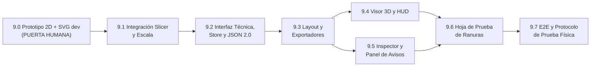

# Plan de Migración — Fase 9: Técnica de Construcción «Waffle» (Encaje por Ranuras)

> [!IMPORTANT]
> **Instrucción para el agente implementador.** Este documento extiende `MIGRATION_PLAN.md` (Fases 1 a 7) y `MIGRATION_PLAN_FASE_8.md` (Fase 8), ya implementados en `./web`. No escribas código fuera del alcance de cada subfase ni modifiques el comportamiento de «Planos apilados». Implementa las subfases **9.0 a 9.7 en orden estricto**. La **Fase 9.0 requiere aprobación humana** antes de continuar con la 9.1. Cada subfase termina con su puerta de calidad obligatoria: `cd web && npm test` y `cd web && npm run typecheck` en verde (`0` errores), `git diff --exit-code web/golden` en `0` y `baseline.test.ts` en verde sin regenerar snapshots.

> [!NOTE]
> **Estado verificado al redactar este plan (2026-10-24):** `npx vitest run` → 11 archivos de test, 74 tests en verde. `npx tsc --noEmit` → salida `0`. Último commit en `HEAD`: `50c9acc feat(slicer): debounce auto-slicing and coalesce worker in-flight requests`.

---

## 1. Verificación del estado real del código y mapa de archivos afectados

### 1.1 Verificación de la Fase 8 en `./web`

Se leyeron íntegramente `slicer.ts`, `polygonStitcher.ts`, `layout.ts`, `svgExporter.ts`, `dxfExporter.ts`, `geometry2d.ts`, `core/build/{types,registry,validateBuild}.ts`, `core/joints/{none,discs/index,discs/discLayout}.ts`, `store/{useSculptureStore,discsSlice}.ts`, `components/hud/RightInspector.tsx`, `components/hud/inspector/{Material,Model,Technique,Result}Section.tsx`, `components/viewport/{SlicedPlatesView,CameraRig,Viewport3D,plateGeometry}.tsx`, `components/hud/FloorNavigatorHUD.tsx`, `core/{project,autosave,sizing,params,validator}.ts` y `worker/slicer.worker.ts`:

1. **Registro de técnicas y uniones (`core/build/registry.ts`):** Existe `TECHNIQUES` con `stacked` (`available: true`) y `waffle` (`available: false`, `unavailableReason: 'Próximamente'`), y `JOINTS` con `none`, `discs` y `rod` (`available: false`).
2. **Separación `g = 0` y JSON 2.0 (`core/project.ts`, `core/joints/none.ts`):** Implementados y probados en `zeroGap.test.ts` y `project.test.ts`. `projectFormatFor` devuelve `'1.0'` únicamente para `stacked + discs` con `gap > 0`, y `'2.0'` en el resto de combinaciones.
3. **Slicer y caché por eje (`core/slicer.ts`, `worker/slicer.worker.ts`):** `AxisSliceCache` rota la malla para alinear `axis` (`'x' | 'y' | 'z'`) con $+Z_s$, centra el bounding box en el origen con `0.5 * (min + max)` y particiona en `NUM_Z_BUCKETS = 128` cubetas. Su método `extractSegmentsAtZ(zUnit, scaleFactor)` es puro y reutilizable en cualquier coordenada `zUnit` pre-escala. El worker ya mantiene un diccionario `axisCaches: Partial<Record<Axis, AxisSliceCache>>` por `meshId`, por lo que cortar en dos ejes ortogonales reutiliza ambos cachés sin recálculos.
4. **Stitcher y Clipper2 (`core/polygonStitcher.ts`):** `stitchAndUnionSegments` cose segmentos con tolerancia `1e-3 mm`, repara micro-brechas $\le 0.05\text{ mm}$ y ejecuta `Clipper64.executePolyTree(ClipType.Union, FillRule.NonZero)` con `CLIPPER_SCALE = 100_000` y filtro `MIN_POLYGON_AREA_MM2 = 1e-3`, garantizando contornos exteriores CCW y huecos CW. Incluye el parche al prototipo `Clipper64.prototype.newOutRec` para `clipper2-js@1.2.4`.
5. **Inspector y corte reactivo (`RightInspector.tsx`, `useSculptureStore.ts`):** El inspector está dividido en `MaterialSection`, `ModelSection`, `TechniqueSection` y `ResultSection`. El corte se dispara automáticamente (con debounce de `350 ms` para números y ejecución inmediata al cambiar de eje o unión).

### 1.2 Mapa de archivos afectados y nuevos

| Ruta | Estado | Símbolos principales | Cambio en Fase 9 |
| :--- | :--- | :--- | :--- |
| `web/src/core/waffle/constants.ts` | **Nuevo** | `WAFFLE_CONSTANTS`, `WAFFLE_PARAM_BOUNDS`, `WAFFLE_DEFAULT_PARAMS` | Único archivo de constantes geométricas, límites, colores y tipografía de grabado para Waffle (Regla 5). |
| `web/src/core/waffle/types.ts` | **Nuevo** | `WaffleParams`, `CanonicalSection2D`, `CrossingInterval`, `WaffleCrossing`, `SlotRect`, `SlotLabel`, `WaffleWarning`, `WaffleSliceResult` | Contratos puros 2D/3D de la técnica Waffle. |
| `web/src/core/waffle/canonicalFrame.ts` | **Nuevo** | `getWaffleAxesConfig`, `fromSlicer2DToCanonical`, `canonicalToWorldMatrix4` | Tabla de las 3 permutaciones cíclicas (`up = 'z' \| 'x' \| 'y'`), transformación inversa exacta desde `AxisSliceCache` y matriz 3D de cada familia. |
| `web/src/core/waffle/grid.ts` | **Nuevo** | `computeFamilyGridPositions`, `computeWaffleGrid` | Cálculo de posiciones $a_i, b_j$ con extensión $L$, paso $p$, desfase $\delta$ y cota `MAX_SECTIONS_TOTAL = 400`. |
| `web/src/core/waffle/verticalSlice.ts` | **Nuevo** | `intersectPolygonAtU`, `intersectIntervals` | Corte vertical exacto de `PolygonWithHoles[]` en $u = c$ con regla semiabierta y operación $O = S_A \cap S_B$. |
| `web/src/core/waffle/slots.ts` | **Nuevo** | `computeCrossingAndSlots`, `applySlotsToSection`, `computeSlotLabelsForSection` | Regla de corredor abierto ($v^*$), resta booleana única con `Clipper64` (`ClipType.Difference`, `FillRule.NonZero`) y posicionamiento de etiquetas de ranura. |
| `web/src/core/waffle/warnings.ts` | **Nuevo** | ` evaluateWaffleWarnings` | Generación determinista de avisos `W1` a `W5`. |
| `web/src/core/waffle/waffleSlicer.ts` | **Nuevo** | `sliceWaffleFromCaches`, `sliceWaffleMesh` | Orquestador puro del pipeline Waffle a partir de dos `AxisSliceCache` (`axisP1`, `axisP2`). |
| `web/src/core/waffle/calibrationSheet.ts` | **Nuevo** | `generateSlotCalibrationSheet` | Generador de hoja de prueba de calce (peine de ranuras parametrizado en torno a $c$). |
| `web/src/core/polygonStitcher.ts` | Modificar | `CLIPPER_SCALE`, `MIN_POLYGON_AREA_MM2`, `polyTreeToPolygonsWithHoles` | Exportar `CLIPPER_SCALE`, `MIN_POLYGON_AREA_MM2` y el extractor `polyTreeToPolygonsWithHoles` para no duplicarlos en `core/waffle/slots.ts`. |
| `web/src/core/sizing.ts` | Modificar | `uniformScaleFromTargetDimension`, `finalSizeFromScale`, `waffleMaxFit` | Añadir escala continua uniforme fijada directamente por las 3 medidas del bloque Modelo cuando la técnica es `waffle`. |
| `web/src/core/build/types.ts` | Modificar | `TechniqueDefinition`, `JointId` (`'slots'`), `WaffleParams` | Formalizar la interfaz común `TechniqueDefinition` derivada de `stacked` y `waffle` (§3.L) y el identificador fijo `'slots'` («Encaje por ranuras»). |
| `web/src/core/build/registry.ts` | Modificar | `TECHNIQUES`, `SLOTS_JOINT`, `getTechnique` | Activar `waffle` (`available: true`) y exponer su definición en el registro. |
| `web/src/core/build/validateBuild.ts` | Modificar | `validateBuildParams`, `validateWaffleParams` | Validar parámetros de `waffle` ($p \ge 2t$, $c \in [0, 1]$, $\delta \in [-p/2, p/2]$, $w = t + c - \text{kerf} > 0$, $N_1 + N_2 \le 400$). |
| `web/src/types/sculpture.ts` | Modificar | `PlacedPlate`, `SlotLabel`, `WorkerRequest`, `WorkerResponse` | Añadir `slotLabels?: SlotLabel[]` opcional en `PlacedPlate` y mensajes de worker para `SLICE_WAFFLE`. |
| `web/src/core/layout.ts` | Modificar | `computePlateLabel`, `generateWaffleSheetLayouts` | Aceptar prefijo/texto de etiqueta (`X1..Xn`, `Y1..Ym`), verificar no colisión con ranuras/etiquetas de ranura, y reportar qué dimensión reducir si excede la hoja. |
| `web/src/core/svgExporter.ts` | Modificar | `generateSheetSvg` | Renderizar `plate.slotLabels` (si existe) en `<g id="grabado">` usando `renderCadText`. Salida de `stacked` intacta. |
| `web/src/core/dxfExporter.ts` | Modificar | `generateSheetDxf` | Renderizar `plate.slotLabels` (si existe) en capa `GRABADO` usando `addDxfCenteredText`. Salida de `stacked` intacta. |
| `web/src/core/project.ts` | Modificar | `serializeProject`, `parseProjectJson`, `checkParamsCompatibility` | Soportar `technique.id === 'waffle'` y `joint.id === 'slots'` en esquema JSON 2.0. |
| `web/src/core/autosave.ts` | Modificar | `RawAutosaveEnvelope`, `saveProjectToLocalStorage`, `loadProjectFromLocalStorage` | Persistir y restaurar `waffleParams` en el sobre de `localStorage`. |
| `web/src/worker/slicer.worker.ts` | Modificar | `self.onmessage` | Soportar petición `SLICE_WAFFLE` reutilizando `axisCaches[axisP1]` y `axisCaches[axisP2]`. |
| `web/src/store/waffleSlice.ts` | **Nuevo** | `WaffleSlice`, `createWaffleSlice` | Estado y acciones de Waffle (`waffleParams`, `waffleResult`, `waffleFamilyFilter`, `selectedWafflePieceId`, acciones de selección e inspección de avisos). |
| `web/src/store/useSculptureStore.ts` | Modificar | `SculptureStore`, `setTechnique`, `setDimensionTargetMm`, `runSlice` | Integrar `waffleSlice`, confirmación al cambiar desde `stacked + discs` con discos colocados, y despacho al worker. |
| `web/src/components/viewport/WafflePlatesView.tsx` | **Nuevo** | `WafflePlatesView` | Renderizado 3D de familias P1 y P2 con dos tonos de color, `lineSegments`, filtro X/Y/Ambas y resaltado de pieza activa y sus cruces. |
| `web/src/components/hud/WaffleNavigatorHUD.tsx` | **Nuevo** | `WaffleNavigatorHUD` | Sustituto de `FloorNavigatorHUD` cuando `techniqueId === 'waffle'` (filtro `Ambas \| Solo X \| Solo Y` y selector de pieza `X1..Xn` / `Y1..Ym`). |
| `web/src/components/hud/inspector/WaffleWarningsPanel.tsx` | **Nuevo** | `WaffleWarningsPanel` | Lista de avisos `W1..W5` con contador y selección de pieza en el visor al hacer clic. |
| `web/src/components/hud/inspector/{Model,Technique,Result}Section.tsx` | Modificar | `ModelSection`, `TechniqueSection`, `ResultSection` | Controles de Waffle en `TechniqueSection`, escala continua en `ModelSection` y métricas + botón de hoja de prueba en `ResultSection`. |
| `web/scripts/dump-waffle-svg.ts` | **Nuevo** | CLI dev script | Script de Fase 9.0 que ejecuta el prototipo 2D sobre fixtures y vuelca archivos SVG de inspección humana. |

---

## 2. Tabla «Choques y objeciones»

| # | Regla o archivo existente / Pedido del usuario | Choque u objeción detectada | Decisión y propuesta arquitectónica | Criterio de aceptación |
| :--- | :--- | :--- | :--- | :--- |
| **CH-1** | Contexto: UI organizada como `(Modelo, Material, Técnica, Unión)`. Código real: `RightInspector.tsx:35-38` y `e2e/sculpture.spec.ts:195-200`. | En el código real el orden de encabezados `h2` es `['Material', 'Modelo', 'Técnica de construcción', 'Resultado']` (`Unión` vive dentro de `Técnica de construcción`) y no existe botón «Aplicar corte» porque el corte es reactivo (`50c9acc`). | **No se altera el orden de `RightInspector.tsx`** para no romper el test E2E 6 existente. En `waffle`, el corte también se ejecuta de forma reactiva (con el mismo debounce de `350 ms` para inputs numéricos y ejecución inmediata para botones/selects). | E2E 6 sigue en verde sin modificar sus aserciones de orden de encabezados. |
| **CH-2** | Sección B: Transformación inversa del slicer al marco canónico $(u, v)$ en P2 (vista desde $-Y$ hacia $+Y$, o sus permutaciones cíclicas). | En `slicer.ts:64-78`, el plano de `AxisSliceCache` tiene su normal en $+\hat{z}_s$ (para `axis='x'` es $+X$; para `axis='y'` es $+Y$; para `axis='z'` es $+Z$). La familia P1 se mira desde $+\hat{e}_1$ hacia $-\hat{e}_1$ ($\hat{u}_{P1} \times \hat{v} = +\hat{z}_s$, $\det J = +1$), pero la familia P2 se mira desde $-\hat{e}_2$ hacia $+\hat{e}_2$ ($\hat{u}_{P2} \times \hat{v} = -\hat{z}_s$, $\det J = -1$). Si solo se remapean coordenadas $(x_s, y_s) \mapsto (u, v)$ en P2 sin invertir el orden de vértices, **los anillos exteriores de P2 quedan CW y los huecos CCW**, rompiendo Clipper2 y Three.js. | En la transformación `fromSlicer2DToCanonical`, cuando $\det J = -1$ (siempre la familia P2 en las 3 permutaciones cíclicas), **se invierte el orden de los vértices (`ring.reverse()`)** tras transformar $(x_s, y_s) \mapsto (u, v)$. Así todas las secciones canónicas mantienen exteriores CCW (`signedArea2D > 0`) y huecos CW (`signedArea2D < 0`). | Test unitario en 9.0 verifica `signedArea2D(exterior) > 0` y `signedArea2D(hole) < 0` para todas las secciones de P1 y P2 en los 3 ejes `up`. |
| **CH-3** | Sección D: En formas cóncavas donde $O = S_A \cap S_B$ tiene varios intervalos disjuntos $[v_1, v_2] \cup [v_3, v_4]$, se define $v^* = (\min O + \max O)/2$ y corredor abierto desde $v^*$ hasta el extremo. | **Objeción técnica:** (1) Si $v^*$ cae dentro de una laguna intermedia $(v_2, v_3)$ donde no hay solape, o si uno de los intervalos es mucho menor que el otro, puede ocurrir que $\max O - \min O \ge \text{MIN\_ENGAGE\_MM}$ pero que de un lado de $v^*$ casi no exista material en $O$ (o que el corredor abierto corte un puente de material intermedio produciendo una partición `W4`). | Se respeta la regla cerrada de corredor único con $v^* = (\min O + \max O)/2$ (necesaria para que la pieza entre en un único movimiento vertical sin bloqueos), pero se refina el invariante **I3** y el aviso **W3**: además de evaluar $H_O = \max O - \min O$, se calcula la longitud de encaje inferior $L_{\text{low}} = \text{longitud}(O \cap (-\infty, v^*])$ y superior $L_{\text{high}} = \text{longitud}(O \cap [v^*, +\infty))$. Se emite **W3** si $H_O < \text{MIN\_ENGAGE\_MM}$ **o** si $\min(L_{\text{low}}, L_{\text{high}}) < \text{MIN\_ENGAGE\_MM} / 2$. Si la ranura divide un puente cóncavo, el detector **W4** lo reporta automáticamente. | Test con dos cubos separados en vertical y con pieza en C verifica que el corredor se abre completo, detecta `W4` cuando parte una rama y evalúa $L_{\text{low}}, L_{\text{high}}$. |
| **CH-4** | Sección C y E: $p_{\min} = 2t$, holgura $c \in [0, 1]$, ancho dibujado $w = t + c - \text{kerf}$. Caso borde: ranuras muy cercanas en la misma pieza. | **Objeción técnica:** Las ranuras de una misma pieza están separadas centro a centro por $p \ge 2t$, por lo que el tabique entre dos ranuras vecinas mide $p - w = p - (t + c - \text{kerf})$. Para $t \ge 1\text{ mm}$ siempre es $> 0$, pero si el usuario configura un material muy delgado (p. ej. $t = 0.2\text{ mm}$, $p = 0.4\text{ mm}$, $c = 0.8\text{ mm}$, $\text{kerf} = 0$), entonces $w = 1.0\text{ mm} > p = 0.4\text{ mm}$ y dos ranuras contiguas se solaparían destruyendo la pieza. | Se añade en `validateWaffleParams` la regla de validación estricta: $p - w \ge \text{MIN\_SLOT\_PITCH\_CLEARANCE\_MM}$ ($0.5\text{ mm}$), es decir, el paso $p$ debe dejar al menos $0.5\text{ mm}$ de material entre bordes de ranuras contiguas ($p \ge w + 0.5\text{ mm}$ además de $p \ge 2t$). Si no se cumple, lanza `ValidationError` con mensaje explícito. | `validateBuildParams` rechaza configuraciones donde $w \ge p - 0.5\text{ mm}$ con mensaje claro. |
| **CH-5** | Sección C: Escala uniforme fijada directamente con las 3 medidas del bloque Modelo vs `sizing.ts` actual (donde la escala depende de `plates * t + (plates - 1) * g`). | En `stacked`, `uniformScale` está cuantizada por el entero `plates`. En `waffle` no hay apilado: si se usara `plates`, editar `Alto (Z)` redondearía a múltiplos de $t+g$. Además, al alternar entre `stacked` y `waffle`, el modelo no debe cambiar bruscamente de escala. | Se añade en `WaffleParams` el campo `targetScale: number` (inicializado desde el `scaleFactor` vigente al activar `waffle`, o `1.0` si la malla acaba de cargarse). En `waffle`, editar cualquiera de las 3 dimensiones `dim` a `targetMm` actualiza directamente `targetScale = targetMm / extentOf(modelExtents, dim)` sin cuantización, y las 3 cajas muestran `extent * targetScale`. Así existe **una sola fuente de verdad** del factor de escala por técnica. | En `waffle`, escribir `120.0` mm en `Alto (Z)` produce exactamente `scaledHeight === 120.0` mm y `scaleFactor === 120.0 / extents.z` con error $< 10^{-9}$. |
| **CH-6** | Regla 4 y Sección G: Añadir `slotLabels` a `PlacedPlate` sin alterar la salida ni los snapshots de `stacked` (`baseline.test.ts`). | `baseline.test.ts:30` compara `JSON.stringify(sheets, null, 2)` byte a byte contra `web/src/__tests__/__baseline__/case*/layout.json`. Si `PlacedPlate` incluyera `slotLabels: []` en `stacked`, `JSON.stringify` emitiría `"slotLabels": []` y rompería los 5 casos de línea base. | En `PlacedPlate`, el campo `slotLabels?: SlotLabel[]` es **opcional** y en `generateSheetLayouts` (usado por `stacked`) **no se asigna la propiedad** (`undefined`). Solo `generateWaffleSheetLayouts` asigna `slotLabels`. En `svgExporter.ts` y `dxfExporter.ts` se itera `if (plate.slotLabels) { ... }`. | `baseline.test.ts` pasa al 100% sin tocar un solo byte de `__baseline__/`. |
| **CH-7** | Sección G: `computePlateLabel` (`layout.ts:80`) recibe `plateIdx: number` y construye fijo `` `P${plateIdx}` ``. En Waffle los IDs son `X1..Xn` y `Y1..Ym` y no deben chocar con ranuras ni con `slotLabels`. | Si la etiqueta principal `X1` se evalúa solo en el centroide del polígono exterior, una ranura que llegue hasta el centro ($v^* \approx 0$) o una etiqueta de ranura cercana puede solaparse con `X1`. | Como las ranuras ya fueron restadas del contorno exterior (`ClipType.Difference`), cualquier punto sobre una ranura está **fuera** de `PolygonWithHoles` (`distanceToPolygonBoundary === 0`). Para evitar que `X1` choque con las `slotLabels` o quede en un cuello estrecho si el centroide cae en una ranura, se usa una grilla determinista de puntos candidatos dentro del polígono (empezando por el centroide) que maximice `distanceToPolygonBoundary` y respete una distancia mínima a todas las `slotLabels`. | Test verifica que en un cubo y una esfera (donde la ranura central pasa por $u=0, v^*=0$), la etiqueta `X1`/`Y1` nunca cae dentro del hueco de la ranura ni se solapa con ninguna `slotLabel`. |
| **CH-8** | Sección A, J y K: Unión fija «Encaje por ranuras» en Waffle y persistencia en JSON 2.0. | En `core/build/types.ts`, `JointId = 'none' \| 'discs' \| 'rod'`. Si se mete `'slots'` en el arreglo `JOINTS` global, aparecería como cuarta opción en el dropdown de `stacked`. | Se amplía `JointId = 'none' \| 'discs' \| 'rod' \| 'slots'`, pero `JOINTS` (las uniones seleccionables en `stacked`) conserva exactamente las 3 entradas actuales (`joints.test.ts` sigue intacto). Para `waffle`, su definición de técnica fija `jointId: 'slots'` («Encaje por ranuras»), el `<SelectField>` de Unión se muestra deshabilitado con ese único valor, y el JSON 2.0 serializa `"joint": { "id": "slots", "params": {} }`. | `joints.test.ts` sigue pasando; en `waffle` el selector de unión muestra `Encaje por ranuras` deshabilitado; JSON 2.0 valida que `waffle` solo acepte `joint.id === 'slots'`. |

---

## 3. Diseño Detallado (A a L)

### 3.A Qué es y qué no es (Fundamento físico y aproximación de plano medio)

1. **Definición geométrica:** La técnica Waffle construye el volumen 3D mediante dos familias ortogonales de secciones planas verticales:
   - **Familia $P_1$ (`X1..Xn`):** planos perpendiculares al primer eje horizontal $\hat{e}_1$ en posiciones $a_0 < a_1 < \dots < a_{n-1}$.
   - **Familia $P_2$ (`Y1..Ym`):** planos perpendiculares al segundo eje horizontal $\hat{e}_2$ en posiciones $b_0 < b_1 < \dots < b_{m-1}$.
   - Ambas familias comparten el mismo **eje vertical** (`upAxis` $\in \{\text{'z'}, \text{'x'}, \text{'y'}\}$, por defecto `'z'`).
2. **Ensamblaje vertical exclusivo:** En cada cruce $(a_i, b_j)$, los planos medios de la pieza $A \in P_1$ y la pieza $B \in P_2$ se intersectan en una recta paralela al eje vertical. $A$ recibe una ranura abierta hacia **arriba** ($+v$) desde el punto medio del solape $v^*$ hasta su borde superior, y $B$ recibe una ranura abierta hacia **abajo** ($-v$) desde su borde inferior hasta $v^*$. Toda la familia $P_2$ desciende verticalmente en bloque (o pieza por pieza en dirección $-v$) sobre la familia $P_1$ sin requerir deformación elástica ni rotaciones.
3. **Sin discos, ni base, ni varilla:** La unión es intrínseca a la geometría del contorno («Encaje por ranuras», `jointId: 'slots'`). No existen piezas adicionales fuera de las secciones $P_1$ y $P_2$.
4. **Aproximación por plano medio (documentación del error geométrico):**
   - Cada placa física tiene espesor $t > 0$ y ocupa el intervalo $[a_i - t/2, a_i + t/2]$ (o $[b_j - t/2, b_j + t/2]$), pero su contorno se obtiene intersectando la malla 3D con el **plano medio** $e_1 = a_i$ (o $e_2 = b_j$).
   - **Magnitud del error:** En una superficie cuya normal forma un ángulo $\theta$ con el plano de la placa, la diferencia entre la sección en el plano medio y la envolvente real en las caras laterales $\pm t/2$ es $\Delta r \approx \frac{t}{2} |\cot \theta|$. Para acrílico de $t = 3\text{ mm}$ y pendientes típicas ($\theta \in [30^\circ, 90^\circ]$), el error en el borde es de $0\text{ a } 2.6\text{ mm}$, idéntico al escalonamiento de «Planos apilados».
   - **Impacto en el encaje:** En el cruce $(a_i, b_j)$, la ranura tiene ancho físico $t + c$, por lo que la pieza compañera entra hasta apoyar en las paredes a $\pm t/2$ del plano medio. Como la ranura de corredor abierto despeja todo el semiespacio superior en $P_1$ e inferior en $P_2$ con margen exterior, una variación suave del perfil entre $a_i$ y $a_i \pm t/2$ no impide el cierre a ras en $v^*$. Se confirma que la aproximación de plano medio es **estándar y aceptable** para fabricación láser en acrílico.
5. **Criterio de aceptación A:**
   - **CA-A1:** El resultado de Waffle produce únicamente secciones de $P_1$ y $P_2$, con `discs = []` y `discGroups = []` en todas las hojas.

---

### 3.B Marco de coordenadas canónico (Decisión cerrada)

1. **Definición del marco 2D canónico $(u, v)$ de cada pieza:**
   - Para toda pieza (tanto de $P_1$ como de $P_2$), $v$ es la coordenada a lo largo del **eje vertical** elegido (`upAxis`), con $+v$ apuntando siempre hacia arriba ($+\text{upAxis}$).
   - $u$ es la coordenada horizontal contenida en el plano de la pieza, orientada hacia la derecha cuando el observador mira la pieza de frente desde su **cara de vista** ($\hat{n}_{\text{vista}} = \hat{u} \times \hat{v}$ apunta hacia el observador).
2. **Tabla completa de las 3 permutaciones cíclicas (mano derecha) y transformación inversa desde `slicer.ts`:**
   En `slicer.ts:64-78`, `AxisSliceCache` transforma las coordenadas centradas del modelo $(X, Y, Z)$ a $(x_s, y_s, z_s)$ según el eje de corte:
   - Corte `axis = 'x'`: $(x_s, y_s, z_s) = (-Z, Y, X)$
   - Corte `axis = 'y'`: $(x_s, y_s, z_s) = (X, -Z, Y)$
   - Corte `axis = 'z'`: $(x_s, y_s, z_s) = (X, Y, Z)$

| Eje vertical (`upAxis`) | Familia | Eje normal ($\hat{e}$ de `AxisSliceCache`) | Cara de vista (mirando desde $\to$ hacia) | Ejes canónicos $(\hat{u}, \hat{v}, \hat{n}_{\text{vista}})$ | Salida 2D de `slicer.ts` $(x_s, y_s)$ | Transformación inversa exacta $(x_s, y_s) \mapsto (u, v)$ | $\det J$ y rev. de anillo | Posición de cruce en su plano |
| :--- | :--- | :--- | :--- | :--- | :--- | :--- | :--- | :--- |
| **`z`** (default) | **$P_1$ (`X`)** | `axis = 'x'` ($X = a_i$) | $+X \to -X$ (Lateral der.) | $(+Y, +Z, +X)$ | $(-Z, Y)$ | $u = y_s,\; v = -x_s$ | $+1$ (no invertir) | $u = b_j$ ($Y = b_j$) |
| **`z`** (default) | **$P_2$ (`Y`)** | `axis = 'y'` ($Y = b_j$) | $-Y \to +Y$ (Frontal) | $(+X, +Z, -Y)$ | $(X, -Z)$ | $u = x_s,\; v = -y_s$ | $-1$ (**invertir anillo**) | $u = a_i$ ($X = a_i$) |
| **`x`** | **$P_1$ (`Y`)** | `axis = 'y'` ($Y = a_i$) | $+Y \to -Y$ | $(+Z, +X, +Y)$ | $(X, -Z)$ | $u = -y_s,\; v = x_s$ | $+1$ (no invertir) | $u = b_j$ ($Z = b_j$) |
| **`x`** | **$P_2$ (`Z`)** | `axis = 'z'` ($Z = b_j$) | $-Z \to +Z$ | $(+Y, +X, -Z)$ | $(X, Y)$ | $u = y_s,\; v = x_s$ | $-1$ (**invertir anillo**) | $u = a_i$ ($Y = a_i$) |
| **`y`** | **$P_1$ (`Z`)** | `axis = 'z'` ($Z = a_i$) | $+Z \to -Z$ | $(+X, +Y, +Z)$ | $(X, Y)$ | $u = x_s,\; v = y_s$ | $+1$ (no invertir) | $u = b_j$ ($X = b_j$) |
| **`y`** | **$P_2$ (`X`)** | `axis = 'x'` ($X = b_j$) | $-X \to +X$ | $(+Z, +Y, -X)$ | $(-Z, Y)$ | $u = -x_s,\; v = y_s$ | $-1$ (**invertir anillo**) | $u = a_i$ ($Z = a_i$) |

3. **Preservación de orientación CCW/CW (Regla crítica):**
   - En $P_1$, $\hat{n}_{\text{vista}} = +\hat{z}_s$, por lo que $(x_s, y_s) \mapsto (u, v)$ tiene determinante $+1$ y preserva el sentido CCW de exteriores y CW de huecos.
   - En $P_2$, $\hat{n}_{\text{vista}} = -\hat{z}_s$, por lo que $(x_s, y_s) \mapsto (u, v)$ es una reflexión ($\det J = -1$). Por tanto, `fromSlicer2DToCanonical` **debe invertir el arreglo de puntos (`ring.reverse()`)** de cada `exterior` y de cada `hole` en $P_2$ inmediatamente después de mapear $(u, v)$.
4. **Cara de vista, textos grabados y efecto de voltear la pieza:**
   - En el layout 2D (hoja CAD), $(x_{\text{hoja}}, y_{\text{hoja}})$ se alinea directamente con $(u, v)$ de la pieza vista desde su cara de vista ($\hat{n}_{\text{vista}}$).
   - Los textos grabados (`X1..Xn`, `Y1..Ym` y las etiquetas de ranura) se graban sobre esa cara de vista y se leen al derecho mirándola desde $\hat{n}_{\text{vista}}$.
   - **Advertencia física documentada:** Si una pieza asimétrica se voltea cara-con-dorso durante el armado (rotación de $180^\circ$ alrededor del eje vertical $v$), su coordenada $u$ se invierte ($u \mapsto -u$, la pieza queda **espejada**) y el grabado queda del lado trasero leíble al revés. Por tanto, la regla de oro de armado físico es: *todas las piezas $P_1$ se colocan con el grabado mirando hacia $+\hat{e}_1$ (derecha si `up='z'`) y todas las $P_2$ con el grabado mirando hacia $-\hat{e}_2$ (frente si `up='z'`).*
5. **Firmas de tipos (`core/waffle/canonicalFrame.ts`):**
```ts
export type FamilyId = 'P1' | 'P2';

export interface WaffleAxesConfig {
  upAxis: Axis;
  p1Axis: Axis;          // 'x' si up='z', 'y' si up='x', 'z' si up='y'
  p2Axis: Axis;          // 'y' si up='z', 'z' si up='x', 'x' si up='y'
  p1Prefix: 'X' | 'Y' | 'Z';
  p2Prefix: 'X' | 'Y' | 'Z';
}

export function getWaffleAxesConfig(upAxis: Axis): WaffleAxesConfig;
export function fromSlicerPointToCanonical(pt: Point2D, upAxis: Axis, family: FamilyId): Point2D;
export function fromSlicerPolygonsToCanonical(
  polygons: PolygonWithHoles[],
  upAxis: Axis,
  family: FamilyId
): PolygonWithHoles[];
export function canonicalPointToWorld3D(
  u: number,
  v: number,
  wLocal: number,
  planeCoord: number,
  upAxis: Axis,
  family: FamilyId
): [number, number, number];
```
6. **Criterios de aceptación B:**
   - **CA-B1:** Para el fixture asimétrico `test_l_block.obj` en las 3 configuraciones (`up = 'z'`, `'x'`, `'y'`), al transformar las secciones remapeadas $(u, v)$ de vuelta a 3D con `canonicalPointToWorld3D(u, v, 0, pos, upAxis, family)`, todos los vértices caen sobre las caras del modelo 3D original centrado y escalado con error $\le 10^{-5}\text{ mm}$.
   - **CA-B2:** En todas las secciones remapeadas de $P_1$ y $P_2$, `signedArea2D(poly.exterior) > 0` y `signedArea2D(hole) < 0`.

---

### 3.C Rejilla de secciones y escala uniforme

1. **Parámetros de rejilla:**
   - `pitch` ($p$, mm): separación entre secciones centro a centro, común a ambas familias en v1.
     - Mínimo dinámico: $p_{\min} = \max(2 \cdot t,\; w + 0.5)$ donde $t$ es `thickness` y $w = t + c - \text{kerf}$.
     - Valor por defecto al iniciar o al cambiar $t$ (si `pitch` no fue editado manualmente): $p_{\text{default}} = 4 \cdot t$.
     - Cota superior: `MAX_PITCH_MM = 1000.0`.
   - `gridOffset` ($\delta$, mm): desfase de rejilla dentro de «Avanzado».
     - Rango válido: $[-\frac{p}{2}, +\frac{p}{2}]$, valor por defecto `0`, paso `0.5 mm`.
2. **Fórmula exacta de posiciones por familia:**
   Para cada familia ($k \in \{1, 2\}$), sea $[h_{\min}, h_{\max}]$ el intervalo ya escalado del modelo a lo largo del eje normal de esa familia ($\hat{e}_k$), con extensión horizontal $L = h_{\max} - h_{\min}$ (en mm):
   $$N = \max\left(1, \lfloor L / p \rfloor\right)$$
   $$a_i = h_{\min} + \frac{L - N \cdot p}{2} + \frac{p}{2} + i \cdot p + \delta, \quad i = 0, \dots, N - 1$$
   - **Filtrado:** Se descartan todas las posiciones $a_i$ que caigan fuera del intervalo abierto/cerrado útil: concretamente, se conservan solo aquellas con $h_{\min} < a_i < h_{\max}$ (o en $[h_{\min}, h_{\max}]$ que además produzcan área neta $\ge \text{MIN\_POLYGON\_AREA\_MM2}$).
   - **Cota total de secciones:** Sea $N_{\text{total}} = N_{P_1} + N_{P_2}$ antes de cortar. Si $N_{\text{total}} > \text{MAX\_SECTIONS\_TOTAL}$ (`400`), `validateBuildParams` lanza `ValidationError`:
     `El total de secciones de la rejilla ({N_total}) excede el máximo permitido de 400. Aumenta la separación entre secciones (p) o reduce el tamaño del modelo.`
3. **Omisión de secciones vacías:**
   - Al cortar cada posición $a_i$ (o $b_j$) con `AxisSliceCache.extractSegmentsAtZ(a_i / scaleFactor, scaleFactor)` y `stitchAndUnionSegments`, si el área neta total de los polígonos resultantes es $< \text{MIN\_POLYGON\_AREA\_MM2}$ (`1e-3 mm²`, `polygons.length === 0`), la sección **se omite** de la lista final de piezas de su familia y se registra un aviso **W1** indicando la familia, el índice de rejilla original y la coordenada en mm.
   - Las piezas no vacías restantes se numeran consecutivamente desde `1` en orden creciente de su coordenada: `X1..Xn` y `Y1..Ym` (o el prefijo correspondiente según la tabla de §3.B.2).
4. **Fuente única de verdad del factor de escala (`targetScale` vs `scaleFactor`):**
   - En Waffle **no aplica** $N \cdot t + (N - 1) \cdot g$.
   - El tamaño del modelo se gobierna con un único escalar positivo `waffleParams.targetScale` (por defecto `1.0` al cargar malla, o heredado de `uniformScale(...)` al cambiar desde `stacked` a `waffle`).
   - En `sizing.ts` se añaden las funciones puras:
     ```ts
     export function scaleForTargetDimension(extents: ModelExtents, dim: ModelDimension, targetMm: number): number;
     export function finalSizeFromScale(extents: ModelExtents, scale: number): FinalSize;
     export function waffleMaxFit(
       extents: ModelExtents,
       upAxis: Axis,
       sheet: Pick<CoreParams, 'sheetW' | 'sheetH' | 'sheetMargin'>
     ): { maxScale: number; size: FinalSize; limitingFamily: FamilyId; limitingAxisLabel: string } | null;
     ```
   - Cuando el usuario edita `Alto (Z)`, `Ancho (X)` o `Largo (Y)` en el bloque Modelo estando en `waffle`, el store calcula `targetScale = scaleForTargetDimension(modelExtents, dim, targetMm)` y las otras dos dimensiones se actualizan de inmediato multiplicando `modelExtents` por `targetScale` (candado de proporción cerrado).
   - Al ejecutar `sliceWaffleFromCaches`, el slicer recibe `scaleFactor = waffleParams.targetScale` directamente y lo devuelve en `waffleResult.scaleFactor`. Así, `finalSizeFromScale(modelExtents, waffleParams.targetScale).scale === waffleResult.scaleFactor` bit a bit.
5. **Criterios de aceptación C:**
   - **CA-C1:** Con $\delta = 0$, la rejilla es simétrica respecto al centro $(h_{\min} + h_{\max})/2$: $a_i + a_{N-1-i} = h_{\min} + h_{\max}$ ($\pm 10^{-12}$).
   - **CA-C2:** Si $p < 2t$, `validateBuildParams` lanza `ValidationError`: `La separación entre secciones (${p} mm) debe ser al menos 2 veces el grosor de placa (${(2 * t).toFixed(2)} mm).`
   - **CA-C3:** Si $|\delta| > p/2 + 10^{-9}$, `validateBuildParams` lanza `ValidationError`: `El desfase de rejilla (${delta} mm) debe estar entre -${(p/2).toFixed(2)} y +${(p/2).toFixed(2)} mm.`

---

### 3.D Cruces y regla de ranuras (Corredor abierto e invariantes I1–I5)

1. **Corte vertical 1D exacto (`core/waffle/verticalSlice.ts`):**
   Dada una sección $A$ expresada como `PolygonWithHoles[]` en su marco canónico $(u, v)$ y una recta vertical $u = c$:
   - Se recorren todas las aristas dirigidas $(u_0, v_0) \to (u_1, v_1)$ de todos los anillos (`exterior` y `holes`) de todos los polígonos de la sección.
   - **Regla semiabierta determinista (idéntica a `slicer.ts:190`):** Se define `right0 = (u0 >= c)` y `right1 = (u1 >= c)`.
     - Si `right0 === right1`, la arista no cruza $u = c$ (esto descarta automáticamente aristas verticales colineales con $u = c$ y resuelve sin doble conteo vértices exactamente sobre $u = c$).
     - Si `right0 !== right1`, se ordenan canónicamente los extremos por $(u, v)$ (`iMin`, `iMax` tales que $u_{\min} < u_{\max}$) para garantizar idénticos operandos IEEE-754 sin importar el sentido de la arista:
       $$\alpha = \frac{c - u_{\min}}{u_{\max} - u_{\min}}, \quad v_{\text{hit}} = v_{\min} + \alpha \cdot (v_{\max} - v_{\min})$$
   - Los valores $v_{\text{hit}}$ se ordenan de menor a mayor: $v_0 \le v_1 \le \dots \le v_{2k-1}$ y se emparejan en intervalos cerrados $[v_{2m}, v_{2m+1}]$.
   - Se fusionan intervalos contiguos o solapados cuya distancia sea $\le \text{INTERVAL\_MERGE\_TOL\_MM}$ (`1e-6 mm`) y se descartan intervalos degenerados de longitud $< \text{MIN\_INTERVAL\_LEN\_MM}$ (`1e-5 mm`). El resultado es $S_A$: lista ordenada de intervalos disjuntos $[v_{\text{start}}, v_{\text{end}}]$.
2. **Intersección de intervalos en el cruce $(A_i, B_j)$:**
   - Para la pieza $A_i \in P_1$ en posición $a_i$ y la pieza $B_j \in P_2$ en posición $b_j$:
     - $S_A = \text{intersectPolygonAtU}(A_i.\text{polygons}, b_j)$
     - $S_B = \text{intersectPolygonAtU}(B_j.\text{polygons}, a_i)$
     - $O = \text{intersectIntervals}(S_A, S_B)$ (intersección conjuntista 1D, fusionando intervalos contiguos con tolerancia `1e-6 mm` y filtrando longitudes $< 10^{-5}\text{ mm}$).
3. **Regla de ranura (CORREDOR ABIERTO):**
   - **Paso 1:** Si $O$ está vacío (`O.length === 0`), no hay cruce entre $A_i$ y $B_j$: no se genera ranura ni etiqueta de ranura.
   - **Paso 2:** Si $O \ne \emptyset$: sea $v_{\min}^O = O[0].\text{min}$ y $v_{\max}^O = O[O.\text{length}-1].\text{max}$. El punto de encaje es:
     $$v^* = \frac{v_{\min}^O + v_{\max}^O}{2}$$
   - **Paso 3 (Ranura en $A_i \in P_1$, abre hacia ARRIBA $+v$):**
     Sea $v_{\text{top}}(A_i)$ el máximo de $v$ de todos los vértices de $A_i$. Se construye el rectángulo de ranura:
     $$R_{A_i, j} = \left[b_j - \frac{w}{2},\; b_j + \frac{w}{2}\right] \times \left[v^*,\; v_{\text{top}}(A_i) + \text{SLOT\_OVERRUN\_MM}\right]$$
     donde $\text{SLOT\_OVERRUN\_MM} = 1.0\text{ mm}$ y $w = t + c - \text{kerf}$.
   - **Paso 4 (Ranura en $B_j \in P_2$, abre hacia ABAJO $-v$):**
     Sea $v_{\text{bot}}(B_j)$ el mínimo de $v$ de todos los vértices de $B_j$. Se construye el rectángulo de ranura:
     $$R_{B_j, i} = \left[a_i - \frac{w}{2},\; a_i + \frac{w}{2}\right] \times \left[v_{\text{bot}}(B_j) - \text{SLOT\_OVERRUN\_MM},\; v^*\right]$$
   - **Paso 5 (Justificación física y matemática del corredor abierto):**
     1. *Acceso desde el exterior:* Para que la pieza $B_j$ pueda deslizarse desde arriba ($+v$) hacia abajo ($-v$) sobre $A_i$, ninguna lengüeta de $A_i$ puede bloquear la columna $u \in [b_j - w/2, b_j + w/2]$ por encima de $v^*$, y ninguna lengüeta de $B_j$ puede bloquear la columna $u \in [a_i - w/2, a_i + w/2]$ por debajo de $v^*$. Si la ranura solo se cortara dentro de $[\min O, \max O]$ sin llegar a $v_{\text{top}}(A) + 1$ (o $v_{\text{bot}}(B) - 1$) en una pieza con voladizo superior/inferior, la ranura quedaría como una ventana cerrada y las piezas serían físicamente imposibles de armar.
     2. *Imposibilidad de colisión:* Tras restar $R_{A_i, j}$ y $R_{B_j, i}$, en la línea de cruce el material restante de $A_i$ está contenido en $(-\infty, v^*]$ y el de $B_j$ en $[v^*, +\infty)$. Su intersección interior en $v$ es vacía: jamás chocan.
   - **Paso 6 (Resta booleana única por pieza con Clipper2):**
     Para cada pieza, se reúnen **todos** sus rectángulos de ranura $\{R_1, R_2, \dots, R_k\}$ como anillos CCW en `clipPaths` y todos los anillos (`exterior` CCW y `holes` CW) de la pieza antes de ranurar en `subjectPaths`, escalados por `CLIPPER_SCALE = 100_000`. Se ejecuta **una sola llamada** a `Clipper64.executePolyTree(ClipType.Difference, FillRule.NonZero, polyTree)` y se convierte el `PolyTree64` resultante a `PolygonWithHoles[]` mediante `polyTreeToPolygonsWithHoles` (descartando fragmentos con área neta $< \text{MIN\_POLYGON\_AREA\_MM2}$).
4. **Resolución explícita de casos borde:**
   - **CB-1 (Solape en varios intervalos / formas cóncavas):** $O$ contiene múltiples intervalos $[v_1, v_2] \cup [v_3, v_4]$. Se toma $\min O = v_1$ y $\max O = v_4$, por lo que $v^* = (v_1 + v_4)/2$. El corredor abierto despeja toda la columna desde $v^*$ hasta el extremo de la pieza. Si ello corta un puente cóncavo intermedio en dos componentes, se emite **W4**; si la longitud efectiva de encaje de algún lado de $v^*$ dentro de $O$ es $< \text{MIN\_ENGAGE\_MM} / 2$, se emite **W3**.
   - **CB-2 (Pieza con hueco interior en la línea de cruce):** `intersectPolygonAtU` incluye las aristas de `poly.holes`. Como las aristas del exterior y del hueco alternan sus cruces con $u = c$, el emparejamiento par/impar $v_{2m} \dots v_{2m+1}$ excluye exactamente el interior del hueco.
   - **CB-3 (Cruce en el borde exacto de una pieza):** Si $u = c$ coincide con una pared vertical de la pieza:
     - Si la pieza queda en $u < c$ (a la izquierda de $c$), `u >= c` es `false` en ambos vértices de la pared vertical: `0` cruces $\Rightarrow S = \emptyset$, no hay ranura.
     - Si la pieza queda en $u \ge c$ (a la derecha de $c$), las aristas horizontales superior e inferior tienen un extremo con `u >= c` (`true`) y otro con `u < c` (`false`), produciendo el intervalo sobre el borde. Sin embargo, para evitar ranurar un roce tangencial sin espesor horizontal real a ambos lados de la ranura, se comprueba además si el intervalo persiste o si el cruce ocurre a menos de $w/2$ del borde horizontal de la pieza (que el paso 6 convierte en una muesca lateral limpia; si parte la pieza o deja cuello $< \text{MIN\_WEB\_MM}$, saltan **W4** / **W5**).
   - **CB-4 (Cruce en un solo vértice / tangencia puntual):** Si $u = c$ toca un pico superior/inferior o si $S_A$ y $S_B$ se tocan en un único punto ($v_{\min} = v_{\max}$), la longitud del intervalo es $0 < \text{MIN\_INTERVAL\_LEN\_MM}$ (`1e-5 mm`), por lo que se descarta de $O$ y no genera ranura espuria.
   - **CB-5 (Ranuras muy cercanas entre sí en la misma pieza):** Dos ranuras de una misma pieza provienen de dos planos vecinos $b_j, b_{j+1}$ de la otra familia, cuya distancia centro a centro es $p$. Por CH-4 ($p \ge \max(2t, w + 0.5\text{ mm})$), los rectángulos $R_j$ y $R_{j+1}$ están separados por al menos $p - w \ge 0.5\text{ mm}$ y nunca se fusionan. Si $p - w < \text{MIN\_WEB\_MM}$ (`2.0 mm`), se emite el aviso **W5**.
5. **Invariantes obligatorios (exigidos como tests automáticos para cada cruce de cada fixture):**
   - **I1 (Disjunción vertical tras ranurar):** Para todo cruce activo $(A_i, B_j)$, sea $S'_A = \text{intersectPolygonAtU}(A'_i, b_j)$ y $S'_B = \text{intersectPolygonAtU}(B'_j, a_i)$ sobre los polígonos ya ranurados $A'_i, B'_j$. Entonces $\text{intersectIntervals}(S'_A, S'_B) = \emptyset$ (con tolerancia `2e-4 mm` por redondeo de `CLIPPER_SCALE`).
   - **I2 (Corredor despejado):** Para todo $u_{\text{test}} \in \{c - w/2 + \varepsilon,\; c,\; c + w/2 - \varepsilon\}$ ($\varepsilon = 10^{-3}\text{ mm}$):
     - En $A'_i$ ($c = b_j$): todo intervalo de $\text{intersectPolygonAtU}(A'_i, u_{\text{test}})$ cumple $v_{\max} \le v^* + 2\cdot 10^{-4}\text{ mm}$.
     - En $B'_j$ ($c = a_i$): todo intervalo de $\text{intersectPolygonAtU}(B'_j, u_{\text{test}})$ cumple $v_{\min} \ge v^* - 2\cdot 10^{-4}\text{ mm}$.
   - **I3 (Encaje real y umbral `MIN_ENGAGE_MM = 4.0 mm`):** Si $O$ es un único intervalo conexo $[\min O, \max O]$, existe material de $A'_i$ bajo $v^*$ y de $B'_j$ sobre $v^*$ en los costados de la ranura. Si $(\max O - \min O) < \text{MIN\_ENGAGE\_MM}$ (`4.0 mm`), **aun así se corta la ranura** (para cumplir I1 y evitar colisión física) y se emite el aviso **W3**.
   - **I4 (Exactitud del ancho dibujado):** La distancia horizontal entre las dos paredes verticales de cada ranura en el polígono resultante $A'_i$ y $B'_j$ (y en el SVG/DXF exportado) es exactamente $w = t + c - \text{kerf}$ con tolerancia $\le 2 / \text{CLIPPER\_SCALE}$ ($2 \cdot 10^{-5}\text{ mm}$).
   - **I5 (Monotonía y localización de la resta de área):** $\text{Area}(A'_i) \le \text{Area}(A_i)$ y la diferencia de área $\text{Area}(A_i) - \text{Area}(A'_i)$ es exactamente igual al área de $A_i \cap \left(\bigcup_j R_{A_i, j}\right)$ con tolerancia $\le 10^{-3}\text{ mm}^2$.

---

### 3.E Ancho de ranura, holgura y compensación de kerf

1. **Parámetro de holgura (`slotClearance`, $c$):**
   - Ubicado en el bloque «Técnica de construcción» cuando `techniqueId === 'waffle'`.
   - Rango: $[0.0, 1.0]\text{ mm}$, valor por defecto `0.1 mm`, paso `0.05 mm`.
2. **Fórmula del ancho dibujado ($w$) y contraste con el kerf de los discos:**
   - El espesor nominal de la placa compañera es $t$ (`params.thickness`) y queremos que la ranura terminada después de pasar el láser tenga un ancho **físico** igual a:
     $$w_{\text{físico}} = t + c$$
   - Cuando el haz láser (de diámetro $\text{kerf}$) recorre el perímetro de la pieza siguiendo la línea dibujada, elimina $\text{kerf}/2$ de material hacia adentro de la pieza en la pared izquierda de la ranura y $\text{kerf}/2$ en la pared derecha. Por tanto, el hueco físico resultante es $\text{kerf}$ más ancho que el hueco dibujado ($w_{\text{físico}} = w_{\text{dibujado}} + \text{kerf}$).
   - Despejando el ancho que debe escribirse en los polígonos, el SVG y el DXF:
     $$w = w_{\text{dibujado}} = t + c - \text{kerf}$$
   - **Contraste con los discos de la Fase 1–8 (`svgExporter.ts:135`, `dxfExporter.ts:161`):**
     - En **discos**, el círculo cortado es una **pieza exterior** que debe medir $D$ tras el corte; como el láser se come $\text{kerf}/2$ por cada lado hacia adentro del disco, el círculo se dibuja **más grande**: $D_{\text{dibujado}} = D + \text{kerf}$.
     - En **ranuras de Waffle**, la ranura es una **cavidad interior (muesca)** en el contorno de la placa; como el láser agranda la cavidad en $+\text{kerf}$ al cortar sus dos paredes, la ranura se dibuja **más angosta**: $w_{\text{dibujado}} = t + c - \text{kerf}$.
     - En el contorno exterior de la placa Waffle no se aplica offset global de kerf (igual que en las placas del apilado), para mantener el contrato 1:1 de las Fases 1–8.
3. **Validación cuando $w \le 0$:**
   - Si $w = t + c - \text{kerf} \le 0$ (o $w < \text{MIN\_DRAWN\_SLOT\_WIDTH\_MM} = 0.05\text{ mm}$), `validateBuildParams` lanza `ValidationError`:
     `El ancho dibujado de ranura (t + holgura - kerf = ${w.toFixed(3)} mm) debe ser mayor a 0.05 mm. Reduce el kerf (${kerf} mm) o aumenta el grosor/holgura.`
4. **Criterio de aceptación E:**
   - **CA-E1:** Con $t = 3.0\text{ mm}$, $c = 0.1\text{ mm}$ y $\text{kerf} = 0.15\text{ mm}$, el ancho de cada ranura en `PolygonWithHoles`, SVG y DXF es exactamente $w = 2.95\text{ mm}$ ($\pm 10^{-4}\text{ mm}$).

---

### 3.F Avisos y errores (W1 a W5 y error de hoja)

1. **Catálogo de avisos (no bloquean la exportación):**

| Código | Severidad | Condición exacta de disparo | Identificador de pieza (`pieceId`) | Mensaje en español neutro |
| :--- | :--- | :--- | :--- | :--- |
| **W1** | `info` | Sección en posición de rejilla $a_i$ (o $b_j$) omitida porque su área neta antes de ranurar es $< \text{MIN\_POLYGON\_AREA\_MM2}$ (`1e-3 mm²`). | `null` (no genera pieza) | `Sección omitida en familia {X\|Y} (posición {pos} mm): el plano no intersecta volumen útil.` |
| **W2** | `warning` | **Por isla (`PolygonWithHoles` individual antes de ranurar), no por pieza completa:** una isla de la pieza `pieceId` no tiene ningún cruce activo ($O \ne \emptyset$) con ninguna pieza de la familia ortogonal. Esa isla quedaría suelta al cortar. | `pieceId` (p. ej. `'X3'`) | `Pieza {pieceId} (isla #{k}): no tiene ningún cruce con la otra familia y quedará suelta al armar.` |
| **W3** | `warning` | Cruce activo entre `pieceIdA` y `pieceIdB` cuya altura de solape cumple $(\max O - \min O) < \text{MIN\_ENGAGE\_MM}$ (`4.0 mm`) o donde el encaje efectivo de un lado de $v^*$ es $< 2.0\text{ mm}$. | `pieceIdA` (y referencia a `pieceIdB`) | `Cruce {pieceIdA}–{pieceIdB}: altura de encaje débil ({engageMm} mm < 4.0 mm).` |
| **W4** | `warning` | Al restar las ranuras de `pieceId`, el número de polígonos exteriores (`polygonsAfter.length`) es estrictamente mayor que antes de ranurar (`polygonsBefore.length`), o una isla existente se divide en $\ge 2$ componentes. Para identificar qué cruce causó la partición, cuando `polygonsAfter.length > polygonsBefore.length` se prueban individualmente las ranuras de esa pieza (solo ocurre en piezas con `W4`, costo despreciable) y se reportan los `crossingPartnerId` culpables. | `pieceId` | `Pieza {pieceId}: la ranura del cruce con {partnerIds} parte la pieza en múltiples fragmentos. Sugerencia: ajusta el desfase de rejilla (δ) o la separación (p).` |
| **W5** | `warning` | **Viable y definido en alcance:** Cuello delgado junto a una ranura ($< \text{MIN\_WEB\_MM} = 2.0\text{ mm}$). Se evalúa de dos formas deterministas: (a) tabique entre dos ranuras vecinas en la misma pieza: $p - w < \text{MIN\_WEB\_MM}$; (b) cuello vertical o lateral restante al aplicar una erosión interna de radio $r = \text{MIN\_WEB\_MM} / 2$ (`1.0 mm`) mediante `ClipperOffset` (o rectángulo reducido) sobre la pieza antes vs después de ranurar: si la versión erosionada de `polygonsAfter` tiene más componentes conexas que la versión erosionada de `polygonsBefore` (y no disparó ya `W4`), la ranura dejó un cuello de espesor $< 2.0\text{ mm}$. | `pieceId` | `Pieza {pieceId}: cuello delgado (< 2.0 mm) junto a ranura. Riesgo de fractura en acrílico; considera ajustar δ o p.` |

2. **Error bloqueante de exportación (pieza excede hoja):**
   - Usa el predicado único `isWithinUsableArea(w, h, params)` (`layout.ts:247`).
   - En Waffle, el ancho de la pieza en la hoja es su extensión horizontal $\Delta u$ y su alto en la hoja es su extensión vertical $\Delta v$ (que puede alcanzar la altura completa del modelo).
   - Si `w > usableW` o `h > usableH`, `generateWaffleSheetLayouts` lanza `ValidationError` indicando **qué dimensión del modelo reducir**:
     `La pieza {pieceId} ({w} x {h} mm) excede el área útil de la hoja ({usableW} x {usableH} mm). Reduce {dimHint} en la sección Modelo o aumenta el tamaño de la hoja.`
     donde `dimHint` indica explícitamente la dimensión culpable (p. ej. si $h > \text{usableH}$ y `upAxis === 'z'`, dice `«Alto (Z)»`; si $w > \text{usableW}$ en familia `X` con `upAxis === 'z'`, dice `«Largo (Y)»`).
3. **Interacción en UI:**
   - El panel de avisos muestra el contador total y la lista de avisos. Hacer clic en cualquier aviso con `pieceId !== null` llama a `selectWafflePiece(warning.pieceId)`, que resalta esa pieza y sus cruces en el visor 3D.

---

### 3.G Etiquetado y grabado (Capa `GRABADO`)

1. **ID de cada pieza (`X1..Xn`, `Y1..Ym`):**
   - Las piezas no vacías de $P_1$ se nombran con el prefijo de su eje normal seguido de su índice base 1 en orden de posición creciente (`X1, X2, ..., Xn` cuando `up = 'z'`). Las de $P_2$ igual (`Y1, Y2, ..., Ym` cuando `up = 'z'`).
   - La etiqueta principal de la pieza se calcula después de haber restado las ranuras (sobre `localPolys` ya ranurados) y después de haber posicionado las `slotLabels`.
   - **Algoritmo anti-colisión con ranuras y `slotLabels`:**
     - Como `localPolys` ya tiene las ranuras restadas de `exterior`, cualquier punto dentro de una ranura está **fuera** de `localPolys` (`pointInPolygonWithHoles === false`).
     - Se evalúa primero el centroide de la isla de mayor área. Si `pointInPolygonWithHoles` es `true`, su distancia al borde (`distanceToPolygonBoundary`) es $\ge r_{\text{req}}$ y su caja de texto no intersecta ninguna caja de `slotLabels` (con margen `0.8 mm`), se coloca ahí.
     - Si el centroide cae dentro de una ranura o demasiado cerca de un borde/etiqueta de ranura, se muestrea una grilla determinista de $9 \times 9$ puntos interiores dentro del bounding box de la isla mayor y se elige el punto válido con **mayor holgura al contorno** (`distanceToPolygonBoundary`). Si ningún punto interior alcanza $r_{\text{req}}$, cae al modo `labelOutside: true` debajo de la pieza (igual que `computePlateLabel` en `layout.ts:134-141`).
2. **Etiquetas de ranura (`slotLabels`, opción booleana, default `true`):**
   - Por cada cruce activo $(A_i, B_j)$ de una pieza:
     - En la pieza $A_i \in P_1$ (cuya ranura se extiende desde $v^*$ hacia arriba hasta el borde superior), se graba el ID de la pieza compañera (`B_j.id`, p. ej. `'Y3'`) **justo DEBAJO del fondo de la ranura** (en el material restante bajo $v^*$).
     - En la pieza $B_j \in P_2$ (cuya ranura se extiende desde el borde inferior hacia arriba hasta $v^*$), se graba el ID de la pieza compañera (`A_i.id`, p. ej. `'X2'`) **justo ENCIMA del techo de la ranura** (en el material restante sobre $v^*$).
   - **Posición y caja determinista (en coordenadas locales de la pieza $(u_{\text{local}}, v_{\text{local}}) = (u - u_{\min}, v - v_{\min})$):**
     - Tamaño de fuente fijo en constante: `SLOT_LABEL_FONT_SIZE_MM = 2.2` mm; separación vertical al fondo/techo de la ranura: `SLOT_LABEL_OFFSET_MM = 1.6` mm.
     - Centro del texto:
       - $u_{\text{lbl}} = u_{\text{slot}} - u_{\min}$
       - En $P_1$: $v_{\text{lbl}} = (v^* - v_{\min}) - \text{SLOT\_LABEL\_OFFSET\_MM} - \frac{\text{SLOT\_LABEL\_FONT\_SIZE\_MM}}{2}$
       - En $P_2$: $v_{\text{lbl}} = (v^* - v_{\min}) + \text{SLOT\_LABEL\_OFFSET\_MM} + \frac{\text{SLOT\_LABEL\_FONT\_SIZE\_MM}}{2}$
     - Semiancho estimado de la caja del texto: $W_{\text{half}} = 0.5 \cdot \text{text.length} \cdot \text{SLOT\_LABEL\_FONT\_SIZE\_MM} \cdot 0.65 + 0.25\text{ mm}$; semialto: $H_{\text{half}} = 0.5 \cdot \text{SLOT\_LABEL\_FONT\_SIZE\_MM} + 0.25\text{ mm}$.
     - **Comprobación de contención completa en el material:** Se verifica con `pointInPolygonWithHoles` y `distanceToPolygonBoundary >= 0.2` que las 4 esquinas y los 4 puntos medios de los lados del rectángulo $[u_{\text{lbl}} - W_{\text{half}}, u_{\text{lbl}} + W_{\text{half}}] \times [v_{\text{lbl}} - H_{\text{half}}, v_{\text{lbl}} + H_{\text{half}}]$ estén dentro de algún polígono de `localPolys` (ya ranurado).
     - Si algún punto cae fuera del material (p. ej. cuello muy angosto o solape muy corto), la etiqueta de esa ranura **se omite** y se agrega un aviso informativo.
3. **Soporte en exportadores (`svgExporter.ts` y `dxfExporter.ts`):**
   - Ambos exportadores hoy solo soportan texto **horizontal** (`renderCadText` en `svgExporter.ts:23-36` y `addDxfCenteredText` en `dxfExporter.ts:58-72` sin ángulo de rotación). Por diseño, todas las `slotLabels` son horizontales y usan exactamente esas dos funciones en la capa `GRABADO` (`#0000FF`).
   - En `types/sculpture.ts` se define:
     ```ts
     export interface SlotLabel {
       crossingId: string; // p. ej. "X1-Y3"
       text: string;       // p. ej. "Y3"
       x: number;          // Coordenada X en la hoja (mm CAD: plate.xOffset + u_lbl)
       y: number;          // Coordenada Y en la hoja (mm CAD: plate.yOffset + v_lbl)
       fontSize: number;   // SLOT_LABEL_FONT_SIZE_MM (2.2 mm)
     }
     ```
     y en `PlacedPlate` se añade `slotLabels?: SlotLabel[]`.
4. **Ranuras en capa `CORTE`:**
   - Al haberse obtenido con `ClipType.Difference` y `SLOT_OVERRUN_MM = 1.0 mm` más allá del borde de la pieza, cada ranura abre el anillo `exterior` de la pieza convirtiéndose en una bahía cóncava del propio contorno exterior (`CORTE`, `#FF0000`). **Nunca** se emiten como rectángulos cerrados separados.

---

### 3.H Layout y exportación

1. **Reutilización del acomodo por estantes (sin rotación):**
   - Se reutiliza el algoritmo de estantes (`shelf packing` de izquierda a derecha y de abajo hacia arriba) de `layout.ts`.
   - **Orden determinista de piezas:** Primero todas las piezas válidas de la familia $P_1$ en orden `X1..Xn`, seguidas de todas las piezas válidas de la familia $P_2$ en orden `Y1..Ym`.
   - **Decisión de producto explícita:** No se rotan las piezas al acomodarlas en la hoja (manteniendo el eje $+v$ de todas las piezas apuntando hacia $+Y_{\text{hoja}}$). Esto facilita identificar la orientación vertical de armado a simple vista en la cama láser, a cambio de un mayor consumo de hojas en piezas esbeltas (documentado en §8 «Fuera de alcance y limitaciones»).
2. **Efecto del tamaño de las piezas en el número de hojas:**
   - A diferencia del apilado horizontal (donde las placas de los extremos suelen ser pequeñas), en Waffle cada sección central tiene altura cercana a la altura total del modelo ($\Delta v \approx H_{\text{modelo}}$) y ancho cercano al ancho/largo del modelo. Por ejemplo, un modelo de $200 \times 200 \times 200\text{ mm}$ con 8 secciones en X y 8 en Y produce 16 piezas de hasta $200 \times 200\text{ mm}$: en una hoja estándar de $600 \times 400\text{ mm}$ (área útil $580 \times 380\text{ mm}$) solo caben $2 \times 1 = 2$ piezas de $200 \times 200\text{ mm}$ por hoja, requiriendo ~8 hojas.
   - `ResultSection` en el inspector calcula y muestra el **número de hojas** en tiempo real para que el usuario vea inmediatamente el impacto de $p$ y del tamaño del modelo.
3. **Exportación SVG y DXF:**
   - `generateSheetSvg` y `generateSheetDxf` reciben `SheetLayout[]` sin cambios de firma.
   - En Waffle, `sheet.discs = []`, `sheet.discGroups = []`, `plate.discs = []` y `sheet.sheetType = 'plates'`. No se emite ningún `<circle>` ni entidad `CIRCLE`/`ARC` en `CORTE` ni en `GRABADO`.

---

### 3.I Visor 3D y HUD

1. **Componente `WafflePlatesView.tsx`:**
   - Se monta en `Viewport3D.tsx` cuando `viewMode === 'plates'` y `build.techniqueId === 'waffle'`.
   - Para cada pieza de $P_1$ y $P_2$, construye en un `useMemo` su `meshGeometry = buildPlateExtrudeGeometry(section.polygons, thickness)` (centrada en $[-t/2, +t/2]$) y su `edgesGeometry = buildPlateEdgesBufferGeometry(section.polygons, thickness * 0.5)` reutilizando `plateGeometry.ts` (cero `<Edges>` de drei).
   - **Transformación 3D al mundo:** Cada `<group>` aplica la matriz 3D de su marco canónico `canonicalToWorldMatrix4(section.planeCoord, upAxis, section.family)` cuyos ejes locales $(X_{\text{loc}}, Y_{\text{loc}}, Z_{\text{loc}})$ son $(\hat{u}, \hat{v}, \hat{n}_{\text{vista}})$ y cuya traslación lleva el origen al plano $e_k = \text{planeCoord}$.
   - **Liberación de VRAM:** `useEffect` de limpieza que invoca `.dispose()` en cada `meshGeometry` y `edgesGeometry` al cambiar `waffleResult` o `thickness` o al desmontar (idéntico a `SlicedPlatesView.tsx:62-69`).
   - **Paleta de colores por familia y estado de selección (constantes en `core/waffle/constants.ts`):**
     - Familia $P_1$: azul cobalto (`#3B82F6`), bordes `#93C5FD`.
     - Familia $P_2$: ámbar cálido (`#F59E0B`), bordes `#FCD34D`.
     - Pieza seleccionada (`selectedWafflePieceId === section.id`): índigo brillante (`#6366F1`), opacidad `0.95`, bordes `#E0E7FF`.
     - Piezas compañeras que cruzan con la pieza seleccionada: esmeralda (`#10B981`), opacidad `0.75`, más un segmento resaltado a lo largo de la línea de cruce 3D.
     - Resto de piezas cuando hay una seleccionada: opacidad atenuada (`0.18`, `depthWrite: false`) para ver claramente la pieza activa y sus encajes.
     - Cuando no hay pieza seleccionada (`selectedWafflePieceId === null`): todas las piezas visibles se muestran con opacidad sólida/translúcida de ensamble (`0.82`, `depthWrite: true`).
2. **Controles HUD (`WaffleNavigatorHUD.tsx`) y desactivación de discos:**
   - Cuando `build.techniqueId === 'waffle'`:
     - `DiscsDockHUD` e `InteractiveDiscsView` **no se montan** (garantizado porque `build.jointId === 'slots'`, cuya entrada en `JOINT_UI` es `{}`).
     - `FloorNavigatorHUD` **se sustituye** por `WaffleNavigatorHUD` en la misma posición lateral izquierda (`fixed left-3 top-1/2 -translate-y-1/2 z-30`).
     - `WaffleNavigatorHUD` incluye:
       1. Selector segmentado de filtro de familia (`data-testid="waffle-family-filter"`): `Ambas` | `Solo X` ($P_1$) | `Solo Y` ($P_2$) (usando las letras reales de `p1Prefix` y `p2Prefix`).
       2. Botones `Anterior (S)` / `Siguiente (W)` y lista/selector compacto para recorrer individualmente las piezas (`Ninguna (vista ensamblada)`, `X1..Xn`, `Y1..Ym`).
       3. Los atajos de teclado `W`/`ArrowUp` y `S`/`ArrowDown` en `App.tsx` delegan en `stepWafflePiece(1 | -1)` cuando `techniqueId === 'waffle'`.

---

### 3.J UI (`RightInspector`)

1. **Bloque `Modelo` (`ModelSection.tsx`) en modo Waffle:**
   - Muestra las 3 cajas `Alto (Z)`, `Ancho (X)`, `Largo (Y)` activas con el candado `Lock` deshabilitado (escala uniforme).
   - Ninguna dimensión muestra la etiqueta «Ligada a Placas» (esa etiqueta solo se renderiza si `build.techniqueId === 'stacked'`).
   - Editar cualquier dimensión actualiza `waffleParams.targetScale` y dispara auto-slice con debounce de `350 ms`.
   - La línea inferior `data-testid="max-fit-line"` usa `waffleMaxFit`: muestra `Máx. garantizado en hoja: {ancho} × {largo} × {alto} mm` o una alerta ámbar si el tamaño actual hace que alguna familia supere el área útil de la hoja.
2. **Bloque `Técnica de construcción` (`TechniqueSection.tsx`) cuando `techniqueId === 'waffle'`:**
   - **Eje vertical (`upAxis`):** Control segmentado de 3 botones `Eje Z` (default) | `Eje X` | `Eje Y` (`data-testid="waffle-up-axis-{ax}"`).
   - **Separación entre secciones ($p$, `pitch`):** `NumericInput` con `label="Separación entre secciones"`, `unit="mm"`, `min={Math.max(2 * params.thickness, Number((params.thickness + waffleParams.slotClearance - params.kerf + 0.5).toFixed(2)))}`, `max={1000}`, `step={0.5}`, `testId="input-waffle-pitch"`.
   - **Holgura de ranura ($c$, `slotClearance`):** `NumericInput` con `label="Holgura de ranura"`, `unit="mm"`, `min={0}`, `max={1}`, `step={0.05}`, `testId="input-waffle-clearance"`.
   - **Acordeón `Collapsible title="Avanzado"`** (cerrado por defecto, con `summary` mostrando `Desfase {gridOffset} mm · Etiquetas {slotLabelsEnabled ? 'Sí' : 'No'}`):
     - `NumericInput` **Desfase de rejilla ($\delta$, `gridOffset`):** `min={-waffleParams.pitch / 2}`, `max={waffleParams.pitch / 2}`, `step={0.5}`, `unit="mm"`, `testId="input-waffle-offset"`.
     - Checkbox **Etiquetas de ranura (`slotLabelsEnabled`):** `label="Grabar etiquetas en ranuras"`, default `true`, `data-testid="checkbox-waffle-slot-labels"`.
   - **Selector `Unión`:** `<SelectField>` deshabilitado (`disabled={true}`, `testId="select-joint"`) con una única opción `{ value: 'slots', label: 'Encaje por ranuras' }`.
3. **Confirmación al cambiar de técnica con discos colocados:**
   - Si el usuario está en `stacked` con `jointId === 'discs'` y `discs.length > 0` e intenta cambiar `Técnica` a `waffle`:
   - `setTechnique('waffle')` devuelve `{ needsConfirmation: true, discCount: discs.length }` sin mutar el estado.
   - `TechniqueSection.tsx` muestra `window.confirm('Cambiar la técnica a Waffle eliminará los N discos colocados. Esta acción no se puede deshacer. ¿Deseas continuar?')`. Si cancela, el `<select>` permanece en `stacked`. Si acepta, llama a `setTechnique('waffle', { confirmed: true })`, que limpia `discManager` y las pilas de undo/redo antes de activar `waffle`.
4. **Bloque `Resultado` (`ResultSection.tsx`) en modo Waffle:**
   - Muestra en `font-mono-tabular`:
     - `Secciones familia {p1Prefix}:` `{p1Sections.length}`
     - `Secciones familia {p2Prefix}:` `{p2Sections.length}`
     - `Total de piezas:` `{p1Sections.length + p2Sections.length}` (`data-testid="waffle-total-pieces"`)
     - `Cruces activos:` `{crossings.length}`
     - `Número de hojas:` `{sheetCount}` (`data-testid="waffle-sheet-count"`, o `Excede hoja` en ámbar/rojo si alguna pieza supera el área útil)
     - `Tamaño final:` `{ancho} × {largo} × {alto} mm`
   - Debajo se monta `<WaffleWarningsPanel />` con contador de avisos y selección de pieza al hacer clic.
   - Botón secundario «Hoja de prueba de ranuras» (`data-testid="btn-slot-calibration-sheet"`, Fase 9.6) y botón primario «Vista previa y exportar».

---

### 3.K Persistencia (Esquema JSON 2.0 y Autosave)

1. **Regla de formato:**
   - `stacked + discs` con `gap > 0` sigue guardándose en `'1.0'` sin cambios (Regla 4).
   - Cuando `build.techniqueId === 'waffle'`, `projectFormatFor` devuelve siempre `'2.0'`.
2. **Estructura exacta del JSON 2.0 para `technique.id === "waffle"`:**
```json
{
  "version": "2.0",
  "material": {
    "thickness": 3.0,
    "sheetW": 600.0,
    "sheetH": 400.0,
    "sheetMargin": 10.0,
    "partGap": 5.0,
    "kerf": 0.15,
    "scrapTagEnabled": true
  },
  "technique": {
    "id": "waffle",
    "params": {
      "upAxis": "z",
      "pitch": 12.0,
      "slotClearance": 0.1,
      "gridOffset": 0.0,
      "slotLabelsEnabled": true,
      "targetScale": 1.0
    }
  },
  "joint": {
    "id": "slots",
    "params": {}
  }
}
```
3. **Validación estricta y mensajes de rechazo en `parseProjectJson`:**
   - Si `technique.id === 'waffle'`:
     - Claves obligatorias en `technique.params`: exactamente `['upAxis', 'pitch', 'slotClearance', 'gridOffset', 'slotLabelsEnabled', 'targetScale']`. Si falta alguna: `Falta el campo obligatorio 'technique.params.{k}' en el archivo JSON.` Si sobra alguna: `Campo no reconocido '{k}' en 'technique.params'.`
     - Tipos: `upAxis` en `'x' | 'y' | 'z'`; `pitch`, `slotClearance`, `gridOffset`, `targetScale` numéricos finitos (`El campo 'technique.params.{k}' debe ser numérico.`); `slotLabelsEnabled` booleano (`El campo 'technique.params.slotLabelsEnabled' debe ser booleano.`).
     - `joint.id` debe ser `'slots'` (si es `'none'` o `'discs'`, lanza `ValidationError`: `La técnica «Waffle» solo admite la unión «Encaje por ranuras» ('slots').`).
     - `joint.params` debe ser `{}` sin claves adicionales y `joint` no debe contener `"discs"` (`La unión «Encaje por ranuras» no admite discos.`).
     - Si `technique.id === 'stacked'` y `joint.id === 'slots'`, lanza `ValidationError`: `La unión «Encaje por ranuras» es exclusiva de la técnica «Waffle».`
     - Finalmente se invoca `validateBuildParams(params, build, waffleParams)` para verificar rangos geométricos ($p \ge 2t$, $c \in [0, 1]$, $|\delta| \le p/2$, $w > 0.05$, $t_{\text{scale}} > 0$).

---

### 3.L Arquitectura e Interfaz Común de Técnica

1. **Tabla comparativa: «Qué necesitó cada técnica» (derivación empírica sin métodos especulativos):**

| Aspecto del ciclo de vida | Qué necesitó `stacked` (Planos apilados) | Qué necesitó `waffle` (Secciones ortogonales) | Método / Propiedad resultante en `TechniqueDefinition` | Justificación (¿por qué existe?) |
| :--- | :--- | :--- | :--- | :--- |
| **Identificación y registro** | `id: 'stacked'`, `label: 'Planos apilados'`, `available: true` | `id: 'waffle'`, `label: 'Waffle'`, `available: true` | `id`, `label`, `available` (`RegistryEntry<TechniqueId>`) | Poblar el selector de técnica en `TechniqueSection` y validar IDs. |
| **Política de uniones permitidas** | Permite elegir entre `'none'`, `'discs'`, `'rod'` (default `'discs'`). | Unión fija única `'slots'` («Encaje por ranuras»). | `allowedJointIds: readonly JointId[]`, `defaultJointId: JointId` | Determinar qué uniones son válidas en `validateBuildParams`, qué inicializar al cambiar de técnica y qué mostrar en el selector Unión. |
| **Validación de parámetros** | Validar `plates ∈ [2, 200]` y `axis ∈ {'x','y','z'}` + validar la unión activa. | Validar `upAxis`, `pitch >= 2*t`, `slotClearance ∈ [0,1]`, `|gridOffset| <= pitch/2`, `w = t + c - kerf > 0.05`, `targetScale > 0`. | `validateParams(ctx: BuildValidationContext): void` | Puerta única antes de enviar trabajos al worker o importar proyectos JSON. |
| **Cálculo de escala y tamaño final** | `finalSize(extents, axis, plates, t, g)` acoplado a `assembledHeight`. | `finalSizeFromScale(extents, targetScale)` continuo uniforme. | `computeFinalSize(ctx: SizingContext): FinalSize` | Que `ModelSection` y el store obtengan las 3 dimensiones y la escala sin `if/else` dispersos. |
| **Generación de hojas 2D (`SheetLayout[]`)** | `generateSheetLayouts` / `generateDiscsLayouts` sobre `sliceResult.plates`. | `generateWaffleSheetLayouts` sobre `waffleResult` (con IDs `X1..Xn`, `Y1..Ym` y `slotLabels`). | `generateLayouts(ctx: LayoutGenerationContext): SheetLayout[]` | Que `openSheetPreviewModal` y `ResultSection` obtengan las hojas de corte con una sola llamada polimórfica. |
| **Serialización / parseo de `technique.params` en JSON 2.0** | Lee/escribe `{ plates, axis }`. | Lee/escribe `{ upAxis, pitch, slotClearance, gridOffset, slotLabelsEnabled, targetScale }`. | `serializeTechniqueParams(ctx): string[]`, `parseTechniqueParams(raw, base): ParsedTechniqueParams` | Evitar un bloque monolítico en `project.ts` y mantener simetría de ida y vuelta en JSON 2.0. |
| **Compatibilidad de parámetros al importar JSON** | Compara `plates`, `thickness`, `gap`, `axis`. | Compara `upAxis`, `pitch`, `slotClearance`, `gridOffset`, `targetScale`, `thickness`, `kerf`. | `areParamsCompatible(a: ProjectSnapshot, b: ProjectSnapshot): boolean` | Decidir en `importProjectFromParsed` si hace falta pedir confirmación y re-rebanar. |

2. **Prohibición de métodos especulativos:** No se incluyen en `TechniqueDefinition` métodos para «autocorrección», «rotación de piezas», «vista explosionada» ni «colocación interactiva en 3D» (que pertenece solo a `JOINT_UI.discs`), porque ninguna de las dos técnicas comparte esa necesidad.
3. **Estructura del módulo `web/src/core/waffle/` y contratos de tipos (100% puro, sin React ni Three.js):**
   - `core/waffle/constants.ts`: Todas las constantes centralizadas en un único archivo (Regla 5):
```ts
// web/src/core/waffle/constants.ts
export { CLIPPER_SCALE, MIN_POLYGON_AREA_MM2 } from '../polygonStitcher';

export const WAFFLE_CONSTANTS = {
  MAX_SECTIONS_TOTAL: 400,
  MIN_ENGAGE_MM: 4.0,
  MIN_WEB_MM: 2.0,
  SLOT_OVERRUN_MM: 1.0,
  SLOT_LABEL_FONT_SIZE_MM: 2.2,
  SLOT_LABEL_OFFSET_MM: 1.6,
  SLOT_LABEL_MARGIN_MM: 0.25,
  MAIN_LABEL_SLOT_CLEARANCE_MM: 0.8,
  INTERVAL_MERGE_TOL_MM: 1e-6,
  MIN_INTERVAL_LEN_MM: 1e-5,
  MIN_DRAWN_SLOT_WIDTH_MM: 0.05,
  MIN_SLOT_PITCH_CLEARANCE_MM: 0.5,
  CALIBRATION_SLOT_COUNT: 7,
  CALIBRATION_STEP_MM: 0.05,
  CALIBRATION_SHEET_W_MM: 120.0,
  CALIBRATION_SHEET_H_MM: 80.0,
  CALIBRATION_COMB_W_MM: 90.0,
  CALIBRATION_COMB_H_MM: 25.0,
  CALIBRATION_SLOT_DEPTH_MM: 12.5,
  COLOR_P1_FILL: '#3B82F6',
  COLOR_P1_EDGE: '#93C5FD',
  COLOR_P2_FILL: '#F59E0B',
  COLOR_P2_EDGE: '#FCD34D',
  COLOR_SELECTED_FILL: '#6366F1',
  COLOR_SELECTED_EDGE: '#E0E7FF',
  COLOR_PARTNER_FILL: '#10B981',
} as const;

export const WAFFLE_PARAM_BOUNDS = {
  pitchFactorMin: 2.0,
  pitchDefaultFactor: 4.0,
  pitchMaxMm: 1000.0,
  pitchStepMm: 0.5,
  slotClearance: { min: 0.0, max: 1.0, step: 0.05, default: 0.1 },
  gridOffsetStepMm: 0.5,
  targetScale: { min: 1e-4, max: 1000.0 },
} as const;
```
   - `core/waffle/types.ts`: Interfaces y tipos puros del dominio Waffle:
```ts
// web/src/core/waffle/types.ts
import type { Axis, Point2D, PolygonWithHoles, SlotLabel } from '../../types/sculpture';
import type { FamilyId } from './canonicalFrame';

export interface WaffleParams {
  upAxis: Axis;
  pitch: number;              // p (mm), >= max(2 * thickness, drawnSlotWidth + 0.5)
  slotClearance: number;      // c (mm), [0, 1], default 0.1
  gridOffset: number;         // delta (mm), [-pitch/2, +pitch/2], default 0
  slotLabelsEnabled: boolean; // default true
  targetScale: number;        // factor de escala uniforme (> 0), default 1.0
}

export interface Interval1D {
  min: number;
  max: number;
}

export interface SlotRect {
  crossingId: string;
  partnerPieceId: string;
  uCenter: number;
  width: number;              // w = t + c - kerf
  vMin: number;
  vMax: number;
  vStar: number;
}

export interface WaffleCrossing {
  id: string;                 // p. ej. "X1-Y3"
  p1PieceId: string;          // p. ej. "X1"
  p2PieceId: string;          // p. ej. "Y3"
  aCoord: number;             // coordenada de P1 en mm
  bCoord: number;             // coordenada de P2 en mm
  intervalsP1: Interval1D[];  // S_A
  intervalsP2: Interval1D[];  // S_B
  overlap: Interval1D[];      // O = S_A ∩ S_B
  vStar: number;              // (min O + max O) / 2
  engageHeightMm: number;     // max O - min O
  effectiveLowMm: number;     // longitud(O ∩ (-inf, v*])
  effectiveHighMm: number;    // longitud(O ∩ [v*, +inf))
  slotOnP1: SlotRect;
  slotOnP2: SlotRect;
}

export type WaffleWarningCode = 'W1' | 'W2' | 'W3' | 'W4' | 'W5';

export interface WaffleWarning {
  code: WaffleWarningCode;
  severity: 'info' | 'warning';
  pieceId: string | null;
  partnerPieceIds?: string[];
  islandIndex?: number;
  message: string;
}

export interface WaffleSection {
  id: string;                        // "X1".."Xn" o "Y1".."Ym"
  family: FamilyId;                  // 'P1' | 'P2'
  indexInFamily: number;             // 0..n-1
  planeCoord: number;                // a_i o b_j en mm
  rawPolygons: PolygonWithHoles[];   // en marco canónico (u, v) ANTES de ranuras
  polygons: PolygonWithHoles[];      // en marco canónico (u, v) DESPUÉS de restar ranuras
  slots: SlotRect[];
  slotLabels: SlotLabel[];           // coordenadas locales a la sección (previas a xOffset/yOffset de hoja)
  bounds2D: { minU: number; minV: number; maxU: number; maxV: number };
}

export interface WaffleSliceResult {
  upAxis: Axis;
  drawnSlotWidth: number;            // w = t + c - kerf
  scaleFactor: number;
  scaledBounds3D: { min: [number, number, number]; max: [number, number, number] };
  p1Sections: WaffleSection[];
  p2Sections: WaffleSection[];
  crossings: WaffleCrossing[];
  warnings: WaffleWarning[];
}
```
   - `core/waffle/{grid,verticalSlice,slots,warnings,waffleSlicer,calibrationSheet}.ts`: Firmas públicas de las funciones puras:
```ts
// grid.ts
export function computeFamilyGridPositions(
  hMin: number,
  hMax: number,
  pitch: number,
  gridOffset: number
): number[];

// verticalSlice.ts
export function intersectPolygonAtU(polygons: PolygonWithHoles[], uCut: number): Interval1D[];
export function intersectIntervals(a: Interval1D[], b: Interval1D[]): Interval1D[];

// slots.ts
export function computeCrossing(
  secA: Pick<WaffleSection, 'id' | 'planeCoord' | 'rawPolygons' | 'bounds2D'>,
  secB: Pick<WaffleSection, 'id' | 'planeCoord' | 'rawPolygons' | 'bounds2D'>,
  drawnSlotWidth: number
): WaffleCrossing | null;
export function subtractSlotsFromSection(
  rawPolygons: PolygonWithHoles[],
  slots: SlotRect[]
): PolygonWithHoles[];
export function computeLocalSlotLabels(
  slottedPolygons: PolygonWithHoles[],
  bounds2D: WaffleSection['bounds2D'],
  slots: SlotRect[],
  family: FamilyId
): { labels: SlotLabel[]; omittedSlotPartnerIds: string[] };

// warnings.ts
export function evaluateWaffleWarnings(params: {
  omittedGridPositions: Array<{ family: FamilyId; prefix: string; coord: number }>;
  p1Sections: WaffleSection[];
  p2Sections: WaffleSection[];
  crossings: WaffleCrossing[];
  pitch: number;
  drawnSlotWidth: number;
}): WaffleWarning[];

// waffleSlicer.ts
export function sliceWaffleFromCaches(
  cacheP1: AxisSliceCache,
  cacheP2: AxisSliceCache,
  coreParams: CoreParams,
  waffleParams: WaffleParams
): WaffleSliceResult;
export function sliceWaffleMesh(
  rawPositions: Float32Array,
  coreParams: CoreParams,
  waffleParams: WaffleParams
): WaffleSliceResult;

// calibrationSheet.ts
export function generateSlotCalibrationSheet(
  coreParams: Pick<CoreParams, 'thickness' | 'kerf' | 'sheetMargin'>,
  baseClearance: number
): SheetLayout;
```
   - `store/waffleSlice.ts`: Contrato del slice de estado en Zustand:
```ts
// web/src/store/waffleSlice.ts
export type WaffleFamilyFilter = 'both' | 'P1' | 'P2';

export interface WaffleState {
  waffleParams: WaffleParams;
  wafflePitchManuallyEdited: boolean;
  waffleResult: WaffleSliceResult | null;
  waffleFamilyFilter: WaffleFamilyFilter;
  selectedWafflePieceId: string | null;
}

export interface WaffleActions {
  setWaffleParam: <K extends keyof WaffleParams>(key: K, value: WaffleParams[K]) => void;
  setWaffleDimensionTarget: (dim: ModelDimension, targetMm: number) => void;
  setWaffleFamilyFilter: (filter: WaffleFamilyFilter) => void;
  selectWafflePiece: (pieceId: string | null) => void;
  stepWafflePiece: (delta: 1 | -1) => void;
  openCalibrationSheetPreview: () => void;
}
```

---

## 4. Plan de Implementación por Fases (9.0 a 9.7)

> **Puerta de calidad común (G) al cierre de CADA subfase:**
> 1. `cd web && npm run typecheck` → salida `0`.
> 2. `cd web && npm test` → 100% de tests en verde (incluidos `baseline.test.ts` y `architecture.test.ts`).
> 3. `git diff --exit-code web/golden web/src/__tests__/__baseline__` → salida `0` (snapshots de apilado intactos).
> 4. Un commit por subfase en inglés siguiendo Conventional Commits (`AGENTS.md`).



### Fase 9.0 — Prototipo puro 2D del Waffle e inspección humana (BLOQUEANTE DE AVANCE)
- **Objetivo:** Implementar y probar en aislamiento el motor geométrico 2D de Waffle (marco canónico, corte vertical, cruces, ranuras de corredor abierto, invariantes I1–I5 y avisos W1–W5) junto con un script de desarrollo que vuelque archivos SVG de las secciones ranuradas para revisión visual humana.
- **Archivos a modificar/crear:**
  - Modificar `web/src/core/polygonStitcher.ts` (exportar `CLIPPER_SCALE`, `MIN_POLYGON_AREA_MM2` y `polyTreeToPolygonsWithHoles`).
  - Crear `web/src/core/waffle/{constants,types,canonicalFrame,grid,verticalSlice,slots,warnings}.ts`.
  - Crear `web/src/__tests__/waffle2d.test.ts` (tests de invariantes I1–I5, casos borde CB-1 a CB-5 y avisos W1–W5 sobre polígonos sintéticos y secciones de cubo, esfera, tubo, doble cubo y pieza que se parte).
  - Crear `web/scripts/dump-waffle-svg.ts` (ejecutable con `npx vite-node scripts/dump-waffle-svg.ts`, que escribe en `web/test-results/waffle-preview/` los SVG de inspección de las piezas P1 y P2 con sus ranuras, líneas $v^*$ y etiquetas de ranura).
- **Pasos:**
  1. Definir todas las constantes en `core/waffle/constants.ts` y contratos en `core/waffle/types.ts`.
  2. Implementar `canonicalFrame.ts` con la tabla de las 3 permutaciones y el `ring.reverse()` en P2; probar con secciones del bloque L en los 3 ejes.
  3. Implementar `verticalSlice.ts` (`intersectPolygonAtU` con regla semiabierta `u >= c` y `intersectIntervals`).
  4. Implementar `slots.ts` (cálculo de $v^*$, rectángulos con `SLOT_OVERRUN_MM = 1.0`, resta única con `Clipper64` `ClipType.Difference` + `FillRule.NonZero`, y cálculo de `slotLabels`).
  5. Implementar `warnings.ts` (`W1` a `W5`, incluyendo `ClipperOffset` interior para `W5`).
  6. Ejecutar `npx vite-node scripts/dump-waffle-svg.ts` y verificar visualmente los SVG generados.
- **Puerta:** Puerta **G** + **Aprobación explícita antes de iniciar la Fase 9.1**.

### Fase 9.1 — Integración con el slicer: dos familias, remapeo al marco canónico, rejilla y escala
- **Objetivo:** Conectar el motor 2D de 9.0 con `AxisSliceCache` (`slicer.ts`) y `sizing.ts` para rebanar mallas 3D completas en dos familias ortogonales.
- **Archivos a modificar/crear:**
  - Modificar `web/src/core/sizing.ts` (`scaleForTargetDimension`, `finalSizeFromScale`, `waffleMaxFit`).
  - Crear `web/src/core/waffle/waffleSlicer.ts` (`sliceWaffleFromCaches`, `sliceWaffleMesh`) y `web/src/core/waffle/index.ts`.
  - Modificar `web/src/worker/slicer.worker.ts` y `web/src/types/sculpture.ts` (añadir request `SLICE_WAFFLE` y response `SLICE_WAFFLE_SUCCESS` reutilizando `axisCaches[axisP1]` y `axisCaches[axisP2]`).
  - Crear `web/src/__tests__/waffleSlicer.test.ts` (fixtures 3D generados por código: cubo, esfera con $v^* = 0$ y $H_O = 2\sqrt{R^2 - a^2 - b^2}$, bloque L en 3 ejes, dos cubos separados en vertical, tubo con hueco, isla suelta W2 y partición W4).
- **Puerta:** Puerta **G**.

### Fase 9.2 — Interfaz común de técnica, registro, store, JSON 2.0 y autosave
- **Objetivo:** Activar `waffle` en el registro de técnicas (§3.L), conectar el estado en Zustand (`waffleSlice.ts`), implementar la confirmación al cambiar de técnica con discos colocados y soportar el esquema JSON 2.0 con `technique = "waffle"`.
- **Archivos a modificar/crear:**
  - Modificar `web/src/core/build/{types,registry,validateBuild}.ts`.
  - Modificar `web/src/core/{project,autosave}.ts`.
  - Crear `web/src/store/waffleSlice.ts` y modificar `web/src/store/useSculptureStore.ts`.
  - Modificar `web/src/__tests__/{joints,project,architecture}.test.ts` (actualizar el test de `waffle` en `joints.test.ts` ahora que `waffle.available === true`; añadir tests de ida y vuelta y rechazos 2.0 de `waffle` en `project.test.ts`; verificar en `architecture.test.ts` que `core/waffle/` no importe React, Three ni `core/joints/discs`).
- **Puerta:** Puerta **G**.

### Fase 9.3 — Layout y exportadores (IDs, etiquetas de ranura y validación de hojas)
- **Objetivo:** Acomodar las secciones `X1..Xn` y `Y1..Ym` en hojas de corte, posicionar las etiquetas principales y `slotLabels` sin colisión y exportarlas en SVG y DXF.
- **Archivos a modificar/crear:**
  - Modificar `web/src/core/layout.ts` (`generateWaffleSheetLayouts`, mensaje de error con dimensión sugerida a reducir).
  - Modificar `web/src/core/svgExporter.ts` y `web/src/core/dxfExporter.ts` (renderizar `plate.slotLabels` cuando exista).
  - Crear `web/src/__tests__/waffleExporter.test.ts` (parseo de SVG con `DOMParser` y de DXF con `dxf-parser`: verificar ancho dibujado $w = t + c - \text{kerf}$, presencia de etiquetas `X1..Xn`/`Y1..Ym` y `slotLabels`, cero entidades `CIRCLE`/`ARC`, quiralidad idéntica del bloque L e idempotencia bit a bit).
- **Puerta:** Puerta **G** (verificando que `baseline.test.ts` siga bit a bit idéntico).

### Fase 9.4 — Visor 3D y HUD (revisión humana en el navegador)
- **Objetivo:** Renderizar el ensamble 3D de Waffle con dos tonos de color, filtro por familia (`Ambas | Solo X | Solo Y`), selección/resaltado de pieza y sus cruces, y `WaffleNavigatorHUD`.
- **Archivos a modificar/crear:**
  - Crear `web/src/components/viewport/WafflePlatesView.tsx`.
  - Crear `web/src/components/hud/WaffleNavigatorHUD.tsx`.
  - Modificar `web/src/components/viewport/Viewport3D.tsx`, `web/src/components/viewport/CameraRig.tsx` (calcular encuadre desde `waffleResult.scaledBounds3D` cuando `techniqueId === 'waffle'`) y `web/src/App.tsx` (sustituir `FloorNavigatorHUD` por `WaffleNavigatorHUD` en modo `waffle` y conectar teclas `W`/`S`).
- **Puerta:** Puerta **G** + verificación visual en el navegador.

### Fase 9.5 — Inspector derecho y panel de avisos
- **Objetivo:** Completar los controles de Waffle en `ModelSection`, `TechniqueSection`, `ResultSection` y el panel interactivo `WaffleWarningsPanel`.
- **Archivos a modificar/crear:**
  - Crear `web/src/components/hud/inspector/WaffleWarningsPanel.tsx`.
  - Modificar `web/src/components/hud/inspector/{ModelSection,TechniqueSection,ResultSection}.tsx`.
- **Puerta:** Puerta **G**.

### Fase 9.6 — Hoja de prueba de ranuras (Calibrador físico de kerf y holgura)
- **Objetivo:** Añadir un generador de hoja de calibración de ranuras (peine de prueba) descargable en SVG/DXF o previsualizable en `SheetPreviewModal` para que el usuario determine empíricamente su holgura óptima $c$ en su acrílico y láser CO2 antes de cortar toda la escultura.
- **Diseño de la hoja de prueba (`core/waffle/calibrationSheet.ts`):**
  - Genera un `SheetLayout` compacto ($120 \times 80\text{ mm}$) con **dos peines idénticos** de $90 \times 25\text{ mm}$ en `CORTE` (`#FF0000`) que incluyen **7 ranuras de prueba** centradas en la holgura actual $c_0$:
    $$c_k = \max(0,\; c_0 + (k - 3) \cdot 0.05\text{ mm}), \quad k = 0, \dots, 6$$
    con ancho dibujado $w_k = t + c_k - \text{kerf}$ y profundidad $12.5\text{ mm}$.
  - En `GRABADO` (`#0000FF`), debajo de cada diente se graba el valor de holgura (`c=0.05`, `c=0.10`, etc.) y en la base del peine se graba `PRUEBA t={thickness}mm kerf={kerf}mm`.
- **Archivos a modificar/crear:**
  - Crear `web/src/core/waffle/calibrationSheet.ts`.
  - Modificar `web/src/store/waffleSlice.ts` (`openCalibrationSheetPreview`) y `ResultSection.tsx` (botón «Hoja de prueba de ranuras»).
  - Añadir tests unitarios en `waffleExporter.test.ts` verificando las 7 ranuras y sus anchos $w_k$ en SVG y DXF.
- **Puerta:** Puerta **G**.

### Fase 9.7 — Suite E2E y protocolo de prueba física
- **Objetivo:** Cubrir el flujo completo de Waffle en Playwright (`e2e/sculpture.spec.ts`) sin romper los 9 tests E2E existentes y dejar listo el protocolo de validación física en láser CO2.
- **Archivos a modificar:**
  - Modificar `web/e2e/sculpture.spec.ts` (añadir tests E2E 10, 11 y 12).
- **Puerta:** Puerta **G** + `cd web && npm run test:e2e` con los 12 casos en verde.

---

## 5. Plan de Pruebas y Fixtures Generados por Código

### 5.1 Generadores de mallas sintéticas en memoria (`web/src/__tests__/helpers/waffleFixtures.ts`)
Prohibido añadir archivos `.obj`/`.stl` pesados al repositorio. Todos los fixtures nuevos se construyen por código como `Float32Array` de triángulos (o `THREE.BufferGeometry` indexada pasada por `normalizeAndValidateGeometry`):

1. **Cubo centrado (`createBoxPositions(wx, wy, wz)`):** Cubo de $60 \times 60 \times 60\text{ mm}$ centrado en $(0,0,0)$.
   - **Propiedad analítica:** En todo cruce $(a_i, b_j)$, $S_A = [-30, 30]$, $S_B = [-30, 30]$, $O = [-30, 30]$ y **$v^* = 0.0\text{ mm}$ exacto** (mitad exacta de la altura).
2. **Esfera centrada (`createSpherePositions(R, widthSegs, heightSegs)`):** Esfera de radio $R = 30\text{ mm}$ ($64 \times 48$ segmentos).
   - **Propiedad analítica:** Por simetría respecto al plano ecuatorial $v = 0$, en todo cruce $(a_i, b_j)$ con $a_i^2 + b_j^2 < R^2$, el intervalo de solape es simétrico $[-h, +h]$ con:
     $$v^* = 0 \quad (\pm 0.05\text{ mm por teselación}), \qquad H_O = \max O - \min O = 2\sqrt{R^2 - a_i^2 - b_j^2}$$
     En un cruce cercano al borde ecuatorial donde $2\sqrt{R^2 - a_i^2 - b_j^2} < 4.0\text{ mm}$, dispara **W3**.
3. **Bloque asimétrico en L (`test_l_block.obj` existente, $30 \times 15 \times 30\text{ mm}$):**
   - Probado en los **3 ejes verticales** (`upAxis = 'z'`, `'x'`, `'y'`). Verifica que las secciones remapeadas $(u, v)$ coincidan con el modelo girado a mano y que su quiralidad sea idéntica en el visor 3D, el SVG y el DXF.
4. **Dos cubos separados en vertical (`createTwoStackedBoxesPositions()`):** Dos bloques de $40 \times 40 \times 15\text{ mm}$ centrados en $z = -15\text{ mm}$ ($z \in [-22.5, -7.5]$) y $z = +15\text{ mm}$ ($z \in [7.5, 22.5]$), separados por un vacío vertical de $15\text{ mm}$.
   - **Propiedad analítica:** En cada cruce, $O = [-22.5, -7.5] \cup [7.5, 22.5]$ (solape en dos intervalos disjuntos), $\min O = -22.5$, $\max O = +22.5$, $v^* = 0.0\text{ mm}$. Además, como cada sección ya tiene 2 islas separadas (superior e inferior), el corredor abierto desde $v^* = 0$ hacia $+v$ en $P_1$ atraviesa por completo la isla superior partiéndola en dos mitades y dispara **W4**.
5. **Tubo vertical / horizontal con hueco interior (`createHollowTubePositions()`):** Prisma exterior de $50 \times 50 \times 50\text{ mm}$ con cavidad interior de $26 \times 26 \times 50\text{ mm}$ (o túnel horizontal en Y de $20 \times 20\text{ mm}$).
   - **Propiedad analítica:** Verifica que `intersectPolygonAtU` respete `poly.holes` (CB-2) excluyendo el hueco interior de $S_A$ y $S_B$.
6. **Malla con isla sin cruces (`createIsolatedIslandPositions()`):** Cubo principal de $50 \times 50 \times 50\text{ mm}$ más un satélite pequeño de $4 \times 30 \times 20\text{ mm}$ ubicado entre dos planos $a_i, a_{i+1}$ de $P_1$ pero atravesado por un plano $b_j$ de $P_2$.
   - **Propiedad analítica:** La sección $B_j$ contiene dos islas (`PolygonWithHoles`): la isla principal (con cruces) y la isla del satélite (con `0` cruces con $P_1$), disparando **W2 por isla**.
7. **Pieza en U / Puente delgado que se parte (`createBridgeSplitPositions()`):** Bloque en U cuyo puente inferior tiene altura $8\text{ mm}$ en el centro mientras las columnas laterales suben hasta $z = +20\text{ mm}$, de modo que $v^*$ queda por encima del puente inferior en $P_2$ y la ranura inferior de $P_2$ corta el puente de lado a lado, aumentando el conteo de polígonos de $1$ a $2$ y disparando **W4** con indicación exacta de pieza y cruce.

### 5.2 Suite de propiedades e invariantes (`waffle2d.test.ts`, `waffleSlicer.test.ts`, `waffleExporter.test.ts`)
1. **Propiedad universal I1 a I5:** Bucle automático que recorre **todos los cruces activos** de **todos los 7 fixtures** y verifica I1 (disjunción vertical post-resta), I2 (corredor libre de material), I3 (encaje y disparo de W3 si $< 4\text{ mm}$), I4 (ancho $w = t + c - \text{kerf}$) e I5 (área restada igual a la intersección con los rectángulos de ranura).
2. **Test de quiralidad extremo a extremo:** Sobre el bloque asimétrico L, extrae el polígono exterior de `X1` y `Y1` desde: (a) `WaffleSliceResult`, (b) la malla 3D de `WafflePlatesView` proyectada desde la cámara de su cara de vista, (c) el `<path>` de `#corte` en el SVG (aplicando la reflexión de `#cad-frame`) y (d) la `LWPOLYLINE` de `CORTE` en el DXF. Comprueba que la esquina del escalón de la L apunta hacia el mismo cuadrante $(+u, +v)$ en los 4 formatos.
3. **Test de anchos y etiquetas en SVG y DXF:** Parsea con `DOMParser` y `dxf-parser` las hojas generadas para `t = 3.0`, `c = 0.15`, `kerf = 0.20` ($w = 2.95\text{ mm}$), mide la distancia entre los segmentos verticales de cada ranura en `LWPOLYLINE` y `<path>` ($\equiv 2.950\text{ mm} \pm 10^{-3}$) y verifica que los textos `X1..Xn`, `Y1..Ym` y las etiquetas de ranura existan en la capa `GRABADO`.
4. **Idempotencia y determinismo bit a bit:** Ejecutar dos veces seguidas `sliceWaffleMesh` + `generateWaffleSheetLayouts` + `generateSheetSvg` + `generateSheetDxf` y `serializeProject` sobre la misma entrada produce cadenas idénticas (`expect(run1).toBe(run2)`).
5. **Benchmark NO bloqueante (`40 × 40` secciones sobre 100k triángulos):**
   - Genera por código una esfera/toro de $100\,000$ triángulos ($250 \times 200$ celdas $\times 2$ triángulos) y ejecuta una rejilla de $40 \times 40$ secciones ($80$ piezas, hasta $1\,600$ cruces).
   - Registra `console.log('[Benchmark Waffle 40x40 @ 100k tris] ... ms')` sin fallar por umbral de tiempo en CI lento (objetivo orientativo $< 1\,500\text{ ms}$).

### 5.3 Casos E2E nuevos (`web/e2e/sculpture.spec.ts`)
- **E2E 10 (Flujo completo Waffle y exportación):** Cargar `test_l_block.obj` → elegir técnica `Waffle` → verificar que el selector `Unión` está deshabilitado en `Encaje por ranuras`, que `FloorNavigatorHUD` y `DiscsDockHUD` no existen y que `WaffleNavigatorHUD` está visible → cambiar separación a `10` mm y holgura a `0.15` mm → abrir «Vista previa y exportar» → descargar DXF y comprobar que contiene `LWPOLYLINE` en `CORTE`, textos `X1`/`Y1` en `GRABADO` y cero entidades `CIRCLE`.
- **E2E 11 (Confirmación al cambiar de `stacked + discs` a `waffle` con discos colocados):** Colocar discos en `stacked` → seleccionar `Waffle` y cancelar el `window.confirm` (permanece en `stacked` con los discos intactos) → seleccionar `Waffle` y aceptar (cambia a `Waffle`, limpia discos y al volver a `stacked` el botón Deshacer está deshabilitado).
- **E2E 12 (Panel de avisos y hoja de prueba de ranuras):** Configurar parámetros que generen un aviso en `WaffleWarningsPanel` → hacer clic en el aviso y verificar que selecciona la pieza en el HUD (`WaffleNavigatorHUD`) → pulsar «Hoja de prueba de ranuras» y verificar que abre el modal con el peine de calibración.

---

## 6. Protocolo de Prueba Física (Para Ejecución Humana en Láser CO2)

Este protocolo lo ejecuta una persona con su cortadora láser CO2 y su lámina real de acrílico antes de dar por cerrada la Fase 9:

### Paso 1 — Medición del material y corte de la Hoja de Prueba de Ranuras
1. Medir con calibrador vernier (pie de rey digital) el espesor real de la lámina de acrílico en 4 puntos del borde (el acrílico colado nominal de $3.0\text{ mm}$ suele medir entre $2.7\text{ mm}$ y $3.3\text{ mm}$). Introducir el promedio real en **Grosor de placa ($t$)** y el **Kerf** habitual de la máquina (p. ej. $0.15\text{ mm}$).
2. En el bloque **Técnica = Waffle**, dejar **Holgura de ranura ($c$) = `0.10 mm`** y pulsar **«Hoja de prueba de ranuras»**.
3. Exportar la hoja en `.dxf` (o `.svg`) y cortarla en el láser CO2 (capa roja `CORTE` a potencia/velocidad de corte; capa azul `GRABADO` a potencia/velocidad de marcado superficial).
4. Ensamblar enfrentando las ranuras de igual etiqueta (`c=0.00` con `c=0.00`, `c=0.05` con `c=0.05`, ..., `c=0.30` con `c=0.30`) y clasificar cada par:
   - **No entra / requiere fuerza excesiva** (riesgo de astillar el acrílico).
   - **Calce por fricción firme sin juego** (entra deslizando con los dedos y se sostiene solo sin tambalear).
   - **Holgado / baila** (requiere pegamento y pierde verticalidad).
5. Elegir como $c_{\text{óptimo}}$ la menor holgura que entre de forma suave y completa hasta hacer tope en el fondo de ambas ranuras sin forzar.

### Paso 2 — Corte y armado de escultura Waffle de prueba ($60\text{ mm}$)
1. Cargar una malla de prueba (esfera o `test_l_block.obj`), fijar **Alto (Z) = `60.0 mm`**, **Separación ($p$) = `12.0 mm`**, **Holgura ($c$) = $c_{\text{óptimo}}$** y **Etiquetas de ranura = `ON`**.
2. Exportar el `.dxf`, cortar las piezas en la misma lámina de acrílico y retirar la película protectora de las zonas de encaje.
3. Ordenar las piezas `X1..Xn` y `Y1..Ym` con el texto grabado mirando hacia su cara de vista (todas las `X` mirando a la derecha $+X$, todas las `Y` mirando al frente $-Y$).
4. Guiándose por las etiquetas grabadas junto a cada ranura (`Y1`, `Y2`, ...), deslizar verticalmente las piezas `Y` sobre las `X`.

### Paso 3 — Tabla de registro y criterio de cierre físico

| Métrica a anotar por el operador humano | Valor medido | Criterio que cierra la Fase 9 |
| :--- | :--- | :--- |
| Espesor real medido del acrílico ($t_{\text{real}}$, mm) | `____ mm` | Registrado con precisión de $0.05\text{ mm}$. |
| Kerf configurado y holgura elegida ($c_{\text{óptimo}}$, mm) | `kerf = ____ mm, c = ____ mm` | Al menos una ranura del peine de prueba logra calce firme sin juego ni fisuras. |
| Ancho físico medido con vernier en la ranura elegida ($w_{\text{real}}$, mm) | `____ mm` | $\|w_{\text{real}} - (t_{\text{real}} + c_{\text{óptimo}})\| \le 0.08\text{ mm}$. |
| Tope a ras en los cruces ($v^*$) | `Sí / No (desfase máx: ____ mm)` | Las crestas y bases de piezas ortogonales enrasan con escalón $\le 0.3\text{ mm}$ en todos los cruces. |
| Ortogonalidad y rigidez del conjunto armado | `Estable / Se tuerce / Se desarma` | El modelo de $60\text{ mm}$ se mantiene armado a $90^\circ$ al levantarlo con la mano sin pegamento y los grabados `Xi`/`Yj` coinciden en el 100% de los cruces. |

---

## 7. Definición de Terminado (DoD)

| # | Criterio | Verificación automática / manual | Umbral de aceptación |
| :--- | :--- | :--- | :--- |
| **DoD-1** | **Invariabilidad total del apilado con discos (Regla 4):** Layout, SVG, DXF y JSON 1.0 de la Fase 8.0 no sufren ningún cambio. | `cd web && npm test -- baseline` y `git diff --exit-code web/golden web/src/__tests__/__baseline__` | `0` diferencias byte a bit en los 6 casos de `baseline.test.ts`. |
| **DoD-2** | **Puerta de Fase 9.0 aprobada e invariantes I1–I5:** Todos los cruces de los 7 fixtures cumplen I1 a I5. | `npm test -- waffle2d waffleSlicer` + revisión de SVGs de `scripts/dump-waffle-svg.ts` | 100% de invariantes I1–I5 en verde; SVGs de 9.0 verificados antes de 9.1. |
| **DoD-3** | **Exactitud del marco canónico y quiralidad:** Las secciones remapeadas coinciden en los 3 ejes verticales y la pieza L tiene idéntica quiralidad en 3D, SVG y DXF. | Tests de CA-B1, CA-B2 y test de quiralidad en `waffleExporter.test.ts` | Error 3D $\le 10^{-5}\text{ mm}$; exteriores CCW y huecos CW en el 100% de las piezas; quiralidad idéntica en los 4 formatos. |
| **DoD-4** | **Exactitud del ancho dibujado de ranura ($w = t + c - \text{kerf}$):** Verificado sobre el SVG y DXF parseados. | `waffleExporter.test.ts` (`DOMParser` + `dxf-parser`) | Error de ancho de ranura $\le 10^{-3}\text{ mm}$ en todas las ranuras exportadas. |
| **DoD-5** | **Avisos W1 a W5 y selección en visor:** Cada condición dispara su aviso exacto (W2 por isla; W4 al partir pieza; W5 en cuello $< 2\text{ mm}$) y hacer clic selecciona la pieza. | `waffle2d.test.ts`, `waffleSlicer.test.ts` y E2E 12 | Los 5 tipos de aviso tienen test unitario propio en verde y clic funcional en UI. |
| **DoD-6** | **Aislamiento arquitectónico y constantes únicas (Regla 5 y §3.L):** `core/waffle/` es puro (sin React ni Three) y todas las constantes viven en `core/waffle/constants.ts`. | `architecture.test.ts` | `0` imports de `react`, `three` o `core/joints/discs` dentro de `core/waffle/`. |
| **DoD-7** | **Persistencia JSON 2.0 y Autosave:** Ida y vuelta completa de proyectos `waffle` y rechazo con mensaje exacto de datos inválidos. | `project.test.ts` | 100% de los casos de §3.K en verde. |
| **DoD-8** | **Suite completa de tipos, tests unitarios y E2E en verde:** Sin regresiones en ninguna funcionalidad previa. | `npm run typecheck && npm test && npm run test:e2e` | `0` errores de TypeScript; todos los tests Vitest y los 12 casos Playwright en verde. |
| **DoD-9** | **Prueba física completada:** Hoja de prueba de ranuras y waffle de $60\text{ mm}$ cortados y armados en acrílico. | Tabla de §6 completada por el humano | Calce firme en $c_{\text{óptimo}}$ y armado vertical completo sin colisiones. |

---

## 8. Fuera de Alcance y Limitaciones Conocidas

Quedan **explícitamente fuera del alcance de la Fase 9** (prohibido implementarlos o añadir métodos especulativos para ellos):

1. **Rotación o anidado (nesting) de piezas al acomodar en la hoja:** Todas las piezas se colocan con su eje vertical $+v$ apuntando hacia $+Y_{\text{hoja}}$. Esto desperdicia material en piezas diagonales o en L, pero garantiza que la orientación vertical de armado sea inmediata al retirar las piezas del láser.
2. **Esquinas redondeadas o «dogbones» / «T-bones» en el fondo de las ranuras:** El láser CO2 tiene un radio de haz muy fino ($\text{kerf} \approx 0.15\text{ mm}$, a diferencia de una fresa CNC), por lo que las esquinas internas de las ranuras se cortan rectas.
3. **Ajuste a presión con lengüetas («snap-fit») o chaflanes de entrada en la boca de las ranuras.**
4. **Separación ($p$) distinta por familia ($p_X \ne p_Y$):** En v1 ambas familias comparten un único paso $p$.
5. **Rejillas no ortogonales (ángulos distintos de $90^\circ$) y Waffle radial o curvo.**
6. **Autocorrección automática de ranuras que parten piezas (`W4`):** El sistema detecta y avisa qué pieza y qué cruce causan la partición y sugiere ajustar $\delta$ o $p$, pero nunca mueve planos en silencio.
7. **Optimización automática de la rejilla** (búsqueda automática de $\delta$ o $p$ para minimizar avisos).
8. **Vista explosionada en el visor 3D:** Solo se implementa la vista ensamblada con filtro por familia (`Ambas | Solo X | Solo Y`) y resaltado de pieza seleccionada.
9. **La unión «Con varilla» (`rod`) en Planos apilados:** Permanece deshabilitada (`Próximamente`).

---

## 9. BLOQUEANTES y Discrepancias Verificadas en el Código

No se encontró ningún bloqueante que impida planear o implementar la Fase 9: todos los cimientos de la Fase 8 están presentes y operativos en `./web`. Se dejan registrados únicamente los siguientes hallazgos reales del código verificados según la **Regla 1** para que el agente implementador no trabaje sobre suposiciones falsas:

1. **Orden real de secciones en `RightInspector.tsx` y ausencia de botón «Aplicar corte»:**
   - En `RightInspector.tsx:35-38` (y validado por `e2e/sculpture.spec.ts:195-200`), el orden actual en producción es `Material`, `Modelo`, `Técnica de construcción`, `Resultado`, con `MaterialSection` colapsado por defecto y rebanado automático reactivo (`50c9acc`). El agente implementador **debe respetar esta estructura real** (ver CH-1).
2. **`INITIAL_BUILD` vacío al arrancar la app (`core/build/types.ts:32-35`):**
   - Al abrir la aplicación desde cero, `build` inicia en `INITIAL_BUILD = { techniqueId: '', jointId: '' }` (mostrando los placeholders `Selecciona una técnica...` y `Selecciona una unión...`), mientras que `DEFAULT_BUILD = { techniqueId: 'stacked', jointId: 'discs' }` se aplica al importar proyectos 1.0. Cuando el usuario selecciona `waffle` en el dropdown de Técnica, `setTechnique('waffle')` debe fijar automáticamente `build = { techniqueId: 'waffle', jointId: 'slots' }` en un solo paso.
3. **`CLIPPER_SCALE` y `MIN_POLYGON_AREA_MM2` son hoy privados en `polygonStitcher.ts:43-44`:**
   - Para usarlos desde `core/waffle/` sin duplicar constantes mágicas ni el parche `Clipper64.prototype.newOutRec` (`polygonStitcher.ts:17-26`), el primer paso de la Fase 9.0 debe exportarlos desde `polygonStitcher.ts` y reexportarlos en `core/waffle/constants.ts`.
4. **Inversión de orientación de anillos en la familia $P_2$ (`det J = -1`):**
   - Como se demostró en **CH-2** y **§3.B.2**, la rotación de `AxisSliceCache` en `slicer.ts:64-78` entrega polígonos vistos desde $+\hat{e}$, mientras que la cara de vista canónica de $P_2$ mira desde $-\hat{e}_2$ hacia $+\hat{e}_2$. Si no se ejecuta `ring.reverse()` al transformar $P_2$ al marco canónico, los contornos exteriores de $P_2$ quedan con orientación horaria (CW) en vez de antihoraria (CCW). El paso de inversión de anillo en $P_2$ es obligatorio en la Fase 9.0.
