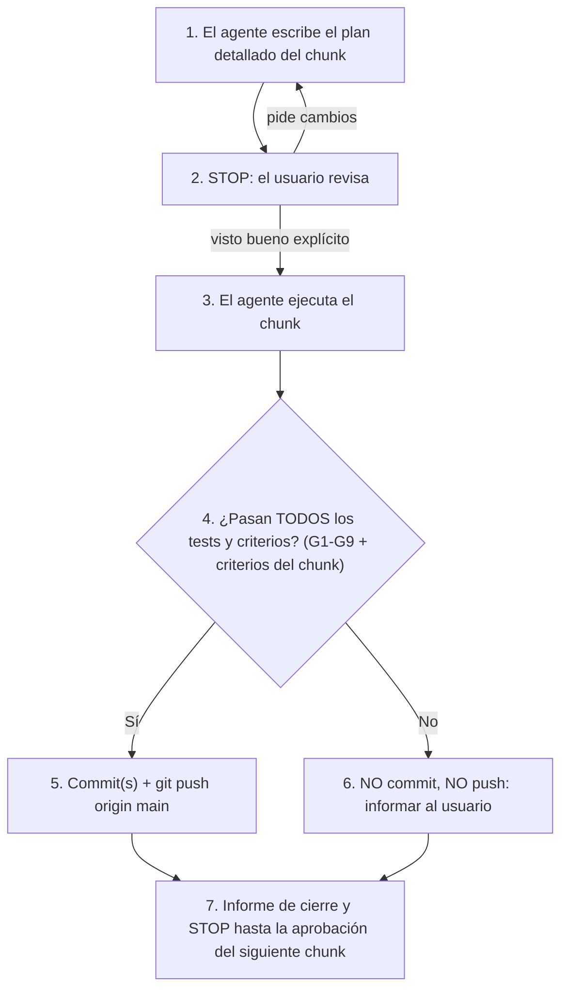

# Plan de resolución — Auditoría de Sculpture

> Base: auditoría sobre el commit `8be7825`. Los `archivo:línea` salen de esa auditoría; **verifícalos con `Select-String` antes de editar**, porque las líneas se desplazan conforme se aplican commits.
> Esta fase solo documenta. No se modificó código fuente.

Gate estándar usado en todo el documento (se ejecuta desde `web/`):

```powershell
npx tsc --noEmit
npx vitest run
```

Gate de fin de chunk:

```powershell
npx tsc --noEmit
npx vitest run
npm run build
npx playwright test        # e2e (npm run test:e2e)
```

---

## 0. Decisiones

### 0.1 Estado (actualizado 2026-11-06)

| # | Estado | Resolución | Efecto en el plan |
|---|---|---|---|
| DEC-1 | ✅ Resuelta | **A: solo documentar.** La máquina compensa el kerf; no se implementa offset. | C10 pasa a ser solo documentación (`docs:`). Desaparecen el toggle, `kerfOffset.ts` y el cambio en `project.ts`. |
| DEC-2 | ✅ Resuelta | **B:** bloquear la exportación con opción "exportar de todos modos". | D2 (C9) sin cambios. |
| DEC-3 | ✅ Resuelta | **Tolerancia relativa a la diagonal (~1e-4) con mínimo y tope absolutos:** `repairGap = clamp(diag × 1e-4, MIN = 0.005 mm, MAX = 0.1 mm)`. Va en **su propio commit**; si un golden cambia, me detengo y espero tu aprobación (regla 4). | D2 (C9): el paso 4 queda desbloqueado. |
| DEC-4 | ✅ Resuelta | **B:** mostrar en la UI el tamaño asumido en mm. | D6 (C9) sin cambios. |
| DEC-5 | ✅ Resuelta | **B:** ordenar por altura (FFD) + rotación de 90°, opt-in, sin nesting poligonal. | D4 (C11) sin cambios. Los goldens de layout solo cambian si algún día se activa por defecto (requeriría tu aprobación). |
| DEC-6 | ✅ Resuelta | **A:** constante compartida de ancho de glifo. | D5 (C11) sin cambios. |
| DEC-7 | ✅ Resuelta | **A:** aislar el parche de Clipper con test de guardia, sin migrar a wasm. | M2 (C3) sin cambios. |
| DEC-8 | ✅ Resuelta | **A: se añade `zod`** como dependencia. | M5 (C8) usa `zod`; se descarta el esquema manual. |
| DEC-9 | ✅ Resuelta | **B:** posponer los errores tipados. | **C12 (M6) queda fuera de este plan** (diferido). |
| DEC-10 | ✅ Resuelta | **A:** ESLint en `warn` primero. | L1 (C0) sin cambios. |
| DEC-11 | ✅ Resuelta | Quitar `clsx` y `tailwind-merge`, **tras confirmar** que no se usan. | L2 (C0) sin cambios (la confirmación ya es el paso 1). |
| DEC-12 | ✅ Resuelta | **PDF descartado.** | Fuera de alcance; sin acción. |

**No quedan decisiones abiertas.**

Justificación de los valores de DEC-3 (propuestos por mí, ajustables):
- **MIN = 0.005 mm**: 5× `SNAP_TOLERANCE` (0.001 mm, `polygonStitcher.ts:41`); por debajo de esto, reparar no se distingue de unir por snap y se generarían falsos "no reparado".
- **MAX = 0.1 mm**: por debajo del kerf típico (0.15 mm por defecto en `params.ts:31`); una brecha mayor ya es visible en la pieza cortada y no debe cerrarse en silencio.
- **Factor 1e-4 × diagonal**: un modelo de ~500 mm da 0.05 mm, igual al valor fijo actual (`MAX_REPAIR_GAP_MM = 0.05`). Por eso el cambio solo debería afectar a modelos con diagonal < ~50 mm (tope inferior 0.005) o > ~500 mm (hasta 0.1); los goldens de esos tamaños son los candidatos a cambiar.
- La diagonal es la del modelo **ya escalado a mm reales** (el stitcher trabaja en esas coordenadas), no la de la malla original.

### 0.2 Detalle original de cada decisión (histórico)

| # | Decisión | Opciones | Mi recomendación | Bloquea |
|---|---|---|---|---|
| **DEC-1** | **Política de kerf para contornos de placa (D1)** | A) Documentar que la máquina compensa el kerf y no tocar nada. B) Offset en la exportación (exterior +kerf/2, huecos −kerf/2) con Clipper `InflatePaths`, activable con un toggle. C) Offset siempre activo. | **B, con toggle apagado por defecto**: no cambia los DXF/SVG actuales salvo que se active, y cubre a quien corta sin compensar en LightBurn. Hay que confirmar antes si LightBurn/tu máquina ya compensa (si sí, A). | C10 |
| **DEC-2** | **Bloqueo de exportación con cadenas abiertas descartadas (D2)** | A) Solo advertencia (hoy). B) Bloquear con opción "exportar de todos modos". C) Bloquear siempre. | **B**: previene placas incompletas sin impedir el flujo de quien sabe lo que hace. | C9 |
| **DEC-3** | **Tolerancia de reparación relativa a la escala (D2)** | A) Mantener 0.05 mm absoluto. B) Relativa a la diagonal (como el weld en `validator.ts:208`), con un tope absoluto. | **B con tope**: puede cambiar goldens de modelos pequeños. Necesito tu aprobación para cada golden que cambie. | C9 |
| **DEC-4** | **Aviso de unidades en STL/OBJ/PLY (D6)** | A) Solo documentar. B) Mostrar en la UI el tamaño asumido en mm tras cargar. C) Diálogo de confirmación de unidad. | **B**: bajo coste, sin fricción. C es más invasivo. | C9 |
| **DEC-5** | **Alcance de D4 (layout)** | A) Solo ordenar por altura (FFD). B) A + rotación de 90°. C) Nesting poligonal. | **B**. C queda fuera de este plan (esfuerzo L, riesgo alto). **Cambia los goldens de layout** y la numeración/posición de placas en hoja. | C11 |
| **DEC-6** | **Texto grabado (D5)** | A) Una constante compartida de ancho de glifo. B) Convertir el texto a trazos vectoriales. | **A ahora**. B es una mejora grande y cambia el formato de salida (entidades TEXT → polilíneas). | C11 |
| **DEC-7** | **Parche de Clipper (M2)** | A) Mantener el parche, aislado y con test de guardia. B) Migrar a `clipper2-wasm`. | **A**. B es una dependencia nueva con otro modelo de carga (WASM en worker) y no se justifica sin evidencia de que Clipper sea el cuello de botella. | C3 |
| **DEC-8** | **Validación de proyectos (M5)** | A) Añadir `zod` (dependencia nueva). B) Esquema escrito a mano y tipado, sin dependencia. | **A** si aceptas la dependencia (el JSON de proyecto es un borde de confianza y hoy son 658 líneas manuales). Si no, B. | C8 |
| **DEC-9** | **M6 (errores sin texto en el núcleo)** | A) Hacerlo (códigos de error tipados). B) Dejarlo fuera: solo hay un idioma hoy. | **B hasta que haya un segundo idioma o un consumidor externo del núcleo**. Queda como C12 opcional. | C12 |
| **DEC-10** | **Rigor del linter (L1)** | A) `warn` en todo y se endurece después. B) `error` desde el inicio. | **A**: evita un PR gigante de correcciones; se endurece al terminar el plan. | C0 |
| **DEC-11** | **Dependencias sin uso (L2)** | Eliminar `clsx` y `tailwind-merge` si no hay uso | Sí, **después de confirmar** con búsqueda en `src/`, `scripts/`, `e2e/` y config (la auditoría solo buscó imports con comilla simple). | C0 |
| **DEC-12** | **Exportación a PDF** | La auditoría no encontró PDF, solo DXF y SVG | Fuera de este plan. Dime si estaba planeado. | — |

---

## 1. Resumen de chunks

Orden = riesgo ascendente, respetando dependencias.

| Orden | Chunk | Issues | Esfuerzo | Riesgo | Depende de |
|---|---|---|---|---|---|
| 1 | **C0** Línea base y tooling | B0 (bench), O6, L6, L1, L2, L3 | M | Bajo | — |
| 2 | **C1** Comentarios, exports muertos y precisión float32 | M3, L5, D3 | S | Muy bajo | C0 |
| 3 | **C2** Copias de memoria | O1 | M | Bajo-medio | C0 (bench) |
| 4 | **C3** Stitcher (hash, parche, fusión) | M2, L4, O4 | M | Bajo-medio | C0, C1 |
| 5 | **C4** Hot path del seccionado | O2 | M | Medio | C0, C3 |
| 6 | **C5** Coalescing de SLICE en el worker | O5 | S | Bajo-medio | C2 |
| 7 | **C6** Validator: separar y acelerar | M4, O3 | M | Medio | C2 |
| 8 | **C7** División del store | M1 | L | Medio-alto | C2, C5 |
| 9 | **C8** Parseo y serialización de proyecto (`zod` + `JSON.stringify`) | M5, M7 | M | Medio | C1 |
| 10 | **C9** Robustez de salida (cambio de comportamiento) | D2, D6 | M | Medio | C3 |
| 11 | **C10** Kerf (solo documentación, DEC-1 = A) | D1 | S | Muy bajo | — |
| 12 | **C11** Layout y etiquetas | D4, D5 | M | Medio | C10 |
| — | ~~C12 Errores sin texto~~ **diferido** (DEC-9 = B) | M6 | — | — | fuera de este plan |

Por qué este orden:
- **C0 primero**: sin benchmark no se pueden cumplir las reglas de optimización, y arreglar jsdom acorta todos los ciclos siguientes.
- **C2 antes de C5 y C7**: ambos tocan `slicer.worker.ts` y el store; quitar copias primero simplifica los mensajes del worker.
- **C5 antes de C7** (como pediste): el store se divide más fácil cuando el protocolo con el worker ya es estable.
- **C3 antes de C4 y C9**: D2 toca el stitcher; conviene que esté ya limpio y rápido.
- **Los cambios de comportamiento (C9-C11) van al final**, tras refactors puros y optimizaciones protegidos por goldens sin cambios.

---

## 2. Reglas de ejecución

1. **Un issue = un commit**, con mensaje convencional **en inglés** (regla de `AGENTS.md`): `refactor:`, `perf:`, `fix:`, `chore:`, `test:`, `docs:`. Ejemplo: `perf(slicer): avoid per-triangle array allocations`.
2. Tras cada issue, `npx tsc --noEmit` y `npx vitest run` deben pasar **antes** de continuar.
3. Al terminar cada chunk: gate de fin de chunk (incluye `build` y e2e). Si todo pasa, commit y `git push origin main`; si no, no se publica nada y se me informa. Después **me detengo**. No empiezo el siguiente chunk sin mi visto bueno al plan de ese chunk (ver flujo en la sección 2.2).
4. **Si un golden cambia, me detengo y te aviso. No continúo.** Procedimiento obligatorio:
   1. Detener el trabajo en cuanto un test golden/baseline falle o cambie (no seguir con otros issues ni otros commits).
   2. No editar, regenerar ni actualizar ningún archivo golden/baseline (`web/golden/*`, `web/src/__tests__/__baseline__/*`) para hacer pasar el test.
   3. Avisarte con: qué golden cambió, el diff concreto (campos y valores antes/después), qué commit lo causó y mi explicación de si el cambio es esperado o un error del refactor.
   4. Esperar tu aprobación explícita. Si es un error del refactor, se corrige el código (no el golden). Si lo apruebas, el golden se actualiza **en un commit separado** (`test(golden): ...`) que cita tu aprobación.
   5. Aplica igual a los cambios de comportamiento previstos (D2, D5) y a los de `chore(deps)` (L3, `zod`).
5. **Las optimizaciones requieren medición antes y después** con el benchmark de C0 (B0), con resultados anotados en el mensaje del commit o en `docs/perf-log.md`.
6. **Un refactor puro no cambia el comportamiento observable.** Si lo cambia, es otro issue con su propio commit.
7. **No mezclar limpieza con cambios de comportamiento** en el mismo commit.
8. Antes de un refactor puro sin cobertura suficiente, **primero un commit `test:` de caracterización** que pase sobre el código actual.
9. Rollback = `git revert <commit>` del issue. Por la regla 1, cada issue se revierte de forma aislada.
10. Respetar `AGENTS.md`: cálculos en mm 1:1, capas `CORTE` (#FF0000) y `GRABADO` (#0000FF), y `slicer.ts`/`layout.ts` headless (sin importar React/three de UI; lo vigila `architecture.test.ts`).
11. **Un chunk solo está terminado cuando cumple su "Criterio de CHUNK PASSED"** (sección 2.1 + el bloque específico al final de cada chunk). Si algún punto no se cumple, el chunk **no** está PASSED: el agente no declara éxito, no avanza, y reporta qué punto falla con la salida del comando.

### 2.1 Protocolo de cierre de chunk (aplica a TODOS los chunks)

**Al empezar un chunk:** anotar el hash de inicio (`git rev-parse --short HEAD`) como `<START>`, y confirmar `git status` limpio.

**Criterio común de CHUNK PASSED** (todos los puntos son obligatorios; ejecutar desde `web/` salvo indicación):

| # | Criterio | Comando exacto | Resultado esperado |
|---|---|---|---|
| G1 | Tipos | `npx tsc --noEmit` | Código de salida 0, sin errores |
| G2 | Tests unitarios | `npx vitest run` | Código de salida 0; **0 fallos, 0 omitidos nuevos**; nº de tests ≥ 131 + los añadidos por el chunk (línea base inicial: 14 archivos, 132 tests; pasa a 131 tras L6 en C0) |
| G3 | Build | `npm run build` | Código de salida 0 |
| G4 | E2E | `npx playwright test` | Código de salida 0. La línea base de e2e se registra en C0; si los e2e fallan **antes** de cualquier cambio, ningún chunk puede darse por PASSED hasta que me lo reportes y yo decida |
| G5 | Goldens intactos | `git diff --stat <START>..HEAD -- web/golden web/src/__tests__/__baseline__` | Salida **vacía**. Si no está vacía: **STOP**, aviso y espero aprobación (regla 4) |
| G6 | Commits | `git log --oneline <START>..HEAD` | Un commit por issue del chunk, mensajes convencionales en inglés (regla 1); ningún commit mezcla limpieza con cambio de comportamiento |
| G7 | Árbol limpio | `git status --short` | Sin cambios sin commitear |
| G8 | Criterios específicos | ver el bloque "Criterio de CHUNK PASSED" al final de cada chunk | Todos cumplidos |
| G9 | Mediciones | `docs/perf-log.md` | Para chunks de optimización: tabla antes/después con la métrica indicada |

**Informe de cierre (obligatorio) y parada:** al cumplir G1-G9, el agente entrega un informe con (a) tabla issue → commit → resultado, (b) salida resumida de G1-G5 (nº de tests, tiempos), (c) métricas antes/después si aplica, (d) cualquier desviación o decisión pendiente. Luego **se detiene y espera mi aprobación explícita** antes del siguiente chunk. No hay avance implícito.

**Si un criterio no se cumple:** no se baja el listón ni se editan goldens/tests para forzar el verde. Se reporta el punto fallido, la causa probable y las opciones, y se espera mi respuesta.

**Registro de estado** (el agente lo actualiza al cerrar cada chunk y yo apruebo):

| Chunk | Estado | `<START>` | `<END>` | Aprobado por el usuario |
|---|---|---|---|---|
| C0 | ✅ PASSED | `8be7825` | `38d21e9` | ✅ Aprobado |
| C1 | ✅ PASSED | `38d21e9` | `66bb171` | ✅ Aprobado |
| C2 | ✅ PASSED | `66bb171` | `41a7139` | ✅ Aprobado |
| C3 | ✅ PASSED | `41a7139` | `f071fce` | ✅ Aprobado |
| C4 | ✅ PASSED | `f071fce` | `3dfbb58` | ✅ Aprobado |
| C5 | ✅ PASSED | `3dfbb58` | `ac91cc2` | ✅ Aprobado |
| C6 | ✅ PASSED | `85d3a8d` | `f8d103e` | ✅ Aprobado |
| C7 | ✅ PASSED | `5fa807f` | `1417242` | ⏳ En revisión |
| C8 | ⬜ Pendiente | | | |
| C9 | ⬜ Pendiente | | | |
| C10 | ⬜ Pendiente | | | |
| C11 | ⬜ Pendiente | | | |

### 2.2 Flujo de trabajo por chunk (plan → revisión → ejecución → commit y push)

Este es el ciclo obligatorio para **cada** chunk. El repositorio remoto es `origin` (`https://github.com/MiguelAyala25/3d-Slicer.git`), rama `main`.



**Paso 1 — Plan del chunk.** Antes de tocar código, el agente escribe en este documento (en el apartado del chunk, bajo un encabezado `Plan de ejecución`) los pasos concretos que va a seguir, los archivos a tocar y los tests a escribir primero. Si el apartado del chunk ya es suficientemente concreto, lo declara y no lo duplica.

**Paso 2 — Revisión y visto bueno.** El agente **se detiene** y espera. Solo la respuesta explícita del usuario ("visto bueno", "aprobado" o equivalente) autoriza la ejecución. El silencio no es aprobación. Si el usuario pide cambios, vuelve al paso 1.

**Paso 3 — Ejecución.** Se aplican las reglas de la sección 2 (un issue = un commit, caracterización antes de refactorizar, medición antes y después, etc.).

**Paso 4 — Verificación.** Se ejecutan G1-G9 y los criterios específicos del chunk (bloque "Criterio de CHUNK PASSED").

**Paso 5 — Si TODO pasa:** el agente hace los commits (uno por issue, mensajes convencionales en inglés) y **`git push origin main`**, y verifica el resultado con `git status` y `git log origin/main..HEAD` (debe quedar vacío). Detalles:
- Cada commit de issue se hace en cuanto ese issue pasa `npx tsc --noEmit` y `npx vitest run` (regla 2); el **push** se hace al final del chunk, cuando se cumplen todos los criterios.
- Solo se hace `git add` de los archivos del issue (nunca `git add -A` a ciegas) y se revisa `git status` antes de cada commit para no subir archivos ajenos al chunk.
- No se usa `--force`, `--no-verify` ni se reescribe historial publicado.
- Si el push es rechazado (p. ej. el remoto tiene commits nuevos), **no** se resuelve a ciegas: se informa al usuario.

**Paso 6 — Si algo NO pasa:** **no hay commit del trabajo fallido, no hay push**, y el agente informa al usuario de inmediato con: qué comando/criterio falló, la salida relevante, la causa probable y las opciones. No se cambian tests ni goldens para forzar el verde. Los commits de issues que ya pasaron antes del fallo quedan **locales** (sin push) hasta que el chunk completo cumpla sus criterios o el usuario indique otra cosa.

**Excepciones que detienen el flujo aunque los tests pasen** (el agente informa y espera al usuario, **sin push**):
- Cualquier cambio en `web/golden/*` o `web/src/__tests__/__baseline__/*` (regla 4).
- Una métrica de optimización por debajo del objetivo del chunk (el usuario decide si se conserva).
- Cualquier desviación del plan aprobado (archivos no previstos, issues añadidos, dependencias nuevas no listadas).

**Paso 7 — Informe de cierre y parada.** Se entrega el informe de la sección 2.1, se actualiza la tabla de "Registro de estado" (con `<START>`, `<END>` y el hash del último commit publicado) y el agente espera la aprobación del plan del siguiente chunk (volver al paso 1).

---

## 3. Chunks

---

### C0 — Línea base y tooling

> Objetivo: poder medir, acelerar los tests y detectar problemas. No toca lógica de producción.

#### B0 — Harness de benchmark (prerrequisito, no es un ID de la auditoría)
- **Chunk:** C0 · **Severidad:** n/a (habilita las reglas de medición)
- **Problema:** la auditoría no pudo medir rendimiento real; solo hay un test de waffle de ~286 ms. Sin medición no se pueden validar O1-O5.
- **Solución:**
  1. Crear `web/scripts/bench-slice.ts` (junto a `dump-waffle-svg.ts` y `write-baseline.ts`; usar el mismo runner que ellos, y si no hay uno claro, `npx vite-node`, que viene con vitest).
  2. Cargar `Models/dragon-meshed.obj` y `Models/Hand.OBJ` con `loadMeshFromBuffer` y medir por separado: (a) carga + validación, (b) construcción de `AxisSliceCache`, (c) `sliceMeshFromCache` con 50 y 200 placas, (d) `sliceWaffleFromCaches`.
  3. Reportar mediana de 5 ejecuciones (más una de calentamiento), `process.memoryUsage().heapUsed` pico aproximado y número de triángulos.
  4. Generar también una malla sintética grande (p. ej. esfera subdividida a ~1M de triángulos) para el límite `MAX_TRIANGLES`.
  5. Guardar la salida en `docs/perf-log.md` como tabla "baseline".
- **Tests:** ninguno (es una herramienta). El script debe salir con código 0.
- **Verificar:** `npx vite-node scripts/bench-slice.ts` produce la tabla; repetir 2 veces y comprobar que la variación sea menor a ~10 %.
- **Riesgo/rollback:** nulo para producción; `git revert`.
- **Esfuerzo:** S · **Hecho:** baseline guardado en `docs/perf-log.md` y reproducible con un solo comando.

#### O6 — Vitest con entorno `node` por defecto
- **Chunk:** C0 · **Severidad:** Baja
- **Problema:** `web/vite.config.ts` (bloque `test`) fija `environment: 'jsdom'` para todo. Vitest informó que jsdom consume 68-73 % del tiempo (~90-147 s acumulados en 14 archivos); la mayoría de los tests de `core` no necesitan DOM.
- **Solución:**
  1. Cambiar `environment` a `'node'`.
  2. Ejecutar `npx vitest run`; para cada archivo que falle por falta de `window`/`document`/`localStorage` (probablemente los que usan el store o `autosave.ts`), añadir `// @vitest-environment jsdom` en la primera línea.
  3. No cambiar ninguna aserción.
  - *Alternativa descartada:* `isolate: false` o `pool: 'vmThreads'` (lo sugiere el propio vitest) acelera pero rompe el aislamiento entre archivos, que es justo lo que protege los goldens.
- **Tests:** la propia suite (132 tests deben seguir pasando; si el conteo cambia, algo se rompió).
- **Verificar:** `npx vitest run` antes/después, anotando la duración total (línea base: 21-31 s).
- **Riesgo/rollback:** tests que dependían de globals del DOM sin darse cuenta; se arreglan con la directiva por archivo. Revertir el commit si hay dudas.
- **Esfuerzo:** S · **Hecho:** 132/132 pasan y la duración baja de forma medible.

#### L6 — Eliminar pseudo-benchmark en `waffleSlicer.test.ts`
- **Chunk:** C0 · **Severidad:** Baja
- **Problema:** `web/src/__tests__/waffleSlicer.test.ts:154-169` (`describe('Non-blocking Benchmark')` → `it('slices a dense mesh without blocking or throwing')`) genera una esfera densa en cada corrida de Vitest (~300-480 ms), imprime `console.log('[Benchmark Waffle 3D Slicing]...')` y solo comprueba `expect(result.crossings.length).toBeGreaterThan(0)` (ya cubierto por los otros 16 tests del archivo). Con B0 (`scripts/bench-slice.ts`) este test es redundante y ensucia la salida de tests.
- **Solución:**
  1. Eliminar el bloque `describe('Non-blocking Benchmark', ...)` en `web/src/__tests__/waffleSlicer.test.ts:153-170`.
  2. El conteo base de tests unitarios pasa de 132 a **131** en 14 archivos.
- **Tests:** los 16 tests restantes de `waffleSlicer.test.ts` siguen pasando sin salida en `stdout`.
- **Verificar:** `npx vitest run src/__tests__/waffleSlicer.test.ts` (16 passed, 0 console.log).
- **Riesgo/rollback:** nulo; `git revert`.
- **Esfuerzo:** S · **Hecho:** test eliminado, 131 tests en verde y sin `console.log` de benchmark en Vitest.

#### L1 — ESLint
- **Chunk:** C0 · **Severidad:** Media
- **Problema:** `web/package.json` no tiene script de lint ni ESLint/Prettier; los `as any` (`polygonStitcher.ts:17-25`, `project.ts:366,436,464,565`) pasan sin aviso.
- **Solución (según DEC-10):**
  1. Añadir devDependencies: `eslint`, `typescript-eslint`, `eslint-plugin-react-hooks`.
  2. Crear `web/eslint.config.js` con `recommended` de typescript-eslint, `no-explicit-any: warn`, `react-hooks/*`.
  3. Añadir el script `"lint": "eslint src"`.
  4. **No** autocorregir en este commit: solo contar los avisos y registrar el número como línea base.
  5. Prettier queda fuera por ahora (un reformateo masivo ensucia el historial y mezclaría limpieza con cambios).
- **Tests:** ninguno nuevo.
- **Verificar:** `npm run lint` corre sin errores (los avisos son aceptables); `npx tsc --noEmit` y `vitest` siguen igual.
- **Riesgo/rollback:** nulo para el runtime; `git revert`.
- **Esfuerzo:** S · **Hecho:** `npm run lint` existe, el número de avisos queda anotado y no hay errores.

#### L2 — Dependencias sin uso
- **Chunk:** C0 · **Severidad:** Baja
- **Problema:** `clsx` y `tailwind-merge` aparecen en `web/package.json` y no se encontraron imports (0 referencias).
- **Solución:**
  1. Confirmar con `Get-ChildItem src,scripts,e2e,index.html,*.config.* -Recurse | Select-String "clsx|tailwind-merge"` (cubrir comillas dobles, `require` y configs).
  2. Si no hay uso: `npm uninstall clsx tailwind-merge`.
  3. Verificar también `dxf-parser` (4 referencias; probablemente solo en tests) y, si solo se usa en tests, **moverlo a devDependencies** en vez de borrarlo.
- **Tests:** la suite completa y el build deben pasar.
- **Verificar:** `npx tsc --noEmit`, `npx vitest run`, `npm run build`.
- **Riesgo/rollback:** import dinámico no detectado → el build o un test lo delatan. `git revert` restaura `package.json` y el lockfile.
- **Esfuerzo:** S · **Hecho:** dependencias confirmadas sin uso eliminadas, el lockfile consistente y el build verde.

#### L3 — Dependencias desactualizadas y `npm audit`
- **Chunk:** C0 · **Severidad:** Baja (pendiente de triage)
- **Problema:** `npm outdated` muestra parches o menores (p. ej. `three` 0.186→0.187, `vite` 8.3.4→8.3.6) y `typescript` 5.8→7.0 (mayor). `npm audit --omit=dev` reportó hallazgos, pero **no registré su detalle ni su severidad**.
- **Solución:**
  1. Ejecutar `npm audit --omit=dev --json` y guardar el resumen en `docs/perf-log.md` o en una sección de este documento.
  2. Clasificar cada hallazgo como: afecta al bundle de producción / solo a herramientas de desarrollo.
  3. Aplicar **solo** parches/menores seguros (`npm update` dirigido), uno por commit, ejecutando el gate después de cada uno. `three` y `@types/three` se actualizan juntos.
  4. **No** subir TypeScript a 7.x ni hacer `npm audit fix --force` en este plan.
- **Tests:** suite completa, build y e2e (three.js puede cambiar el render).
- **Verificar:** `npm audit --omit=dev` antes/después, y el gate de fin de chunk.
- **Riesgo/rollback:** regresiones sutiles de render con `three`/`@react-three/*`; `git revert` del commit de actualización (lockfile incluido).
- **Esfuerzo:** S-M · **Hecho:** triage documentado, los hallazgos de producción resueltos o justificados, y todo en verde.

**Fin de C0:** gate de fin de chunk → pausa para tu revisión.

#### ✅ Criterio de CHUNK PASSED — C0
Además de G1-G9:
- **C0-1 (e2e baseline):** `npx playwright test` se ejecutó **antes de cualquier cambio** y su resultado (pasa/falla, nº de tests, duración) está en `docs/perf-log.md`. Nota: `playwright.config.ts` usa `channel: 'msedge'` y `webServer` con `npm run build && npm run preview`; si Edge o el puerto 4173 no están disponibles, reportarlo (no cambiar la config sin avisarme).
- **C0-2 (B0):** `npx vite-node scripts/bench-slice.ts` termina con código 0 dos veces seguidas, y la mediana de cada métrica varía < 10 % entre ambas. `docs/perf-log.md` contiene la tabla baseline (dragón, `Hand.OBJ`, malla sintética ~1M triángulos): tiempo de carga+validación, caché por eje, `sliceMeshFromCache` con 50 y 200 placas, waffle, heap pico.
- **C0-3 (O6 + L6):** `npx vitest run` → **14 archivos, 131 tests, 0 fallos** (132 tras O6 y 131 tras L6 al quitar el pseudo-benchmark de `waffleSlicer.test.ts`), sin `console.log('[Benchmark Waffle 3D Slicing]')` en `stdout`, y la duración total es **menor** que la línea base de 21-31 s (antes/después anotados). Cada archivo que usa `jsdom` lo declara con `// @vitest-environment jsdom`; `vite.config.ts` tiene `environment: 'node'`.
- **C0-4 (L1):** `npm run lint` existe y termina con código 0 (los *warnings* son aceptables, los *errors* no); el nº de warnings queda anotado en `docs/perf-log.md`. No se reformateó ni autocorrigió código.
- **C0-5 (L2):** `Get-ChildItem src,scripts,e2e,index.html,*.config.* -Recurse | Select-String "clsx|tailwind-merge"` devuelve 0 coincidencias; `clsx` y `tailwind-merge` no están en `package.json` ni en `package-lock.json` (`npm ls clsx tailwind-merge` → vacío). Se informa el destino de `dxf-parser` (movido a devDependencies o justificado).
- **C0-6 (L3):** el resumen de `npm audit --omit=dev` está en `docs/perf-log.md` con cada hallazgo clasificado (producción / desarrollo); ningún hallazgo *high/critical* de producción queda sin resolver o sin justificación escrita. No se subió TypeScript a 7.x ni se usó `--force`.
- **C0-7:** `git diff <START>..HEAD --stat -- web/src/core web/src/store web/src/components web/src/worker` está **vacío** (C0 no toca lógica de producción).

---

### C1 — Comentarios obsoletos, exports muertos y documentación del corte

#### M3 — Referencias a código Python eliminado
- **Chunk:** C1 · **Severidad:** Media
- **Problema:** hay comentarios que apuntan a archivos que ya no existen: `slicer.ts:57,91` ("idéntico a slicer.py"), `layout.ts:80,178` ("layout.py:190-263"), `dxfExporter.ts:29,108` ("exporter.py:341-358"), `polygonStitcher.ts:44` ("slicer.py:296"). `project.ts:39` conserva `formatPythonFloat`. El commit `8be7825` borró esos archivos.
- **Solución:**
  1. `Select-String -Pattern "\.py:|\.py\b|Traducción 1:1" -Path src -Recurse` para listar todas las ocurrencias.
  2. Reescribir cada comentario para explicar la **intención** (p. ej. "rotación que alinea el eje elegido con +Z", "área mínima de polígono en mm² para descartar astillas").
  3. **No renombrar `formatPythonFloat` aquí** (se aborda en M7, C8).
  4. Respetar los demás comentarios y docstrings que no estén relacionados.
- **Tests:** ninguno nuevo (solo comentarios). Comprobar con `git diff` que no cambió ninguna línea de código.
- **Verificar:** Gate estándar; `git diff --stat` muestra solo líneas de comentario.
- **Riesgo/rollback:** nulo.
- **Esfuerzo:** S · **Hecho:** cero referencias a `*.py:` en `src/`; diff solo de comentarios.

#### L5 — Eliminar exports muertos en `core/`
- **Chunk:** C1 · **Severidad:** Baja
- **Problema:** existen símbolos exportados con 0 usos en todo el repositorio (ni en producción ni en tests):
  - `isAvailable` en `web/src/core/build/registry.ts:71`
  - `WAFFLE_PARAM_BOUNDS` en `web/src/core/waffle/constants.ts:32`
  - `FORMAT_VERSION_V1`, `FORMAT_VERSION_V2` y `SerializedProjectFile` en `web/src/core/project.ts:10-29`
  - `pointToSegmentDistance` en `web/src/core/geometry2d.ts:34` (solo se usa internamente dentro de `geometry2d.ts`, no necesita `export`).
- **Solución:**
  1. Confirmar con `Select-String` en `src/`, `scripts/` y `e2e/` que ninguno de esos símbolos se importa fuera de su archivo.
  2. Eliminar `isAvailable`, `WAFFLE_PARAM_BOUNDS`, `FORMAT_VERSION_V1`, `FORMAT_VERSION_V2` y `SerializedProjectFile`.
  3. Quitar la palabra clave `export` de `pointToSegmentDistance` en `geometry2d.ts:34` (manteniendo la función interna).
  4. Dejar intactos `getTechnique` (`registry.ts:63`) y `computeWaffleGrid` (`grid.ts:65`) porque sí los ejercitan `joints.test.ts` y `waffle2d.test.ts`.
- **Tests:** la suite existente (`npx tsc --noEmit` y `npx vitest run`) verifica que nada se rompe.
- **Verificar:** Gate estándar.
- **Riesgo/rollback:** nulo; `git revert`.
- **Esfuerzo:** S · **Hecho:** símbolos muertos eliminados, `pointToSegmentDistance` privado al módulo y `tsc` + `vitest` en verde.

#### D3 — Documentar y proteger la precisión float32 del seccionado
- **Chunk:** C1 · **Severidad:** Baja
- **Problema:** `AxisSliceCache` guarda coordenadas en `Float32Array` (`slicer.ts:37`) tras centrar el modelo. Es aceptable para modelos de tamaño humano, pero no hay test ni nota que fije el supuesto; un modelo lejano al origen o de escala extrema podría degradar los contornos.
- **Solución (sin cambiar comportamiento):**
  1. Añadir un comentario en `slicer.ts:37` explicando por qué float32 es suficiente tras el centrado (error relativo ~1e-7).
  2. Añadir un test que corte una malla a escala muy grande y otra muy pequeña (1e-3 y 1e3 respecto del fixture) y compruebe que `openChainsDiscarded === 0` y que el número de polígonos coincide con la escala base.
  - *Alternativa descartada:* pasar a `Float64Array`. Duplica la memoria (ver O1) sin evidencia de problema real.
- **Tests:** nuevo en `web/src/__tests__/slicer.test.ts`. Si falla en la escala extrema, **no se arregla aquí**: se abre un issue nuevo.
- **Verificar:** `npx vitest run src/__tests__/slicer.test.ts`.
- **Riesgo/rollback:** nulo (solo test y comentario).
- **Esfuerzo:** S · **Hecho:** el test pasa y el supuesto está documentado.

**Fin de C1:** gate de fin de chunk → pausa.

#### ✅ Criterio de CHUNK PASSED — C1
Además de G1-G9:
- **C1-1 (M3):** `Get-ChildItem src -Recurse -Include *.ts,*.tsx | Select-String -Pattern "\.py:|\.py\b|Traducción 1:1"` → **0 coincidencias**. El commit de M3 solo cambia comentarios: `git diff <commit>^ <commit> -U0` no muestra ninguna línea `+`/`-` que no sea comentario (revisión manual incluida en el informe). `formatPythonFloat` **no** se renombró.
- **C1-2 (D3):** existe un test nuevo en `slicer.test.ts` (escalas ×1e-3 y ×1e3 del fixture) que **pasa**, con `openChainsDiscarded === 0` y el mismo nº de polígonos que la escala base. Si no pasara, el chunk **no** está PASSED: se reporta como issue nuevo (no se arregla aquí).
- **C1-3:** `slicer.ts:37` (o su línea actual) tiene el comentario del supuesto float32.
- **C1-4:** nº de tests = 131 + los añadidos por D3 (≥ 1) (base de 131 tras L6 en C0).

#### Plan de ejecución — C1

Hash de inicio (`<START>`): `38d21e9` (`git status` limpio verificado).
Se ejecutarán **3 commits separados** (1 por issue), corriendo `npx tsc --noEmit` y `npx vitest run` tras cada uno, y el gate completo (`G1`-`G8`) al cerrar el chunk:

1. **Issue M3 — Commit 1: `docs(core): replace obsolete python references in comments with intent descriptions`**
   - **Archivos y líneas verificadas con `Select-String`** (33 ocurrencias en 12 archivos, **solo comentarios**, 0 líneas de código):
     - `web/src/components/viewport/SlicedPlatesView.tsx:56` (`viewer.py:390` → explicar rampa HSV estable por índice físico `i / total`).
     - `web/src/core/joints/discs/discGeometry.ts:13` (`viewer.py:680` → explicar tolerancia de borde por defecto de 1.0 mm).
     - `web/src/core/joints/discs/discLayout.ts:14, 125` (`layout.py:434-648`, `layout.py:553-633` → describir acomodo de discos en bandejas por hueco y partición multi-fila cuando excede el ancho útil).
     - `web/src/core/joints/discs/DiscManager.ts:227` (`main.py:201-212` → explicar el re-escalado previo a `purgeInvalidDiscs`).
     - `web/src/core/dxfExporter.ts:29, 108` (`exporter.py:341-358`, `exporter.py:322-338` → describir generación de arcos punteados y círculos de alineación en `GRABADO`).
     - `web/src/core/layout.ts:80, 178, 221, 305` (`layout.py:190-263`, `110-144`, `392-412`, `183-187` → describir posición de etiqueta `P{i}`, cálculo de dimensiones/ocupación y generación de etiquetas de sobrante `SOBRANTE`, y validación de área útil).
     - `web/src/core/params.ts:4, 20` (`params.py:9-59`, `ui.py:94-205`, `params.py:9-33` → describir límites, pasos y valores por defecto en mm).
     - `web/src/core/polygonStitcher.ts:44` (`slicer.py:296` → describir umbral de área mínima en mm² para descartar astillas degeneradas).
     - `web/src/core/project.ts:14, 58, 613` (`project.py:29-39`, `14-46`, `88-115` → describir esquema JSON v1.0, serialización compatible con `web/golden/l_block_project.json` y verificación de compatibilidad geométrica). No se renombra `formatPythonFloat`.
     - `web/src/core/slicer.ts:57, 91` (`slicer.py:134-156`, `159` → describir rotación que alinea el eje elegido con `+Z` y centrado del AABB en el origen).
     - `web/src/store/useSculptureStore.ts:263` (`ui.py:265-272` → describir sincronización automática `gap = thickness` mientras el usuario no haya editado `gap` manualmente en unión por discos).
     - `web/src/types/sculpture.ts:4-15, 44` (`params.py`, `ui.py`, `layout.py:173` → conservar en los comentarios el valor por defecto y el rango `[min..max]` en mm sin citar archivos `.py`).
   - **Verificación:** `Select-String -Pattern "\.py:|\.py\b|Traducción 1:1"` devuelve 0 coincidencias; `git diff` muestra únicamente líneas de comentario; `npx tsc --noEmit` y `npx vitest run`.

2. **Issue L5 — Commit 2: `refactor(core): remove unused exported symbols`**
   - **Observación técnica verificada con `Select-String` y `tsconfig.json`:**
     - `pointToSegmentDistance` (`web/src/core/geometry2d.ts:34-43`) **tampoco tiene usos internos** dentro de `geometry2d.ts` (`closestPointOnRing` invoca `closestPointOnSegment` directamente). Como `web/tsconfig.json` tiene `"noUnusedLocals": true`, si solo se quitara `export`, `npx tsc --noEmit` fallaría con `TS6133: 'pointToSegmentDistance' is declared but its value is never read`. Por tanto, se eliminará la función `pointToSegmentDistance` completa (o dime si prefieres conservarla usada desde algún sitio).
     - En `web/src/core/build/registry.ts:71`, al eliminar `isAvailable`, el tipo importado `RegistryEntry` (`registry.ts:7`) queda sin uso local; se quitará también de la lista de `import type` en `registry.ts` para no romper `"noUnusedLocals": true` ni añadir warnings de ESLint (`RegistryEntry` sigue exportado en `core/build/types.ts`).
   - **Archivos a modificar:**
     - `web/src/core/build/registry.ts`: eliminar `isAvailable` y el import sin uso `RegistryEntry`.
     - `web/src/core/waffle/constants.ts`: eliminar `WAFFLE_PARAM_BOUNDS`.
     - `web/src/core/project.ts`: eliminar `FORMAT_VERSION_V1`, `FORMAT_VERSION_V2` y `SerializedProjectFile` (junto con su JSDoc).
     - `web/src/core/geometry2d.ts`: eliminar `pointToSegmentDistance`.
   - **Verificación:** `npx tsc --noEmit`, `npx vitest run` y `npm run lint` (0 errores, y sin aumento de warnings).

3. **Issue D3 — Commit 3: `test(slicer): document float32 precision assumption and test extreme mesh scales`**
   - **Archivos a modificar:**
     - `web/src/core/slicer.ts:37`: documentar sobre `readonly coords: Float32Array` por qué `Float32Array` (~7 dígitos decimales significativos, error relativo ~`1e-7`) es suficiente una vez centrada la malla en su AABB y antes de aplicar `scaleFactor` en `Float64` (`number` de JS) durante `extractSegmentsAtZ`.
     - `web/src/__tests__/slicer.test.ts`: añadir un bloque `describe('Float32 precision across extreme mesh scales (D3)', ...)` que cargue el fixture `test_l_block.obj`, escale sus posiciones por `1e-3` y `1e3`, ejecute `sliceMesh` y verifique para ambos casos que `result.warnings` tenga 0 descartes (`openChainsDiscarded === 0` en todos los pisos) y que el conteo de polígonos por placa coincida exactamente con la escala base (`×1`).
   - **Verificación:** `npx tsc --noEmit` y `npx vitest run src/__tests__/slicer.test.ts` (132 tests en total en toda la suite).

---

### C2 — Copias de memoria en la carga

#### O1 — Copias redundantes de posiciones
- **Chunk:** C2 · **Severidad:** Media
- **Problema:** una malla de 1M de triángulos son ~36 MB por copia de posiciones y hay varias:
  `meshLoader.ts:58-65` (`clone` + `applyMatrix4` + `toNonIndexed` + otra `BufferGeometry`), `validator.ts:204` (`clone`) y `:229-232` (copia de índices con `getX`), `slicer.worker.ts:21` y `:29` (dos copias de `Float32Array`), y `useSculptureStore.ts:742,749` (otra copia en el fallback síncrono).
- **Solución:**
  1. **Caracterización primero:** commit `test:` que fija el contenido exacto de `positions` tras `loadMeshFromBuffer` para los 4 fixtures (`web/fixtures/test_l_block.*` y `test_torus.stl`): hash o checksum de los `Float32Array`, más `metadata`.
  2. `slicer.worker.ts:21,29`: `posAttr.array` ya es `Float32Array`. Usarlo directamente y transferir **una única** copia; el worker conserva la original. Documentar la propiedad de cada buffer (el `SET_MESH` ya recibe uno propio).
  3. `validator.ts:229-232`: usar `indexAttr.array` (con `Uint32Array.from` solo si no es `Uint32Array`) en lugar del bucle con `getX`.
  4. `validator.ts:204`: evitar `clone()` completo: crear una `BufferGeometry` nueva con solo el atributo `position` (se descartan normal/uv/color de todas formas).
  5. `meshLoader.ts:58-65`: aplicar la matriz directamente sobre el clon único y no crear `posOnly` si ya no hay otros atributos que quitar. Cuidado: `toNonIndexed()` en `cloned` ya devuelve una geometría nueva.
  6. `useSculptureStore.ts:742,749`: solo el fallback de tests; pasar `posAttr.array as Float32Array` sin copiar, **solo si** `sliceMesh` no la muta (comprobarlo; `AxisSliceCache` crea su propio `rotated`, así que no la muta).
  - *Alternativa descartada:* compartir memoria con `SharedArrayBuffer`. Exige cabeceras COOP/COEP en el servidor y complica el despliegue.
- **Tests:**
  - Antes: caracterización del paso 1.
  - Después: un test que verifique que, tras `LOAD_MESH`, la copia transferida al hilo principal y la que queda en el worker son buffers distintos (el hilo principal no puede quedar con un buffer *detached*; el commit `bbacafc` arregló justo ese bug).
  - Golden/baseline que protegen: `slicer.test.ts`, `baseline.test.ts`, `waffleSlicer.test.ts` y `golden/*slice*.json`. **Ninguno debería cambiar.**
- **Verificar:** gate estándar; **medir** con B0: heap pico en carga y tiempo de carga del dragón y de la malla de ~1M. Objetivo: heap pico bajar al menos ~25 % en la carga.
- **Riesgo/rollback:** buffer *detached* o mutación compartida inesperada (el riesgo más probable, ya ocurrió antes). `git revert` del commit del sub-paso afectado; por eso cada sub-paso puede ser su propio commit si crece.
- **Esfuerzo:** M · **Hecho:** goldens sin cambios, el test de propiedad de buffers pasa, y la mejora de memoria medida y anotada en `docs/perf-log.md`.

**Fin de C2:** gate de fin de chunk → pausa.

#### ✅ Criterio de CHUNK PASSED — C2
Además de G1-G9:
- **C2-1 (caracterización):** el test de checksums de `positions` + `metadata` de los 4 fixtures existe, se commiteó **antes** del refactor y pasa **igual antes y después** (se demuestra con el hash del commit de caracterización y la corrida posterior).
- **C2-2 (propiedad de buffers):** existe un test que comprueba que, tras `LOAD_MESH`, el buffer transferido al hilo principal y el que conserva el worker son distintos y ninguno queda *detached* (`byteLength > 0` en ambos).
- **C2-3 (medición, O1):** `docs/perf-log.md` tiene la tabla antes/después del heap pico en carga (dragón y malla ~1M) y el tiempo de carga. **Objetivo: reducción ≥ 25 % del heap pico en carga.** Si no se alcanza, no se declara PASSED automáticamente: se reporta el número real y decido yo.
- **C2-4:** `Select-String -Path src\worker\slicer.worker.ts -Pattern "new Float32Array\("` muestra **a lo sumo una** copia (la necesaria para transferir).
- **C2-5:** el e2e que carga un modelo y corta pasa (sin errores de buffer *detached* en consola).
- **C2-6:** G5 vacío (goldens intactos).

#### Plan de ejecución — C2

Hash de inicio (`<START>`): `66bb171` (`git status` limpio verificado).
Se ejecutarán **2 commits separados** (1 de caracterización previa según regla 8 + C2-1, y 1 de optimización para el issue `O1`), corriendo `npx tsc --noEmit` y `npx vitest run` tras cada uno, y el gate completo (`G1`-`G9` + `C2-1..C2-6`) al cerrar el chunk:

1. **Paso 1 — Commit de caracterización previo (`test(loader): add characterization tests for fixture positions checksums and metadata`)**
   - **Objetivo (C2-1):** fijar antes de tocar producción el contenido bit a bit (`SHA-256` del `Float32Array` de `position` y su longitud) y el objeto `metadata` completo que devuelve `loadMeshFromBuffer` para los fixtures (`test_l_block.stl`, `test_l_block.obj`, `test_l_block.ply`, `test_l_block.3mf` y `test_torus.stl`).
   - **Archivos a modificar:**
     - `web/src/__tests__/validator.test.ts`: añadir un bloque `describe('loadMeshFromBuffer position buffer checksum & metadata characterization (O1 / C2-1)', ...)` que calcule el hash SHA-256 sobre los bytes exactos de `geometry.getAttribute('position').array` y verifique `toEqual` sobre `metadata` para cada fixture.
   - **Medición "Antes" de carga para C2-3:** ejecutar `bench-slice.ts` midiendo específicamente el pico de heap durante `loadMeshFromBuffer` / `normalizeAndValidateGeometry` (con `--expose-gc` para medir el delta/pico real de carga sin arrastre de corridas previas) en `dragon-meshed.obj` (500k triángulos) y en la malla sintética de ~1M de triángulos (`Sphere ~998k` pasando por `normalizeAndValidateGeometry`).
   - **Verificación:** `npx tsc --noEmit` y `npx vitest run src/__tests__/validator.test.ts` (133 tests en verde).

2. **Paso 2 — Commit del issue O1 (`perf(loader): eliminate redundant position and index buffer copies`)**
   - **Cambios por archivo (verificados con las líneas actuales):**
     - `web/src/core/meshLoader.ts:56-66` (`extractMergedGeometryFromObject3D`):
       - En vez de `mesh.geometry.clone()` (que clona `normal`, `uv` y `color` además de `position`), construir `posOnly = new THREE.BufferGeometry()` copiando **únicamente** el atributo `position` (`mesh.geometry.getAttribute('position').clone()`) y, si existe, el índice (`if (mesh.geometry.index) posOnly.setIndex(mesh.geometry.index)`).
       - Aplicar `applyMatrix4(mesh.matrixWorld)` y `scale(unitScale, ...)` directamente sobre `posOnly` (evita transformar vectores normales que luego se descartan).
       - Si `posOnly.index` existe, hacer `posOnly.toNonIndexed()` (que ya devuelve una `BufferGeometry` nueva solo con `position`); si no es indexada, usar `posOnly` directamente sin instanciar otra `BufferGeometry`.
     - `web/src/core/validator.ts:204-210` y `:229-232` (`normalizeAndValidateGeometry`):
       - En `:204-207`, reemplazar `rawGeometry.clone()` + `deleteAttribute(...)` por una `BufferGeometry` liviana que referencie únicamente `posAttr` (y `rawGeometry.index` si existiera), ya que `mergeVertices(cleanForWeld, weldTolerance)` solo lee esos atributos y no los muta.
       - En `:229-232`, reemplazar la copia manual `for (let i = 0; i < indexAttr.count; i++) indices[i] = indexAttr.getX(i)` usando `indexAttr.array instanceof Uint32Array ? indexAttr.array : Uint32Array.from(indexAttr.array)` (`indexedGeom` es temporal de esta función y sus índices pueden permutarse in-place al normalizar el winding en `:442-446`).
     - `web/src/worker/slicer.worker.ts:20-40`:
       - Extraer la lógica de creación del payload de `LOAD_MESH` (o el estado del worker) en una función exportable/testeable para cubrir `C2-2` sin duplicar buffers.
       - Reemplazar las dos copias (`positions = new Float32Array(posAttr.array)` en `:21` y `transferPositions = new Float32Array(positions)` en `:29`) por:
         - `rawPositions = posAttr.array as Float32Array` (propiedad exclusiva del worker; `normalizeAndValidateGeometry` ya creó un `outPositions` nuevo).
         - `const transferPositions = new Float32Array(rawPositions)` (**única** copia `new Float32Array(` en `slicer.worker.ts`, cumpliendo `C2-4`), cuyo `.buffer` se transfiere al hilo principal en `postMessage(resp, [transferPositions.buffer])`.
       - Documentar explícitamente en comentario la propiedad de cada buffer (`rawPositions` permanece en el worker; `transferPositions` se transfiere al hilo principal; `SET_MESH` recibe su propio buffer clonado/transferido).
     - `web/src/store/useSculptureStore.ts:742,749` (fallback síncrono de tests):
       - Pasar `posAttr.array as Float32Array` directamente a `sliceWaffleMesh` y `sliceMesh` sin envolverlo en `new Float32Array(...)` (verificado en `slicer.ts:86-99`: `AxisSliceCache` construye su propio `rotated = new Float32Array(positions.length)` y nunca muta el `positions` de entrada).
   - **Test nuevo de propiedad de buffers (C2-2):**
     - En `web/src/__tests__/validator.test.ts` (o test dedicado del worker), verificar que al procesar `LOAD_MESH`:
       1. El buffer transferido al hilo principal (`transferPositions.buffer`) y el que conserva el worker (`rawPositions.buffer`) tienen referencias distintas (`!==`).
       2. Ninguno queda *detached* antes de `postMessage` y, incluso simulando la transferencia/detach del buffer enviado al hilo principal (o tras recibirlo), ambos tienen `byteLength > 0` y el mismo contenido.
   - **Actualización de benchmark y registro en `docs/perf-log.md` (C2-3):**
     - Ajustar `web/scripts/bench-slice.ts` para que también mida la carga + validación de la malla sintética de ~1M de triángulos y reporte el heap pico de carga (antes y después de `O1`), registrando la tabla comparativa en `docs/perf-log.md`.
   - **Verificación final del chunk:** ejecutar G1-G9 y verificar C2-1 a C2-6.

---

### C3 — Stitcher: hash, parche de Clipper y fusión de cadenas

> Los tres issues tocan `polygonStitcher.ts`. Los commits van separados y en este orden.

#### M2 — Aislar el monkey-patch de Clipper
- **Chunk:** C3 · **Severidad:** Media
- **Problema:** `polygonStitcher.ts:15-26` modifica `Clipper64.prototype.newOutRec` con `as any` para esquivar un fallo del port 1.2.4; si se actualiza `clipper2-js`, el parche puede dejar de ser necesario o romperse en silencio.
- **Solución (según DEC-7, opción A):**
  1. Test de **caracterización**: un caso mínimo que ejecute `executePolyTree` sin parche y compruebe si falla (documenta el bug concreto).
  2. Mover el parche a `web/src/core/vendor/clipperPatch.ts`, exportando `applyClipperPatch()` idempotente (conserva `__patchedOutRec`), e importarlo desde `polygonStitcher.ts`.
  3. Mantener los comentarios que explican el motivo del parche.
  4. Añadir un test "de guardia" que falle con un mensaje claro si el bug original ya no se reproduce (señal para retirar el parche).
- **Tests:** `waffle2d.test.ts`, `slicer.test.ts` y `baseline.test.ts` protegen; **no deben cambiar goldens**. Nuevo: `clipperPatch.test.ts`.
- **Verificar:** gate estándar.
- **Riesgo/rollback:** que el parche se aplique después de que `Clipper64` se haya usado; mitigado por el import al inicio del módulo. `git revert`.
- **Esfuerzo:** S · **Hecho:** parche aislado, sin `as any` en `polygonStitcher.ts`, test de guardia en verde.

#### L4 — Claves numéricas en los hashes de celdas
- **Chunk:** C3 · **Severidad:** Baja
- **Problema:** `polygonStitcher.ts:52-54` construye strings `` `${cx},${cy}` `` para cada consulta de vecindad (9 celdas por vértice, en `:133-146` y `:289-304`).
- **Solución:**
  1. Reemplazar `cellKey` por una clave numérica. Las coordenadas de celda pueden ser negativas y grandes (`1/SNAP_TOLERANCE` = 1000 celdas/mm), así que usar `(cx + OFFSET) * STRIDE + (cy + OFFSET)` con offset y stride dimensionados para que no superen `Number.MAX_SAFE_INTEGER`; **añadir un test con coordenadas negativas y valores grandes** (±5000 mm).
  2. Mantener el comportamiento idéntico (mismos vértices unidos).
- **Tests:** antes, caracterización de colisiones: conjuntos de segmentos con coordenadas negativas y en el límite; después, los goldens. **Ningún golden debe cambiar.**
- **Verificar:** gate estándar; **medir** con B0 el tiempo de `stitchAndUnionSegments` (objetivo: reducción medible en el dragón con 200 placas).
- **Riesgo/rollback:** colisión de claves entre celdas distintas que une vértices lejanos. El test de coordenadas extremas lo cubre. `git revert`.
- **Esfuerzo:** S · **Hecho:** goldens iguales, test de coordenadas extremas en verde y mejora medida.

#### O4 — Fusión de cadenas abiertas sin reconstruir el hash cada vez
- **Chunk:** C3 · **Severidad:** Baja-Media
- **Problema:** en `polygonStitcher.ts:262-336`, cada fusión exitosa hace `break` y se reconstruye `headGrid` completo; con muchas cadenas abiertas (malla rota) el coste es cuadrático.
- **Solución:**
  1. Test de caracterización con una malla sintética rota (muchas micro-brechas) que fije el resultado actual (`openChainsRepaired`, `openChainsDiscarded` y los polígonos).
  2. Mantener `headGrid` incremental: al fusionar `A+B`, quitar `B` de su celda; la cabeza de `A` no cambia. Sustituir el `break` + reconstrucción por continuar con la siguiente cadena.
  3. Mantener el orden determinista de procesamiento para que el resultado sea idéntico.
- **Tests:** el de caracterización (debe dar **exactamente** el mismo resultado), más `slicer.test.ts` y goldens (**sin cambios**).
- **Verificar:** gate estándar; medir con un caso sintético de 5 000 cadenas abiertas, antes/después.
- **Riesgo/rollback:** cambia el orden de fusión → resultados distintos en casos ambiguos. El test de caracterización lo detecta; si cambia, revertir y buscar otra estrategia. `git revert`.
- **Esfuerzo:** M · **Hecho:** salida idéntica y complejidad medida mejor en el caso sintético.

**Fin de C3:** gate de fin de chunk → pausa.

#### ✅ Criterio de CHUNK PASSED — C3
Además de G1-G9:
- **C3-1 (M2):** existe `core/vendor/clipperPatch.ts` con `applyClipperPatch()` idempotente; `Select-String -Path src\core\polygonStitcher.ts -Pattern "as any"` → **0 coincidencias**; el test `clipperPatch.test.ts` pasa e incluye el test de guardia (falla con mensaje claro si el bug original ya no se reproduce).
- **C3-2 (L4):** `cellKey` ya no construye strings (`Select-String -Pattern "\`\$\{cx\},\$\{cy\}\`"` sin coincidencias en `polygonStitcher.ts`); el test con coordenadas negativas y de ±5000 mm pasa; `docs/perf-log.md` tiene el tiempo de `stitchAndUnionSegments` antes/después (dragón, 200 placas) y **no empeora**.
- **C3-3 (O4):** el test de caracterización con malla sintética rota (≥ 5000 cadenas abiertas) da **exactamente** el mismo `openChainsRepaired`, `openChainsDiscarded` y polígonos antes y después (`toEqual`); `perf-log.md` muestra la mejora de tiempo en ese caso. Si el resultado cambia, **STOP** y revertir ese commit.
- **C3-4:** G5 vacío (ningún golden cambia en este chunk).

#### Plan de ejecución — C3

Hash de inicio (`<START>`): `41a7139` (`git status` limpio verificado).
Se ejecutarán **4 commits separados** (1 para `M2`, 1 para `L4`, 1 de caracterización previa para `O4` según regla 8, y 1 de optimización para `O4`), corriendo `npx tsc --noEmit` y `npx vitest run` tras cada uno, y el gate completo (`G1`-`G9` + `C3-1..C3-4`) al cerrar el chunk:

1. **Issue M2 — Commit 1: `refactor(stitcher): isolate Clipper64 newOutRec patch with guard test`**
   - **Objetivo (C3-1):** aislar el monkey-patch de `Clipper64.prototype.newOutRec` fuera de `polygonStitcher.ts`, eliminar todo uso de `as any` en `polygonStitcher.ts`, y proteger el parche con un test de guardia que avise si una futura versión de `clipper2-js` ya no tiene el bug.
   - **Archivos a crear/modificar (líneas verificadas):**
     - **Nuevo:** `web/src/core/vendor/clipperPatch.ts`:
       - Capturar la referencia original `rawNewOutRec` de `Clipper64.prototype` antes de parchear (tipada mediante una interfaz interna sobre el prototipo sin usar `as any`, para no añadir warnings de `@typescript-eslint/no-explicit-any`).
       - Exportar `applyClipperPatch(): void` idempotente (controlada por bandera en el prototipo `__patchedOutRec`) que asegura que toda instancia `OutRec` devuelta por `newOutRec()` tenga `bounds = new Rect64(false)` y `path = new Path64()` inicializados.
       - Exportar un helper de inspección `checkUnpatchedOutRecBug(): { missingBounds: boolean; missingPath: boolean }` que invoque `rawNewOutRec` sobre una instancia limpia de `Clipper64` para comprobar si el bug del port `clipper2-js@1.2.4` sigue presente.
     - **Modificar:** `web/src/core/polygonStitcher.ts:1-26`:
       - Eliminar `Rect64` de los imports si ya no se usa directamente en `polygonStitcher.ts` y eliminar las líneas `:15-26` (el bloque con `as any`).
       - Importar y ejecutar `applyClipperPatch()` al cargar el módulo.
     - **Nuevo:** `web/src/__tests__/clipperPatch.test.ts`:
       - **Test de guardia:** verificar que `checkUnpatchedOutRecBug()` confirma que `rawNewOutRec` devuelve `bounds === undefined` y/o `path === undefined`, lanzando un mensaje claro si algún día `clipper2-js` corrige el bug y el parche puede retirarse.
       - **Test de idempotencia y `executePolyTree`:** llamar a `applyClipperPatch()` repetidas veces y verificar que `executePolyTree` con un polígono exterior y un hueco produce la jerarquía esperada sin fallar en `checkBounds`.
   - **Verificación:** `Select-String -Path web\src\core\polygonStitcher.ts -Pattern "as any"` → 0 coincidencias; `npx tsc --noEmit`, `npx vitest run` y `npm run lint` (sin incremento de warnings).

2. **Issue L4 — Commit 2: `perf(stitcher): replace string cell keys with collision-free numeric keys`**
   - **Objetivo (C3-2):** eliminar la interpolación de strings `` `${cx},${cy}` `` en las consultas espaciales de `polygonStitcher.ts` (9 celdas por vértice en `getOrCreateVertex` `:133-146` y 9 por cadena en `:289-304`).
   - **Cambios en `web/src/core/polygonStitcher.ts`:**
     - Reemplazar `cellKey(cx: number, cy: number): string` (`:52-54`) por una función numérica exportada `cellKey(cx: number, cy: number): number`:
       - Con `CELL_OFFSET = 67_108_864` ($2^{26}$) y `CELL_STRIDE = 134_217_728` ($2^{27}$), `return (cx + CELL_OFFSET) * CELL_STRIDE + (cy + CELL_OFFSET);`.
       - Para coordenadas de hasta $\pm 67\,000\text{ mm}$ a resolución `SNAP_TOLERANCE = 1e-3` ($cx, cy \in [-6.7 \times 10^7, +6.7 \times 10^7]$), la clave resultante es un entero no negativo estrictamente menor que $2^{53} - 1$ (`Number.MAX_SAFE_INTEGER`), inyectivo (0 colisiones) y sin asignación en heap.
     - Cambiar `grid` (`:122`) y `headGrid` (`:266`) de `Map<string, number[]>` a `Map<number, number[]>`.
   - **Tests nuevos en `web/src/__tests__/slicer.test.ts`:**
     - Verificar que `cellKey` no colisiona en coordenadas negativas, positivas, cruzadas `(cx, cy)` vs `(cy, cx)` ni en extremos de $\pm 5000\text{ mm}$ ($\pm 5\,000\,000$ celdas).
     - Ejecutar `stitchAndUnionSegments` sobre lazos cuadrados en coordenadas extremas ($[-5000, -4990]$, $[+4990, +5000]$ y alrededor del origen) comprobando que une los vértices correctos sin falsas fusiones entre cuadrantes.
   - **Medición (C3-2):** medir antes y después con `web/scripts/bench-slice.ts` (añadiendo desglose o medición directa de `stitchAndUnionSegments` / `sliceMeshFromCache` con 200 placas en `dragon-meshed.obj`) y registrar en `docs/perf-log.md`.

3. **Issue O4 (Paso 1) — Commit 3: `test(stitcher): add characterization test for broken mesh with 5000+ open chains`**
   - **Objetivo (regla 8 + C3-3):** fijar antes de optimizar el resultado exacto (`openChainsRepaired`, `openChainsDiscarded` y `polygons`) sobre un conjunto sintético determinista con $\ge 5000$ cadenas abiertas con micro-brechas reparables ($\le 0.05\text{ mm}$) y cadenas descartables.
   - **Archivos a modificar:**
     - `web/src/__tests__/slicer.test.ts`: añadir un test de caracterización que genere determinísticamente $\ge 5000$ cadenas abiertas (por ejemplo, 1250 anillos cuadrados partidos cada uno en 4 cadenas abiertas con micro-brechas de $0.02\text{ mm}$ en orden barajado determinista + 200 cadenas abiertas aisladas que se descartan), verifique el conteo exacto de `openChainsRepaired`, `openChainsDiscarded`, el número de polígonos y sus áreas/vértices con `toEqual`.
   - **Verificación:** `npx tsc --noEmit` y `npx vitest run src/__tests__/slicer.test.ts`.

4. **Issue O4 (Paso 2) — Commit 4: `perf(stitcher): maintain headGrid incrementally during open chain merging`**
   - **Objetivo (C3-3):** eliminar la reconstrucción cuadrática $O(N^2)$ de `headGrid` en cada fusión (`polygonStitcher.ts:261-336`) manteniendo el resultado **100 % idéntico** al algoritmo actual.
   - **Análisis de equivalencia exacta:**
     - En el bucle actual (`:261-336`), cuando la cadena activa `i` (`chainA`) se fusiona con `bestOther` (`chainB`), `chainB` se concatena al final de `chainA` y `active[bestOther]` pasa a `0`. El vértice cabeza (`chainA[0]`) **nunca cambia de coordenadas ni de celda**, y ninguna cadena nueva se añade al conjunto de cabezas activas; únicamente desaparecen cabezas (`bestOther`, y `i` si `chainA` se cierra sobre sí misma).
     - Como ninguna cabeza se mueve ni se crea, ninguna cadena `k < i` que ya haya buscado sin éxito en `headGrid` puede encontrar un candidato nuevo después de una fusión en `i`. El único extremo que cambia tras fusionar `chainA` con `chainB` es la **cola (`tail`) de la propia `chainA`**.
     - Por tanto:
       1. Se construye `headGrid` **una sola vez** antes de recorrer `openChains`, insertando los índices `cIdx = 0 .. openChains.length - 1` en el mismo orden ascendente.
       2. Para eliminar una cadena de `headGrid` cuando pasa a inactiva (`bestOther` al fusionarse, o `i` al cerrarse), se remueve su índice del bucket de su celda preservando el orden relativo de los demás elementos del bucket.
       3. Para cada `i = 0 .. openChains.length - 1`, un bucle `while (active[i])` extiende repetidamente la cola de `openChains[i]` buscando `bestOther` en la vecindad $3 \times 3$ de `headGrid` hasta que `openChains[i]` se cierre o su nueva cola no tenga candidatos en `headGrid`, momento en que se avanza a `i + 1`.
     - Esto realiza exactamente la misma secuencia de fusiones y desempates (`dSq <= bestDistSq` en el mismo orden de celdas y de índices) en tiempo $O(N)$ en lugar de $O(N^2)$.
   - **Medición y registro en `docs/perf-log.md` (C3-3):**
     - Incluir en `web/scripts/bench-slice.ts` (y/o reportar en `docs/perf-log.md`) el tiempo antes y después de `stitchAndUnionSegments` sobre el caso sintético de $\ge 5000$ cadenas abiertas (más la tabla de `dragon-meshed.obj` 200 placas para `L4`+`O4`).
   - **Verificación final del chunk:** ejecutar G1-G9 y comprobar C3-1 a C3-4 (incluyendo G5 vacío).

---

### C4 — Hot path del seccionado

#### O2 — Asignaciones por triángulo y buckets fijos
- **Chunk:** C4 · **Severidad:** Media
- **Problema:** `extractSegmentsAtZ` (`slicer.ts:157-246`) crea ~5 arrays pequeños por triángulo candidato (`vx, vy, vz, above`, `:179-190`; `ptsX/ptsY`, `:192-193`) y un objeto por segmento. Los buckets son fijos, `NUM_Z_BUCKETS = 128` (`slicer.ts:13`): con 1M de triángulos, cada placa recorre miles de candidatos y los triángulos altos se duplican en varios buckets.
- **Solución (dos commits separados):**
  1. **`perf: remove per-triangle allocations`**: usar variables escalares locales (`x0..z2`, `a0..a2`) en vez de arrays; mantener **exactamente** el mismo orden canónico de operandos (`:200-211`) para que los resultados en punto flotante sean bit a bit iguales. Los segmentos pueden seguir como `DirectedSegment2D[]` (no cambiar la interfaz con el stitcher en este paso).
  2. **`perf: adaptive z-buckets`**: `numBuckets = clamp(round(sqrt(triCount)), 128, 4096)` en lugar de la constante. *Alternativa:* ordenar por `triMinZ` y buscar por rango; más compleja y sin ganancia clara frente a buckets.
- **Tests:**
  - Antes: confirmar que `slicer.test.ts` cubre caras coplanares con el plano de corte y mallas con huecos y casos de contorno exacto; si no, **añadir primero** un test de caracterización que compare la lista de segmentos contra una versión de referencia (puede ser la propia función actual copiada en el test como oráculo).
  - Después: un test que verifique que la salida es **idéntica bit a bit** (`toEqual` sobre los segmentos) entre 128 buckets y N adaptativos.
  - Protegen: `golden/*slice*.json`, `baseline.test.ts`, `zeroGap.test.ts`. **Ningún golden debe cambiar**; si cambia, es un error del refactor, no un golden a actualizar.
- **Verificar:** gate estándar y **medición con B0** (mediana de `sliceMeshFromCache` con 200 placas en el dragón y en la malla de ~1M; y GC/heap pico). Registrar antes/después.
- **Riesgo/rollback:** cambios de redondeo en la intersección producen costuras entre triángulos vecinos (por eso el orden canónico es crítico). `git revert` de cada commit por separado.
- **Esfuerzo:** M · **Hecho:** salidas idénticas, goldens sin cambios y mejora de tiempo medida (objetivo orientativo: ≥ 20-30 %; si no se alcanza, se documenta y se decide si el cambio justifica su complejidad).

**Fin de C4:** gate de fin de chunk → pausa.

#### ✅ Criterio de CHUNK PASSED — C4
Además de G1-G9:
- **C4-1 (identidad bit a bit):** existe un test que compara `extractSegmentsAtZ` contra un oráculo (la implementación previa copiada en el test) con `toEqual` exacto sobre los segmentos, para los fixtures y para 128 buckets vs. buckets adaptativos. Pasa.
- **C4-2 (cobertura de bordes):** hay test(s) para caras coplanares con el plano de corte y corte exactamente sobre un vértice; pasan.
- **C4-3 (medición, O2):** `docs/perf-log.md` tiene antes/después de `sliceMeshFromCache` con 200 placas (dragón y malla ~1M) y heap pico. **Objetivo orientativo: ≥ 20 % menos de tiempo.** Si no se alcanza, se reporta el número real y decido si el cambio se conserva.
- **C4-4:** `NUM_Z_BUCKETS` constante fija ya no se usa en `extractSegmentsAtZ`/constructor (buckets adaptativos), dos commits separados (`perf: remove per-triangle allocations` y `perf: adaptive z-buckets`).
- **C4-5:** G5 vacío. **Cualquier cambio de golden aquí es un error del refactor**: STOP.

#### Plan de ejecución — C4

Hash de inicio (`<START>`): `f071fce` (`git status` limpio verificado).
Se ejecutarán **3 commits separados** (1 de caracterización previa según regla 8 + `C4-1`/`C4-2`, 1 para eliminar asignaciones por triángulo y 1 para los Z-buckets adaptativos según `C4-4`), corriendo `npx tsc --noEmit` y `npx vitest run` tras cada uno, y el gate completo (`G1`-`G9` + `C4-1..C4-5`) al cerrar el chunk:

1. **Paso 1 — Commit de caracterización previo (`test(slicer): add oracle bit-for-bit and coplanar/vertex boundary tests for extractSegmentsAtZ`)**
   - **Objetivo (`C4-1` + `C4-2` + regla 8):** fijar antes de tocar producción un oráculo de referencia (`referenceExtractSegmentsAtZ`, copia exacta de la implementación actual con 128 buckets y arrays por triángulo) y ampliar la cobertura de casos borde.
   - **Archivos a modificar:**
     - `web/src/__tests__/slicer.test.ts`:
       - Añadir la función oráculo `referenceExtractSegmentsAtZ(cache: AxisSliceCache, zUnit: number, scaleFactor: number): DirectedSegment2D[]` con la lógica original de `slicer.ts:165-254`.
       - Verificar identidad bit a bit (`expect(actual).toEqual(expected)`) entre `cache.extractSegmentsAtZ(zUnit, scaleFactor)` y `referenceExtractSegmentsAtZ(cache, zUnit, scaleFactor)` en los 3 ejes (`x`, `y`, `z`) y múltiples alturas `zUnit` para los fixtures (`test_l_block.obj`, `test_l_block.stl`, `test_torus.stl`) y para una malla densa sintética (> 20 000 triángulos).
       - Añadir tests explícitos de bordes (`C4-2`):
         1. Caras estrictamente coplanares con el plano de corte (`z0 = z1 = z2 = zUnit`, tanto tapa superior/inferior como escalón intermedio) verificando que `extractSegmentsAtZ` las ignora limpiamente sin duplicar aristas ni producir `NaN`.
         2. Plano de corte pasando exactamente por un vértice aislado (`z0 = zUnit` con `z1, z2 < zUnit`, con `z1, z2 > zUnit`, y con `z1 < zUnit < z2`), comprobando que `extractSegmentsAtZ` coincide bit a bit con el oráculo y que el polígono cosido es cerrado y válido.
   - **Verificación:** `npx tsc --noEmit` y `npx vitest run src/__tests__/slicer.test.ts`.

2. **Paso 2 — Commit 1 de O2 (`perf(slicer): remove per-triangle allocations in extractSegmentsAtZ`)**
   - **Objetivo (`C4-1`, `C4-4`):** eliminar las ~6 asignaciones de arrays pequeños por triángulo candidato (`vx`, `vy`, `vz`, `above`, `ptsX`, `ptsY`) dentro del bucle caliente de `AxisSliceCache.extractSegmentsAtZ` (`web/src/core/slicer.ts:186-235`).
   - **Cambios en `web/src/core/slicer.ts` (`:165-254`):**
     - Leer `coords = this.coords` en escalares locales por triángulo: `vx0, vy0, vz0`, `vx1, vy1, vz1`, `vx2, vy2, vz2` y booleanos `a0 = vz0 >= zUnit`, `a1 = vz1 >= zUnit`, `a2 = vz2 >= zUnit`.
     - Reemplazar `ptsX: number[] = []` y `ptsY: number[] = []` por acumuladores escalares (`x0 = 0, y0 = 0, x1 = 0, y1 = 0, ptCount = 0`).
     - Evaluar las 3 aristas `(0,1)`, `(1,2)` y `(2,0)` en el mismo orden exacto (`e = 0, 1, 2`), manteniendo **idéntico** el predicado de orden canónico `(pMin, pMax)` por `(z, x, y)` y la fórmula IEEE-754 `(minX + alpha * (maxX - minX)) * scaleFactor` para que el resultado en punto flotante sea bit a bit igual al oráculo.
     - Mantener la interfaz `DirectedSegment2D[]` sin cambios.
   - **Verificación:** `npx tsc --noEmit` y `npx vitest run` (incluyendo el test de identidad bit a bit contra `referenceExtractSegmentsAtZ`).

3. **Paso 3 — Commit 2 de O2 (`perf(slicer): adaptive z-buckets in AxisSliceCache`)**
   - **Objetivo (`C4-1`, `C4-3`, `C4-4`, `C4-5`):** reemplazar la constante fija `NUM_Z_BUCKETS = 128` (`web/src/core/slicer.ts:13`) por un número de buckets adaptativo `numBuckets = clamp(Math.round(Math.sqrt(triCount)), 128, 4096)`.
   - **Cambios en `web/src/core/slicer.ts`:**
     - Sustituir `NUM_Z_BUCKETS = 128` por `MIN_Z_BUCKETS = 128`, `MAX_Z_BUCKETS = 4096` y la función exportada `computeNumZBuckets(triCount: number): number`.
     - Añadir `readonly numBuckets: number` en `AxisSliceCache` (permitiendo un parámetro opcional `numBucketsOverride?: number` en `constructor(rawPositions: Float32Array, axis: Axis, numBucketsOverride?: number)` para poder instanciar cachés con `128` buckets frente a `N` adaptativos en el test de `C4-1`).
     - Usar la misma expresión `const invSpan = this.numBuckets / this.origHeight` tanto al poblar `bucketLists` en el constructor (`:124-156`) como al calcular `bucketIdx` en `extractSegmentsAtZ` (`:166-174`), garantizando por monotonía IEEE-754 que `b0 <= bucketIdx <= b1` para todo triángulo que cruce `zUnit` y preservando el orden ascendente de índice de triángulo `t` dentro de cada bucket.
   - **Ampliación del test en `web/src/__tests__/slicer.test.ts` (`C4-1`):**
     - Comprobar con `toEqual` que `new AxisSliceCache(pos, axis, 128).extractSegmentsAtZ(zUnit, scaleFactor)` y `new AxisSliceCache(pos, axis).extractSegmentsAtZ(zUnit, scaleFactor)` (con `numBuckets > 128` en malla densa) producen listas de segmentos **idénticas bit a bit** y que ambos coinciden con `referenceExtractSegmentsAtZ`.
   - **Medición y registro en `docs/perf-log.md` (`C4-3`):**
     - Ejecutar `npx vite-node scripts/bench-slice.ts` y registrar en `docs/perf-log.md` la tabla comparativa antes/después de `sliceMeshFromCache` (50 y 200 placas) y heap pico en `dragon-meshed.obj` (500k triángulos, `numBuckets = 707`) y en `Sphere ~998k` (~1M triángulos, `numBuckets = 999`).
   - **Verificación final del chunk:** ejecutar G1-G9 y comprobar C4-1 a C4-5 (con G5 vacío).

---

### C5 — Coalescing de SLICE en el worker

#### O5 — Descartar trabajo de seccionado obsoleto
- **Chunk:** C5 · **Severidad:** Media
- **Problema:** `slicer.worker.ts:10` procesa los mensajes en cola uno tras otro y el seccionado es síncrono (`:60-101`, `:103-152`); el store solo descarta el **resultado** viejo por `jobId` (`useSculptureStore.ts:395`), pero el worker igual lo calcula. Con varios cambios rápidos de parámetros se acumula trabajo inútil (el debounce de 350 ms, `:162`, lo mitiga solo parcialmente).
- **Solución:**
  1. **Medir primero** (B0 + un script que envíe 10 mensajes `SLICE` seguidos al worker y mida el tiempo hasta el último resultado). Si el problema no es medible, **no se implementa**.
  2. En el worker, que `onmessage` no ejecute el seccionado directamente: guardar el último `SLICE`/`SLICE_WAFFLE` pendiente en una variable y procesarlo con `setTimeout(0)`/microtarea, de modo que mensajes que lleguen antes reemplacen al pendiente. Los mensajes `LOAD_MESH` y `SET_MESH` **nunca se descartan** y mantienen su orden.
  3. Responder con un mensaje `SLICE_SKIPPED { jobId }` (o simplemente no responder, porque el store ya ignora jobIds antiguos; elegir lo segundo si el store no espera una respuesta por job para limpiar `isSlicing`; **verificarlo** en `useSculptureStore.ts` antes de decidir).
  - *Alternativa descartada:* cancelación cooperativa dentro del bucle de placas (`slicer.ts` comprobaría una bandera): requiere `SharedArrayBuffer` o dividir el bucle en lotes con `await`; más complejo y toca el núcleo.
- **Tests:** test del worker (o de la función extraída que decide qué mensaje procesar) con una cola simulada: de 5 `SLICE` seguidos solo se ejecuta el último; `LOAD_MESH` entre ellos conserva el orden y `meshId` obsoleto sigue dando `SLICE_ERROR`. e2e de `sculpture.spec.ts` protege el flujo completo.
- **Verificar:** gate estándar y e2e; medición del paso 1, antes/después.
- **Riesgo/rollback:** `isSlicing` se queda en `true` si el store espera una respuesta por job que ya no llega (spinner infinito, que ya fue un bug en `bbacafc`). `git revert`.
- **Esfuerzo:** S-M · **Hecho:** medición que demuestra la mejora, test de cola en verde, e2e verde y sin spinner colgado.

**Fin de C5:** gate de fin de chunk → pausa.

#### ✅ Criterio de CHUNK PASSED — C5
Además de G1-G9:
- **C5-1 (medición previa obligatoria):** `docs/perf-log.md` contiene la medición de 10 mensajes `SLICE` seguidos (tiempo hasta el último resultado) **antes** del cambio. **Si el problema no es medible, O5 no se implementa**: el chunk se cierra como PASSED con la nota "no reproducible, sin cambios" y yo lo apruebo.
- **C5-2 (si se implementó):** el test de cola pasa: de 5 `SLICE` consecutivos solo se ejecuta el último; `LOAD_MESH`/`SET_MESH` nunca se descartan y conservan orden; un `meshId` obsoleto sigue produciendo `SLICE_ERROR`.
- **C5-3:** la medición posterior muestra mejora del tiempo hasta el último resultado (antes/después en `perf-log.md`).
- **C5-4:** e2e pasa y **no hay spinner colgado**: tras una ráfaga de cambios de parámetros, `isSlicing` vuelve a `false` (cubierto por test o e2e).
- **C5-5:** G5 vacío.

#### Plan de ejecución — C5

Hash de inicio (`<START>`): `3dfbb58` (`git status` limpio verificado).
Según el paso 1 de `O5` y `C5-1`, **primero se medirá la ráfaga de 10 mensajes `SLICE` seguidos** y solo si el problema es medible se ejecutará el cambio:

1. **Paso 1 — Diagnóstico del protocolo actual (`slicer.worker.ts` + `useSculptureStore.ts`) y medición previa (`C5-1`)**
   - **Verificación en `useSculptureStore.ts:604-732` y `slicer.worker.ts:10-155`:**
     - Actualmente `slicer.worker.ts` ejecuta cada mensaje (`LOAD_MESH`, `SET_MESH`, `SLICE`, `SLICE_WAFFLE`) **de forma síncrona dentro de `self.onmessage`** (`:62-154`). Si llegan `N` mensajes `SLICE` o `SLICE_WAFFLE` a la cola del worker antes de que drenen, el worker calcula los `N` cortes completos uno tras otro aunque los primeros `N - 1` ya estén obsoletos.
     - En `useSculptureStore.ts:615-683`, cada llamada a `executeJob(targetJobId, ...)` registra un listener que espera un mensaje con `msg.jobId === targetJobId` para:
       1. Resolver la `Promise` de `runSlice()`.
       2. Despachar `pendingWorkerJob` si existe, o poner `isWorkerExecuting = false`.
     - Por lo tanto, si el worker descarta un `SLICE`/`SLICE_WAFFLE` encolado sin responder nada por ese `jobId`, cualquier consumidor que espere respuesta por `jobId` (o un test/llamador directo del worker) quedaría con la promesa pendiente o con `isWorkerExecuting = true`. En cambio, responder con `{ type: 'SLICE_SKIPPED', jobId, meshId }` por cada job reemplazado permite que `useSculptureStore.ts` limpie el listener, resuelva la promesa del job obsoleto y nunca deje `isSlicing: true` ni `isWorkerExecuting: true` colgados (`C5-4`).
   - **Medición previa (`C5-1`):**
     - Añadir en `web/scripts/bench-slice.ts` una prueba reproducible que envíe **10 mensajes `SLICE` consecutivos** (p. ej. `plates = 41..50` sobre `dragon-meshed.obj` y `Hand.OBJ`) a la cola del worker y mida el tiempo total hasta recibir el resultado del 10.º mensaje (`jobId = 10`) y cuántos cortes reales se ejecutaron:
       - **Sin coalescing en el worker (actual):** los 10 mensajes encolados ejecutan 10 veces `sliceMeshFromCache` (~10x el coste de un corte).
       - **Con coalescing en el worker (`O5`):** los primeros 9 mensajes se coalescen (`SLICE_SKIPPED`) y solo se ejecuta el 10.º corte (~1x el coste de un corte, ~90 % menos tiempo).
     - Registrar la medición "Antes" en `docs/perf-log.md`. (Si por algún motivo no fuera medible, se aplica la regla de `C5-1` y se cierra sin cambios; si se confirma la diferencia de ~10x -> 1x, se procede al Paso 2).

2. **Paso 2 — Commit único para `O5`: `perf(worker): coalesce queued SLICE and SLICE_WAFFLE messages`**
   - **Archivos a modificar:**
     - `web/src/types/sculpture.ts`:
       - Añadir `{ type: 'SLICE_SKIPPED'; jobId: number; meshId: number }` a la unión `WorkerResponse`.
     - `web/src/worker/slicer.worker.ts`:
       - Extraer un controlador de cola testeable (`createSlicerWorkerHost(postMessageFn)` usado por `self.onmessage`) que mantenga:
         - `pendingSliceMsg: Extract<WorkerRequest, { type: 'SLICE' | 'SLICE_WAFFLE' }> | null = null`
         - `flushScheduled = false`
       - Cuando llega `SLICE` o `SLICE_WAFFLE`:
         - Si ya existe `pendingSliceMsg`, emitir inmediatamente `{ type: 'SLICE_SKIPPED', jobId: pendingSliceMsg.jobId, meshId: pendingSliceMsg.meshId }` por el job desplazado y reemplazar `pendingSliceMsg = msg`.
         - Si no hay flush programado (`!flushScheduled`), programar `setTimeout(flushPendingSlice, 0)` para que todos los mensajes `SLICE`/`SLICE_WAFFLE` encolados en el mismo turno del event loop se coalescan en uno solo (el último).
       - Cuando llega `LOAD_MESH` o `SET_MESH`:
         - **Nunca se descartan y mantienen su orden estricto (`C5-2`):** si había un `pendingSliceMsg` previo en cola antes de `LOAD_MESH`/`SET_MESH`, drenarlo o evaluarlo en orden antes de actualizar `currentMeshId` (o procesarlo en secuencia) para que `LOAD_MESH`/`SET_MESH` conserven el orden de llegada y un `SLICE` con `meshId` obsoleto siga produciendo `SLICE_ERROR` cuando `meshId !== currentMeshId`.
     - `web/src/store/useSculptureStore.ts`:
       - En `onMessage` dentro de `runSlice` (`:615-655`), manejar `msg.type === 'SLICE_SKIPPED'`: si `targetJobId === latestJobId` (caso defensivo), poner `isSlicing: false`; en todos los casos llamar a `onJobDone()` y avanzar `pendingWorkerJob` / `isWorkerExecuting = false` para garantizar que jamás quede el spinner colgado (`C5-4`).
   - **Tests nuevos (`C5-2` y `C5-4`):**
     - En `web/src/__tests__/slicer.test.ts` (o `web/src/__tests__/workerQueue.test.ts`):
       1. **Cola de 5 `SLICE` seguidos:** enviar 5 mensajes `SLICE` (`jobId = 1..5`) en ráfaga; verificar que los `jobId` 1..4 reciben `SLICE_SKIPPED`, que `sliceMeshFromCache` se ejecuta **exactamente 1 vez** (para `jobId = 5`) y que `jobId = 5` devuelve `SLICE_SUCCESS`.
       2. **Orden de `LOAD_MESH` y `SET_MESH`:** enviar `LOAD_MESH` / `SET_MESH` intercalados con `SLICE`; comprobar que `LOAD_MESH` y `SET_MESH` nunca se descartan, se procesan en orden, y que un `SLICE` con `meshId` obsoleto sigue devolviendo `SLICE_ERROR`.
       3. **Sin spinner colgado (`isSlicing === false`):** simular una ráfaga de cambios de parámetros/cortes sobre el store y verificar que al terminar la ráfaga `useSculptureStore.getState().isSlicing` vuelve a `false` y el resultado corresponde al último parámetro enviado.
   - **Medición posterior (`C5-3`) y cierre (`G1`-`G9` + `C5-1..C5-5`):**
     - Ejecutar el benchmark de ráfaga de 10 mensajes `SLICE` antes/después y anotar la tabla en `docs/perf-log.md`.
     - Ejecutar `npx tsc --noEmit`, `npx vitest run`, `npm run build`, `npx playwright test` y verificar `G5` vacío.

---

### C6 — Validator: separar responsabilidades y acelerar el anidamiento

> Orden: M4 (refactor puro) primero, O3 (optimización) después, para no mezclar.

#### M4 — Separar `validator.ts` y simplificar `validateParams`
- **Chunk:** C6 · **Severidad:** Media
- **Problema:** `validator.ts` (507 líneas) mezcla validación de extensión (`:17-40`), de parámetros (`:42-122`, un `if` repetido por campo) y reparación topológica (`:174-`). `validateParams` se invoca desde `slicer.ts:253,303` y `layout.ts:268`. El mensaje de `gap` (`:67`) tiene "1000 mm" fijo en vez de usar `CORE_GAP_BOUNDS`.
- **Solución:**
  1. **Caracterización:** test que ejecute `validateParams` con un valor inválido por campo y compruebe el **texto exacto** del error (para no cambiar mensajes por accidente) y la validez de los casos límite (min y max).
  2. Crear `core/paramValidation.ts` (con `validateParams` data-driven a partir de `PARAM_BOUNDS`) y `core/meshRepair.ts` (con `normalizeAndValidateGeometry` y el ray casting). `validator.ts` queda como fachada que **reexporta** lo mismo (para no tocar los imports de todo el repo en este commit) y se eliminan los reexports en un commit posterior.
  3. Conservar `ValidationError` en un único lugar (p. ej. `core/errors.ts`) y reexportarlo.
  4. Mantener los textos de error exactamente iguales (excepto el literal "1000 mm", que pasa a interpolar `CORE_GAP_BOUNDS.max`; el valor numérico es el mismo, así que el texto no cambia).
  5. **Decisión de diseño sobre llamadas duplicadas:** *no* quitar las llamadas a `validateParams` en `slicer.ts`/`layout.ts` en este issue: son una red de seguridad y cambiar dónde se valida es un cambio de comportamiento. Anotarlo como mejora posterior.
- **Tests:** la caracterización del paso 1; `validator.test.ts` y `architecture.test.ts` (verifica que `core` no importe de UI). Goldens sin cambios.
- **Verificar:** gate estándar; `Select-String` de que no queda ninguna importación rota.
- **Riesgo/rollback:** import circular (`validator` ↔ `params`); el compilador o los tests lo delatan. `git revert`.
- **Esfuerzo:** M · **Hecho:** archivos separados, mismos mensajes (test de caracterización en verde) y suite sin cambios.

#### O3 — Ray casting de anidamiento más rápido
- **Chunk:** C6 · **Severidad:** Media
- **Problema:** `validator.ts:392-432` compara cada componente cerrada contra todas las demás (O(C²·F)); lee vértices con `weldedPos.getX/getY/getZ` (`:412-423`) y el rayo tiene una dirección fija casi alineada con X (`:385-388`), frágil en mallas muy simétricas.
- **Solución:**
  1. **Caracterización:** un fixture con componentes anidadas (esfera dentro de esfera, y dos separadas) que fije el `nestingDepth` esperado y las inversiones.
  2. Leer de `weldedPos.array` (`Float32Array`) con índices, sin `getX/Y/Z`; precalcular una vez el array de posiciones y de índices para todo el bucle.
  3. Saltar en O(1) las componentes cuyo AABB no contenga el punto antes de iterar sus caras (ya existe en `:400-406`; mantenerlo).
  4. **No cambiar la dirección del rayo** en este issue (cambiarla es un cambio de comportamiento potencial). Si se quiere robustez adicional (segundo rayo y votación), abrir un issue aparte y pedir tu aprobación.
- **Tests:** la caracterización del paso 1, más `validator.test.ts`. Goldens sin cambios.
- **Verificar:** gate estándar; **medir** con B0 el tiempo de `normalizeAndValidateGeometry` en una malla sintética con ~200 componentes cerradas pequeñas.
- **Riesgo/rollback:** diferencia de precisión entre `getX` (convierte desde el atributo) y lectura directa del array: para `Float32Array` es el mismo valor. `git revert`.
- **Esfuerzo:** M · **Hecho:** mismos resultados de anidamiento y mejora medida.

**Fin de C6:** gate de fin de chunk → pausa.

#### ✅ Criterio de CHUNK PASSED — C6
Además de G1-G9:
- **C6-1 (M4):** existen `core/paramValidation.ts`, `core/meshRepair.ts` y `core/errors.ts` (o equivalentes acordados); `validator.ts` queda como fachada que reexporta, y **todos** los imports del repo compilan (G1).
- **C6-2 (mensajes idénticos):** el test de caracterización de `validateParams` (un valor inválido por campo + límites min/max, texto exacto) existe, se commiteó antes del refactor y pasa antes y después. `architecture.test.ts` y `validator.test.ts` pasan sin modificar sus aserciones.
- **C6-3 (O3):** el fixture de componentes anidadas (esfera dentro de esfera + dos separadas) da el mismo `nestingDepth` e inversiones antes y después; `perf-log.md` muestra antes/después de `normalizeAndValidateGeometry` con ~200 componentes cerradas pequeñas y **no empeora**. La dirección del rayo **no** cambió.
- **C6-4:** `Select-String -Path src\core\meshRepair.ts -Pattern "getX\(|getY\(|getZ\("` ya no aparece dentro del bucle de anidamiento.
- **C6-5:** G5 vacío.

#### Plan de ejecución — C6

Hash de inicio (`<START>`): `85ed580` (`git status` limpio verificado).
Se ejecutarán **4 commits separados** (1 de caracterización previa de `M4` según regla 8 + `C6-2`, 1 de refactor puro para `M4`, 1 de caracterización previa de `O3` según regla 8 + `C6-3`, y 1 de optimización para `O3`), corriendo `npx tsc --noEmit` y `npx vitest run` tras cada uno, y el gate completo (`G1`-`G9` + `C6-1..C6-5`) al cerrar el chunk:

1. **Paso 1 — Commit de caracterización previo de M4 (`test(validator): add exact error message and boundary characterization tests for validateParams`)**
   - **Objetivo (`C6-2` + regla 8):** fijar antes de tocar producción el texto exacto de error de cada validación y el comportamiento en los límites inferiores y superiores (`min` y `max`) de `validateParams` y `validateFileExtension`.
   - **Archivos a modificar:**
     - `web/src/__tests__/validator.test.ts`: añadir un bloque `describe('validateParams & validateFileExtension exact message characterization (M4 / C6-2)', ...)` que compruebe:
       1. **Límites válidos (`min` y `max`):** `plates` (`2` y `200`), `thickness` (`0.1` y `100.0`), `gap` (`0` y `1000.0`), `axis` (`'x'`, `'y'`, `'z'`), `sheetW` (`10.0` y `5000.0`), `sheetH` (`10.0` y `5000.0`), `sheetMargin` (`0.0` y `200.0` con hoja suficientemente grande), `partGap` (`0.0` y `100.0`), `kerf` (`0.0` y `5.0`), `scrapTagEnabled` (`true` y `false`).
       2. **Texto exacto de `ValidationError` por cada campo inválido:**
          - `plates` no entero (`2.5`), `< 2` (`1`) y `> 200` (`201`) → `"El número de placas debe ser un entero entre 2 y 200 (recibido: ...)."`
          - `thickness` `< 0.1`, `> 100` y `NaN` → `"El grosor debe estar entre 0.1 y 100 mm (recibido: ...)."`
          - `gap` `< 0` (`-0.1`) y `> 1000` (`1000.1`) → `"La separación debe ser mayor o igual a 0 mm y menor o igual a 1000 mm (recibido: ...)."`
          - `axis` inválido (`'w'`) → `"El eje de corte debe ser 'x', 'y' o 'z' (recibido: 'w')."`
          - `sheetW` / `sheetH` fuera de `[10, 5000]` → `"Las dimensiones de la hoja deben estar entre 10 y 5000 mm (recibido: ... x ...)."`
          - `sheetMargin` fuera de `[0, 200]` → `"El margen de la hoja debe estar entre 0 y 200 mm (recibido: ...)."`
          - `sheetMargin * 2 >= Math.min(sheetW, sheetH)` → `"El margen (... mm) es demasiado grande para la hoja de ... x ... mm."`
          - `partGap` fuera de `[0, 100]` → `"La separación entre piezas debe estar entre 0 y 100 mm (recibido: ...)."`
          - `kerf` fuera de `[0, 5]` → `"El kerf debe estar entre 0 y 5 mm (recibido: ...)."`
          - `scrapTagEnabled` no booleano → `"scrapTagEnabled debe ser un valor booleano."`
       3. **Texto exacto de `validateFileExtension`:** ruta vacía, extensión no soportada (con y sin extensión), archivo de `0` bytes y archivo `> MAX_FILE_SIZE_BYTES`.
   - **Verificación:** `npx tsc --noEmit` y `npx vitest run src/__tests__/validator.test.ts`.

2. **Paso 2 — Commit del issue M4 (`refactor(validator): split into errors, paramValidation and meshRepair modules`)**
   - **Objetivo (`C6-1`, `C6-2`):** separar responsabilidades sin romper ningún import existente ni cambiar textos de error.
   - **Archivos a crear/modificar:**
     - **Nuevo:** `web/src/core/errors.ts`:
       - Define y exporta `ValidationError` (movido desde `validator.ts:10-15`).
     - **Nuevo:** `web/src/core/paramValidation.ts`:
       - Define y exporta `SUPPORTED_EXTENSIONS`, `MAX_FILE_SIZE_BYTES`, `validateFileExtension` y `validateParams` (movidos desde `validator.ts:6-7, 17-122`).
       - Refactoriza `validateParams` para que las reglas de rango numérico sean *data-driven* a partir de `PARAM_BOUNDS` y `CORE_GAP_BOUNDS` (usando `${CORE_GAP_BOUNDS.min}` y `${CORE_GAP_BOUNDS.max}` en vez de los literales `0` y `1000` en el mensaje de `gap`, preservando el **texto exacto** y el mismo orden de evaluación).
     - **Nuevo:** `web/src/core/meshRepair.ts`:
       - Define y exporta `MAX_TRIANGLES` y `normalizeAndValidateGeometry` (junto con `rayIntersectsTriangle` y `ClosedComponentInfo`, movidos desde `validator.ts:8, 124-509`).
       - Importa `ValidationError` desde `./errors`.
     - **Modificar:** `web/src/core/validator.ts`:
       - Queda como fachada limpia de reexportación (`export { ValidationError } from './errors'; export { SUPPORTED_EXTENSIONS, MAX_FILE_SIZE_BYTES, validateFileExtension, validateParams } from './paramValidation'; export { MAX_TRIANGLES, normalizeAndValidateGeometry } from './meshRepair';`).
       - Se mantienen intactas las llamadas a `validateParams` en `slicer.ts:261,311` y `layout.ts:268`.
   - **Verificación:** `npx tsc --noEmit`, `npx vitest run` (incluyendo `validator.test.ts` y `architecture.test.ts`) y `npm run lint`.

3. **Paso 3 — Commit de caracterización previo de O3 (`test(validator): add nested and disjoint closed components characterization test`)**
   - **Objetivo (`C6-3` + regla 8):** fijar antes de optimizar el comportamiento exacto de `normalizeAndValidateGeometry` sobre componentes cerradas anidadas y separadas.
   - **Archivos a modificar:**
     - `web/src/__tests__/validator.test.ts`: añadir un test en `three mandatory winding & nesting depth tests` que construya un fixture combinado con:
       1. Dos componentes cerradas anidadas (esfera/caja exterior en profundidad 0 + esfera/caja interior en profundidad 1, verificando tanto el caso en que la cavidad interior ya tiene normales hacia adentro —0 inversiones— como el caso en que ambas vienen con normales hacia afuera —la interior se invierte automáticamente a cavidad, `invertedComponentCount === 1`—).
       2. Dos componentes cerradas separadas espacialmente (ambas en profundidad 0, una con normales hacia afuera y otra con normales invertidas hacia adentro), comprobando que solo se invierte la segunda y que el buffer `position` resultante coincide exactamente antes y después.
   - **Verificación:** `npx tsc --noEmit` y `npx vitest run src/__tests__/validator.test.ts`.

4. **Paso 4 — Commit del issue O3 (`perf(validator): read Float32Array directly in nesting ray cast and component loops`)**
   - **Objetivo (`C6-3`, `C6-4`):** acelerar `normalizeAndValidateGeometry` en `web/src/core/meshRepair.ts` eliminando las llamadas a `weldedPos.getX/getY/getZ` dentro del ray casting de anidamiento y los bucles de componentes.
   - **Cambios en `web/src/core/meshRepair.ts`:**
     - Precalcular una sola vez `const posArray = weldedPos.array as Float32Array;` antes del bucle de componentes conexas.
     - En el bucle de anidamiento (`meshRepair.ts`, antes `validator.ts:394-434`), mantener el descarte `O(1)` por AABB (`ox < other.minX || ...`) y la dirección exacta del rayo (`rdx, rdy, rdz`), y leer las coordenadas de cada triángulo directamente desde `posArray` mediante `const b0 = indices[f * 3] * 3`, `const b1 = indices[f * 3 + 1] * 3`, `const b2 = indices[f * 3 + 2] * 3` (`x0 = posArray[b0]`, etc.), sin invocar `getX`, `getY` ni `getZ`.
     - Aplicar igualmente la lectura directa sobre `posArray` en el bucle de centroide/AABB, volumen firmado (`signedVol6`), `sampleVertex` y volcado a `outPositions`, dejando **0 ocurrencias** de `getX(`, `getY(` o `getZ(` en `web/src/core/meshRepair.ts` (`C6-4`).
   - **Medición en `web/scripts/bench-slice.ts` y `docs/perf-log.md` (`C6-3`):**
     - Añadir en `web/scripts/bench-slice.ts` un benchmark sintético con **200 componentes cerradas pequeñas** (incluyendo pares anidados y componentes separadas) que mida la mediana de `normalizeAndValidateGeometry` antes y después de `O3`, y registrar la tabla comparativa en `docs/perf-log.md`.
   - **Verificación final del chunk:** ejecutar G1-G9 y comprobar `C6-1` a `C6-5` (con `G5` vacío).

---

### C7 — División del store

#### M1 — `useSculptureStore.ts` monolítico
- **Chunk:** C7 · **Severidad:** Alta
- **Problema:** `useSculptureStore.ts` tiene 1467 líneas: carga de malla, ciclo de vida del worker (`:179-196`), autosave, importación de proyecto, técnica y unión, y estado de cámara. `runSlice()` se invoca desde más de 15 sitios (`:351, 495, 905, 930, 1043, 1193, 1277, 1428`…) y el debounce `350` aparece como literal en `:337, 355, 831, 1279, 1313`, aunque `scheduleAutoSlice` ya lo declara por defecto (`:162`).
- **Solución (por pasos, un commit por paso):**
  1. **Caracterización:** tests del store (en `jsdom`) que fijen el comportamiento observable: cambiar parámetros dispara un único `runSlice` (con timers falsos), `setTechnique` pide confirmación cuando hay discos, etc. Complementar con el e2e existente.
  2. `refactor`: constante `AUTO_SLICE_DEBOUNCE_MS = 350` y sustituir los literales. (Lo más barato; ya puede hacerse en un commit pequeño al inicio de C7.)
  3. Extraer `store/workerClient.ts`: `getOrCreateWorker`, `latestJobId`, envío de `LOAD_MESH`/`SET_MESH`/`SLICE`/`SLICE_WAFFLE` y manejo de respuestas. El store solo llama a una API (`workerClient.slice(params)`).
  4. Extraer `store/projectSlice.ts`: `exportProjectJsonString`, `importProjectFromParsed`, y el autosave (`checkAutosaveOnStartup`, `restoreAutosaveSession`, `discardAutosaveSession`), siguiendo el patrón que ya usan `discsSlice.ts` y `waffleSlice.ts`.
  5. Extraer `store/viewSlice.ts` (cámara, wireframe, floors, viewMode), que no tiene lógica de seccionado.
  6. **Un solo punto de re-seccionado:** un `subscribe` que observe solo los campos que afectan al corte (`CoreParams`, técnica, parámetros waffle, malla) y llame a `scheduleAutoSlice`. Esto reemplaza llamadas dispersas **solo si** la caracterización demuestra que el comportamiento es idéntico; si no, se deja para un issue posterior (es el paso más riesgoso y se puede omitir sin perder el resto).
  - *Alternativa descartada:* reescribir con otra librería de estado. Zustand ya funciona y el patrón de slices está en uso.
  - *Por qué después de O5 y O1:* el protocolo del worker ya es estable y no hay que mover código que luego cambia.
- **Tests:** caracterización del paso 1 (antes); `project.test.ts`, `discs.test.ts`, `joints.test.ts`, `architecture.test.ts` y el e2e `sculpture.spec.ts` protegen. **Goldens: ninguno debe cambiar** (es un refactor puro).
- **Verificar:** gate estándar tras cada paso; gate de fin de chunk al final (e2e imprescindible). Medida complementaria: líneas de `useSculptureStore.ts` (objetivo < ~500) y número de invocaciones de `runSlice` por interacción (debe ser igual o menor).
- **Riesgo/rollback:** alto dentro de los refactors: dependencias circulares entre slices, y re-seccionados que dejan de dispararse (la UI no se actualiza) o se disparan de más. Mitigación: pasos pequeños y e2e. Se revierte paso a paso con `git revert`.
- **Esfuerzo:** L · **Hecho:** store < ~500 líneas, `workerClient` y slices separados, e2e y suite en verde, y sin cambios en goldens ni en el comportamiento (verificado con la caracterización).

**Fin de C7:** gate de fin de chunk → pausa (revisión especialmente cuidadosa).

#### ✅ Criterio de CHUNK PASSED — C7
Además de G1-G9:
- **C7-1 (tamaño):** `(Get-Content web\src\store\useSculptureStore.ts).Count` es **< 500** líneas (objetivo del plan; si queda entre 500 y 600, se reporta y decido).
- **C7-2 (estructura):** existen `store/workerClient.ts`, `store/projectSlice.ts` y `store/viewSlice.ts`; `useSculptureStore.ts` los compone; no hay dependencias circulares (G1 pasa y `architecture.test.ts` pasa).
- **C7-3 (debounce):** el literal `350` aparece **una sola vez** como constante `AUTO_SLICE_DEBOUNCE_MS` (`Select-String -Path src\store -Pattern "\b350\b" -Recurse` → 1 coincidencia).
- **C7-4 (caracterización):** los tests del store (escritos antes del refactor, en `jsdom`) pasan antes y después sin cambiar aserciones: un cambio de parámetros dispara **un único** `runSlice` (timers falsos), `setTechnique` pide confirmación cuando hay discos, etc.
- **C7-5 (comportamiento):** el número de invocaciones de `runSlice` por interacción es **≤** al previo (medido en los tests de caracterización).
- **C7-6:** e2e completo pasa (obligatorio en este chunk); G5 vacío. El paso "un solo punto de re-seccionado" solo se considera hecho si la caracterización prueba comportamiento idéntico; si se omitió, se declara en el informe (no impide PASSED).

#### Plan de ejecución — C7

Hash de inicio (`<START>`): `56677ae` (`git status` limpio verificado).
Actualmente `web/src/store/useSculptureStore.ts` tiene **1472 líneas** (`waffleSlice.ts` solo declara tipos y estado inicial, dejando sus 208 líneas de acciones dentro de `useSculptureStore.ts`).
Se ejecutarán **5 commits separados** (1 de caracterización previa según regla 8 + `C7-4`/`C7-5`, y 4 pasos incrementales de refactor puro para `M1`), corriendo `npx tsc --noEmit` y `npx vitest run` tras cada uno, y el gate completo (`G1`-`G9` + `C7-1..C7-6`) al cerrar el chunk:

1. **Paso 1 — Commit de caracterización previo (`test(store): add jsdom characterization tests for debounce, runSlice counts and store slices`)**
   - **Objetivo (`C7-4`, `C7-5` + regla 8):** fijar antes de tocar producción el comportamiento observable del store en `jsdom` (creando `web/src/__tests__/storeCharacterization.test.ts` con `// @vitest-environment jsdom` en la primera línea):
     1. **Debounce de 350 ms en cambios continuos (`C7-4`, `C7-5`):** con `vi.useFakeTimers()` y `vi.stubEnv('VITEST', '')` + `vi.stubEnv('NODE_ENV', 'development')` (para activar la rama con `setTimeout` de `scheduleAutoSlice` sin modificar aún el código de producción), tras cargar el fixture `test_l_block.obj`, realizar una ráfaga de 5 llamadas seguidas a `setParam('plates', 6..10)` y comprobar que `runSlice` se invoca **0 veces** antes de vencer los 350 ms y **exactamente 1 vez** al avanzar `vi.advanceTimersByTime(350)`. Verificar igualmente que `setPlatesFromDimension`, `setWaffleParam('pitch', ...)` y `setWaffleDimensionTarget` disparan **un único** `runSlice` tras 350 ms ante ráfagas de cambios.
     2. **Ejecución inmediata sin debounce en cambios discretos (`C7-5`):** verificar que `setParam('axis', 'x')` (en `stacked`), `setWaffleParam('upAxis', 'y')` y `optimizeWaffleGridForTargetSections` (en `waffle`) cancelan cualquier timer pendiente y ejecutan **exactamente 1** `runSlice` de inmediato (0 ms).
     3. **Confirmación de técnica y unión con discos (`C7-4`):** verificar que `setTechnique('waffle')` y `setJoint('none')` cuando `discs.length > 0` devuelven `{ needsConfirmation: true, discCount }` sin mutar `build` ni invocar `runSlice` (**0 invocaciones**), y con `{ confirmed: true }` limpian discos, actualizan `build` e invocan `runSlice` **exactamente 1 vez**.
     4. **Vista, pisos, cámara y modales (`viewSlice`):** caracterizar `setViewMode`, `toggleWireframe`, `setShowAllFloors`, `setActiveFloor` (clamp y limpieza de `selectedDiscId`), `stepFloor` (salto sobre pisos vacíos con `getNextNonEmptyFloor`), `setCameraPreset` (incremento de `cameraPresetTrigger`), `openSheetPreviewModal` / `closeSheetPreviewModal` (tanto en `stacked` con y sin discos como en `waffle`) y `openCalibrationSheetPreview` / `closeCalibrationSheetPreview`.
     5. **Proyecto y autosave (`projectSlice`):** caracterizar `exportProjectJsonString`, `importProjectFromParsed` (devuelve `{ needsConfirmation: true }` con **0 invocaciones** a `runSlice` cuando los parámetros son incompatibles y `forceAdapt === false`; aplica y ejecuta **1** `runSlice` cuando `forceAdapt === true`), `checkAutosaveOnStartup`, `restoreAutosaveSession` y `discardAutosaveSession`.
   - **Verificación:** `npx tsc --noEmit` y `npx vitest run src/__tests__/storeCharacterization.test.ts` (pasa sobre el código actual sin tocar producción).

2. **Paso 2 — Commit 1 de M1 (`refactor(store): extract AUTO_SLICE_DEBOUNCE_MS constant for 350ms debounce`)**
   - **Objetivo (`C7-3`):** definir `export const AUTO_SLICE_DEBOUNCE_MS = 350;` una sola vez y eliminar los 5 literales `350` repetidos en `useSculptureStore.ts:162, 337, 355, 836, 1284, 1318`.
   - **Verificación:** `Get-ChildItem web/src/store -Recurse -File | Select-String -Pattern "\b350\b"` devuelve **exactamente 1 coincidencia** (`C7-3`); `npx tsc --noEmit` y `npx vitest run`.

3. **Paso 3 — Commit 2 de M1 (`refactor(store): extract worker client, job queue and auto-slice scheduler to workerClient.ts`)**
   - **Objetivo (`C7-2`):** extraer el ciclo de vida del Web Worker, la cola de trabajos en vuelo (`isWorkerExecuting`, `pendingWorkerJob`, `currentMeshId`, `latestJobId`) y el programador `scheduleAutoSlice` / `clearAutoSliceTimer` a `web/src/store/workerClient.ts`.
   - **Archivos a crear/modificar:**
     - **Nuevo:** `web/src/store/workerClient.ts`:
       - Exporta `AUTO_SLICE_DEBOUNCE_MS = 350`, `clearAutoSliceTimer()` y `scheduleAutoSlice(action, delayMs = AUTO_SLICE_DEBOUNCE_MS)`.
       - Encapsula `workerInstance`, `currentMeshId`, `latestJobId`, `isWorkerExecuting`, `pendingWorkerJob` y `getOrCreateWorker()`.
       - Expone una API limpia para el store:
         - `loadMeshWithWorkerOrFallback(buffer, fileName, upOrientation): Promise<{ geometry: THREE.BufferGeometry; metadata: MeshMetadata }>`
         - `runSliceJob(opts: { isWaffle: boolean; geometry: THREE.BufferGeometry; paramsSnapshot: SculptureParams; waffleParamsSnapshot: WaffleParams; onSliceSuccess: (res: SliceResult, durationMs: number) => void; onWaffleSuccess: (res: WaffleSliceResult, durationMs: number) => void; onSkipped: () => void; onError: (msg: string) => void }): Promise<void>`
     - **Modificar:** `web/src/store/useSculptureStore.ts`:
       - Reemplazar la gestión manual de `workerInstance`, `onMessage`/`onError`, `pendingWorkerJob` y el fallback síncrono en `loadMeshArrayBuffer` (`:376-434`) y `runSlice` (`:527-765`) por llamadas a `workerClient.ts`.
   - **Verificación:** `npx tsc --noEmit` y `npx vitest run`.

4. **Paso 4 — Commit 3 de M1 (`refactor(store): extract project import/export and autosave actions to projectSlice.ts`)**
   - **Objetivo (`C7-2`):** extraer la lógica de proyecto y autosave a `web/src/store/projectSlice.ts` siguiendo el patrón de `StateCreator<SculptureStore, [], [], ProjectSlice>` ya usado en `discsSlice.ts`.
   - **Archivos a crear/modificar:**
     - **Nuevo:** `web/src/store/projectSlice.ts`:
       - Define y exporta `PendingAutosaveSession`, `ProjectState` (`pendingAutosave`), `ProjectActions` (`checkAutosaveOnStartup`, `restoreAutosaveSession`, `discardAutosaveSession`, `exportProjectJsonString`, `importProjectFromParsed`), `ProjectSlice`, el helper compartido `persistAutosaveIfLoaded(state)` (que centraliza la condición `if (state.meshGeometry && state.meshFileName) saveProjectToLocalStorage(...)`) y `createProjectSlice`.
     - **Modificar:** `web/src/store/useSculptureStore.ts`:
       - Componer `...createProjectSlice(set, get, api)`, reexportar `PendingAutosaveSession` para mantener compatibilidad de imports externos y usar `persistAutosaveIfLoaded(get())`.
   - **Verificación:** `npx tsc --noEmit` y `npx vitest run`.

5. **Paso 5 — Commit 4 de M1 (`refactor(store): extract viewSlice.ts and move waffle actions into waffleSlice.ts`)**
   - **Objetivo (`C7-1`, `C7-2`, `C7-5`, `C7-6`):**
     - **Nuevo:** `web/src/store/viewSlice.ts`:
       - Define y exporta `CameraPreset`, `ViewMode`, `getNextNonEmptyFloor`, `ViewState` (`viewMode`, `wireframe`, `showAllFloors`, `activeFloor`, `cameraPreset`, `cameraPresetTrigger`, `sheetLayouts`, `isPreviewModalOpen`), `ViewActions` (`setViewMode`, `toggleWireframe`, `setShowAllFloors`, `setActiveFloor`, `stepFloor`, `setCameraPreset`, `openSheetPreviewModal`, `closeSheetPreviewModal`), `ViewSlice` y `createViewSlice: StateCreator<SculptureStore, [], [], ViewSlice>`.
     - **Modificar:** `web/src/store/waffleSlice.ts`:
       - Mover las implementaciones de `WaffleActions` (`setWaffleParam`, `setWaffleDimensionTarget`, `setWaffleFamilyFilter`, `selectWafflePiece`, `stepWafflePiece`, `openCalibrationSheetPreview`, `closeCalibrationSheetPreview`, `optimizeWaffleGridForTargetSections`) desde `useSculptureStore.ts:1228-1435` hacia `createWaffleSlice: StateCreator<SculptureStore, [], [], WaffleSlice>` en `waffleSlice.ts` (manteniendo exportado `INITIAL_WAFFLE_STATE`).
     - **Modificar:** `web/src/store/useSculptureStore.ts`:
       - Componer `createDiscsSlice`, `createWaffleSlice`, `createProjectSlice` y `createViewSlice`; reexportar `CameraPreset` y `ViewMode`.
       - **Sobre el paso 6 ("un solo punto de re-seccionado", `C7-6`):** se centraliza la decisión de auto-corte en un helper explícito `triggerAutoSlice(get, mode: 'immediate' | 'debounced')` invocado por las acciones del store, y **se omite deliberadamente** reemplazarlo por un `store.subscribe(...)` global porque varios tests existentes (`sizing.test.ts`, `zeroGap.test.ts`, `joints.test.ts`) y flujos internos (`loadMeshArrayBuffer(..., false)` en `restoreAutosaveSession` e `importProjectFromParsed` con `await runSlice()`) mutan el estado con `useSculptureStore.setState(...)` esperando que no se dispare un corte asíncrono no solicitado. Esto garantiza que el número de invocaciones a `runSlice` por interacción sea exactamente igual al previo (`C7-5`).
       - `web/src/store/useSculptureStore.ts` queda en **~420-460 líneas (< 500 líneas, cumpliendo `C7-1`)**.
   - **Verificación final del chunk:** ejecutar G1-G9 (`npx tsc --noEmit`, `npx vitest run`, `npm run build`, `npx playwright test`, `git diff` de goldens vacío) y comprobar todos los criterios `C7-1` a `C7-6`.

---

### C8 — Parseo de proyecto

#### M5 — `as any` y validación manual en `project.ts`
- **Chunk:** C8 · **Severidad:** Baja-Media
- **Problema:** `project.ts` (658 líneas) valida a mano con listas de claves y casts: `requiredMatKeys.includes(k as any)` (`:366`), `allowedWaffleKeys.includes(k as any)` (`:436`), `distributionMethod as any` (`:464`), `reqJointKeys.includes(k as any)` (`:565`).
- **Solución (DEC-8 = A, se usa `zod`):**
  0. Commit previo `chore(deps): add zod` (versión exacta fijada, como el resto de dependencias; ejecutar `npm audit --omit=dev` antes y después). El esquema vive solo en `core/`, que sigue headless.
  1. **Caracterización:** guardar un corpus de proyectos (válidos e inválidos: clave faltante, clave extra, tipo erróneo, versión antigua) con el **mensaje de error exacto** de cada caso, y el resultado de `parseProjectJson` para cada válido. `golden/l_block_project.json` y `project.test.ts` ya cubren parte.
  2. Introducir el esquema `zod` en `core/projectSchema.ts` (con `.strict()` donde hoy se rechazan claves extra) y reemplazar las listas y casts. **Los mensajes de error visibles para el usuario se mantienen idénticos**: mapear los errores de `zod` (`issues`) a los textos actuales en vez de mostrar los mensajes por defecto de la librería.
  3. Retirar los `as any` y derivar los tipos del esquema donde sea posible sin cambiar la API pública de `parseProjectJson`.
  4. Añadir un `schemaVersion` explícito **solo si ya existe un campo de versión en el formato** (no inventar formato nuevo en este issue; si no existe, anotar como mejora posterior, ya que cambiaría el JSON guardado).
- **Tests:** la caracterización del paso 1; `project.test.ts` y `golden/l_block_project.json`, **sin cambios**. Si los mensajes de error cambian, se muestra el diff y espera tu aprobación.
- **Verificar:** gate estándar; `npx eslint src/core/project.ts` (de L1) con cero `no-explicit-any` en ese archivo.
- **Riesgo/rollback:** aceptar o rechazar proyectos antiguos de forma distinta a hoy (rompe proyectos guardados por usuarios). Mitigación: corpus de caracterización con archivos reales. `git revert`.
- **Esfuerzo:** M · **Hecho:** cero `as any` en `project.ts`, `zod` fijado y auditado, corpus de caracterización en verde y mismos mensajes de error.

**Fin de C8:** gate de fin de chunk → pausa.

#### ✅ Criterio de CHUNK PASSED — C8
Además de G1-G9:
- **C8-1 (dependencia):** `zod` está en `dependencies` de `package.json` con versión **exacta** (sin `^`/`~`, como el resto) y en `package-lock.json`; `npm audit --omit=dev` no introduce hallazgos nuevos respecto a la línea base de C0. Commit propio `chore(deps): add zod`.
- **C8-2 (sin `as any`):** `Select-String -Path src\core\project.ts,src\core\projectSchema.ts -Pattern "as any"` → **0 coincidencias**.
- **C8-3 (corpus):** el corpus de caracterización (proyectos válidos e inválidos: clave faltante, clave extra, tipo erróneo, versión antigua) existe, se commiteó antes del cambio y pasa antes y después; los **mensajes de error visibles son idénticos** (comparación de texto exacto).
- **C8-4:** `project.test.ts` y `golden/l_block_project.json` pasan sin cambios (G5 vacío). Un proyecto guardado antes del cambio se abre igual (cubierto por el corpus).
- **C8-5:** `core/projectSchema.ts` no importa nada de UI (`architecture.test.ts` pasa).
- **C8-6:** no se inventó formato nuevo: si no existía `schemaVersion`, se anotó como mejora posterior y no se añadió.

---

### C9 — Robustez de salida (cambios de comportamiento)

> DEC-2, DEC-3 y DEC-4 resueltas. **Estos issues sí cambian comportamiento**, así que cada uno es explícitamente un `fix:`/`feat:`.

#### D2 — Cadenas abiertas descartadas y tolerancia absoluta
- **Chunk:** C9 · **Severidad:** Media
- **Problema:** `polygonStitcher.ts:351-353` descarta cadenas abiertas y solo emite un warning (`slicer.ts:271-278`); se puede exportar una placa incompleta. La reparación usa `MAX_REPAIR_GAP_MM = 0.05` absoluto (`polygonStitcher.ts:42`), no relativo a la escala del modelo.
- **Solución (DEC-2 = B resuelta; DEC-3 ⏳ pendiente, por eso el paso 4 no se ejecuta hasta que decidas):**
  1. **Caracterización:** test que fije el warning actual con una malla con agujero (un triángulo borrado de un fixture).
  2. Exponer en `SliceResult` el total de cadenas descartadas (ya hay `warnings` por piso; agregar un agregado o derivarlo en la UI).
  3. En la UI de exportación (`SheetPreviewModal.tsx` y botones en `TopProjectBar.tsx`/`ResultSection.tsx`), si hay descartes: mostrar un aviso con la lista de pisos afectados y requerir confirmación explícita ("Exportar de todos modos").
  4. Tolerancia relativa (DEC-3 aprobada, **commit propio**, `fix(stitcher): scale repair gap with model size`): `repairGap = clamp(diag × 1e-4, 0.005, 0.1)` mm, con `diag` = diagonal del modelo escalado a mm. Sustituir el uso de `MAX_REPAIR_GAP_MM` (`polygonStitcher.ts:42,258-259,346`) por un parámetro de `stitchAndUnionSegments` con el valor actual (0.05) por defecto, y pasarlo desde `sliceMeshFromCache` (`slicer.ts:268`) calculado con `scaledBounds`/`scaledHeight`. Exportar los límites como constantes con comentario. Test: micro-brecha de 0.03 mm con un modelo escalado ×0.01 y ×100.
  5. Dos commits separados: el bloqueo de UI (`feat`) y la tolerancia (`fix`).
- **Tests:** los del paso 1, además del e2e (si el e2e actual exporta una malla con descartes, debe pasar confirmando). **Goldens: la tolerancia relativa puede cambiar los de modelos pequeños o muy grandes** (`golden/hand_slice_z.json`, `golden/torus_slice_z.json` si su escala difiere); no se actualizan sin tu aprobación y se explica el diff concreto.
- **Verificar:** gate estándar y e2e; prueba manual con una malla agujereada.
- **Riesgo/rollback:** molestar al usuario con avisos falsos (modelos con micro-descartes legítimos) o bloquear flujos válidos; el umbral y la opción "exportar de todos modos" lo mitigan. `git revert` de cada commit.
- **Esfuerzo:** M · **Hecho:** el usuario no puede exportar una placa incompleta sin confirmarlo, el comportamiento está cubierto por tests, y los goldens que cambien tienen aprobación.

#### D6 — Aviso de unidades asumidas
- **Chunk:** C9 · **Severidad:** Baja
- **Problema:** STL, OBJ y PLY se asumen en mm sin avisar (`meshLoader.ts:128-152`); solo 3MF convierte unidades (`:17-43`, `:154-164`). El `sizing` auto-escala, pero el usuario no ve qué tamaño se asumió.
- **Solución (DEC-4, opción B):**
  1. Añadir al `MeshMetadata` (o reutilizar los campos existentes) el tamaño del bounding box original; **verificar** si `metadata` ya lo incluye antes de ampliar el tipo.
  2. Mostrar en `ModelSection.tsx` (`components/hud/inspector/`) "Tamaño original asumido: X × Y × Z mm".
  3. Añadir una advertencia suave si alguna dimensión es < 1 mm o > 5000 mm (sugiere unidades erróneas).
- **Tests:** test de `meshLoader` que compruebe el tamaño informado; e2e que verifique que se muestra el texto.
- **Verificar:** gate estándar y e2e.
- **Riesgo/rollback:** cambia el tipo `MeshMetadata` (afecta al worker y al store); `architecture.test.ts` y `tsc` lo detectan. `git revert`.
- **Esfuerzo:** S · **Hecho:** el tamaño asumido se ve en la UI y tiene test.

**Fin de C9:** gate de fin de chunk → pausa.

#### ✅ Criterio de CHUNK PASSED — C9
Además de G1-G9 (**excepción a G5 en este chunk**: puede haber goldens que cambien por D2/tolerancia, pero **solo con mi aprobación previa** a actualizarlos, regla 4):
- **C9-1 (D2, bloqueo):** con un modelo que produce `openChainsDiscarded > 0` (fixture con triángulo borrado), la exportación **no** se ejecuta sin confirmación; existe la opción "Exportar de todos modos" y funciona. Cubierto por test unitario del estado/decisión y por e2e. Con un modelo sano la exportación no muestra aviso.
- **C9-2 (D2, tolerancia, commit propio):** `repairGap = clamp(diag × 1e-4, 0.005, 0.1)` mm implementado en un commit separado `fix(stitcher): scale repair gap with model size`; tests con micro-brecha de 0.03 mm en modelo escalado ×0.01 y ×100 pasan; `stitchAndUnionSegments` conserva 0.05 como valor por defecto cuando no se le pasa el parámetro (los tests unitarios previos no cambian).
- **C9-3 (goldens):** `git diff --stat <START>..HEAD -- web/golden web/src/__tests__/__baseline__` debe estar **vacío**, salvo cambios que yo haya aprobado explícitamente, en cuyo caso están en commits `test(golden): ...` separados que citan mi aprobación y el informe incluye el diff por golden. Si aparece un cambio no aprobado: **STOP**.
- **C9-4 (D6):** al cargar STL/OBJ/PLY, `ModelSection.tsx` muestra "Tamaño original asumido: X × Y × Z mm"; test de `meshLoader` (valor correcto) y e2e (texto visible) pasan; se muestra advertencia si alguna dimensión < 1 mm o > 5000 mm.
- **C9-5:** `architecture.test.ts` pasa (el cambio de `MeshMetadata` no rompe la separación núcleo/UI).

---

### C10 — Kerf

#### D1 — Compensación de kerf en contornos de placa
- **Chunk:** C10 · **Severidad:** Alta (dominio) → resuelta **solo con documentación** (DEC-1 = A)
- **Problema:** el kerf solo se aplica al radio de los discos (`dxfExporter.ts:174`, `svgExporter.ts:149`) y a las ranuras del waffle (`kerf` se resta del ancho de ranura en `core/waffle/`; verifica el archivo y las líneas exactas, ya que la búsqueda de la auditoría los truncó). Los contornos de placa se exportan sin offset (`dxfExporter.ts:93-105`) con un kerf por defecto de 0.15 mm (`params.ts:31`). **Decisión tomada:** es intencional, la máquina compensa el kerf de los contornos de placa; lo que falta es dejarlo escrito.
- **Solución (solo documentación, sin cambios de código de lógica):**
  1. Sección "Kerf" en `README.md` que explique: (a) los contornos de placa se exportan en geometría nominal y la compensación de kerf la hace la máquina/software de corte; (b) el parámetro `kerf` sí se aplica al diámetro de corte de los discos y al ancho de las ranuras del waffle, y por eso conviene **no** compensar además esas piezas en la máquina; (c) valor por defecto 0.15 mm y rango (`params.ts`).
  2. Verificar en el código (no asumir) qué piezas reciben kerf hoy y reflejarlo exacto en el texto: `Select-String -Pattern "kerf" -Path src\core -Recurse`.
  3. Opcional y sin riesgo: texto de ayuda (tooltip) en `MaterialSection.tsx` junto al campo de kerf. Si se toca la UI, va en un commit separado y es un cambio de texto.
  4. Comentario breve en `dxfExporter.ts` sobre los contornos de placa (junto a `:93`) que apunte al README. No cambiar ninguna línea de código.
  - *Descartado por decisión (DEC-1):* toggle `kerfCompensation`, `core/kerfOffset.ts` con `InflatePaths`, y cambios en `project.ts`/`params.ts`.
- **Tests:** ninguno nuevo. Comprobar con `git diff` que solo cambian comentarios, README y, si aplica, un texto de tooltip. Goldens y exportadores **sin cambios**.
- **Verificar:** gate estándar.
- **Riesgo/rollback:** nulo. `git revert`.
- **Esfuerzo:** S · **Hecho:** README documenta la política de kerf con las piezas exactas verificadas en el código, y `git diff` no toca lógica.

**Fin de C10:** gate de fin de chunk → pausa.

#### ✅ Criterio de CHUNK PASSED — C10
Además de G1-G9:
- **C10-1 (solo documentación):** `git diff --stat <START>..HEAD` muestra únicamente `README.md`, comentarios en `dxfExporter.ts` y, si se hizo, un texto de ayuda en `MaterialSection.tsx`. **Ningún archivo de `web/src/core/` cambia más que en líneas de comentario**; no existen `kerfOffset.ts`, ni toggle `kerfCompensation`, ni cambios en `params.ts`/`project.ts`.
- **C10-2 (README):** hay una sección "Kerf" que dice (a) contornos de placa en geometría nominal, la compensación la hace la máquina; (b) qué piezas reciben kerf **según el código actual**, verificado con `Select-String -Pattern "kerf" -Path src\core -Recurse` (discos en `dxfExporter.ts`/`svgExporter.ts` y ranuras waffle: el informe cita archivo:línea de cada una); (c) valor por defecto 0.15 mm y rango de `params.ts`.
- **C10-3:** salidas DXF/SVG idénticas: `exporter.test.ts` y `waffleExporter.test.ts` pasan sin cambios; G5 vacío.

---

### C11 — Layout y etiquetas

> DEC-5 y DEC-6 resueltas. D4 es opt-in (goldens de layout sin cambios con la opción apagada); **D5 puede cambiar goldens de layout**.

#### D4 — Mejora de aprovechamiento de la hoja
- **Chunk:** C11 · **Severidad:** Media
- **Problema:** `layout.ts:316-330` coloca las placas en orden de entrada, por estantes con AABB, sin rotar ni reordenar; si una placa no cabe se lanza error (`:306-310`).
- **Solución (DEC-5, opción B):**
  1. **Caracterización:** fijar la ocupación actual (`occupancyPct`, nº de hojas) para los fixtures y para un caso sintético de 30 placas de tamaños mixtos.
  2. Añadir una función pura `orderPlatesForPacking(...)` (ordena por altura descendente, FFD) con la **numeración de placas y etiquetas intactas** (el índice `P{n}` es el de la placa, no el de la posición en la hoja).
  3. Probar la rotación de 90° solo cuando la placa no cabe en orientación original o reduce la altura de fila. Esto **rompe el vínculo con las ranuras/discos** (sus coordenadas se rotan con la placa): verificar que `hooks.plateEngraveMarks` y las etiquetas de ranura (`slotLabels`) se transforman de forma coherente, o limitar la rotación a piezas sin marcas hasta resolverlo.
  4. Hacerlo **opt-in** (`optimizeLayout: boolean`, por defecto `false`) para no alterar proyectos existentes; el comportamiento por defecto sigue idéntico.
- **Tests:** con la opción apagada, goldens **sin cambios** (`golden/l_block_layout*.json`, `__baseline__/case*/layout.json`). Con la opción activa: nuevos tests de ocupación mayor o igual que la actual, ninguna placa solapada, todas dentro del área útil, y numeración conservada. Si decides activarla por defecto, **cambian los goldens de layout**; se explica y se espera tu aprobación.
- **Verificar:** gate estándar y e2e; comparar `occupancyPct` y nº de hojas antes/después en un modelo real.
- **Riesgo/rollback:** colisiones entre placas rotadas, discos mal posicionados tras rotar. Opt-in lo contiene. `git revert`.
- **Esfuerzo:** M · **Hecho:** ocupación mejora medida con la opción activa, y con la opción apagada la salida es idéntica.

#### D5 — Estimaciones de ancho de texto inconsistentes
- **Chunk:** C11 · **Severidad:** Baja
- **Problema:** `layout.ts:100` estima el ancho del texto como `0.65 × tamaño` por carácter; `dxfExporter.ts:66` centra con `0.3 × tamaño` por carácter (medio ancho); las etiquetas de bandeja usan otro factor (`dxfExporter.ts:165-168`).
- **Solución (DEC-6, opción A):**
  1. Constante compartida `GLYPH_WIDTH_RATIO` en `core/` (p. ej. `labelMetrics.ts`) y helper `estimateTextWidth(text, size)`.
  2. Usarla en `layout.ts` (decisión de si cabe la etiqueta dentro de la pieza), en `dxfExporter.ts` (centrado) y en `svgExporter.ts` si aplica.
  3. **Elegir un valor único**: esto puede mover la posición de etiquetas y cambiar la decisión "dentro/fuera" de la pieza, así que **puede cambiar goldens de layout** (`labelX`, `labelY`, `labelOutside`).
- **Tests:** antes, caracterización de posiciones; después, test del helper y de que la etiqueta no excede el área de la pieza. Los goldens de layout cambian solo si el nuevo factor mueve etiquetas; **se muestra cada diff y se espera tu aprobación**.
- **Verificar:** gate estándar y e2e; inspección visual del SVG exportado.
- **Riesgo/rollback:** etiquetas que se desplazan o se salen de la pieza. `git revert`.
- **Esfuerzo:** S · **Hecho:** una única fuente de verdad del ancho de texto, y diffs de goldens aprobados.

**Fin de C11:** gate de fin de chunk → pausa.

#### ✅ Criterio de CHUNK PASSED — C11
Además de G1-G9 (**excepción a G5 solo para D5**, y solo con mi aprobación previa, regla 4):
- **C11-1 (D4, opt-in):** con `optimizeLayout = false` (valor por defecto), `layout.test.ts`, `golden/l_block_layout*.json` y `__baseline__/case*/layout.json` pasan **sin cambios**.
- **C11-2 (D4, activado):** tests nuevos con `optimizeLayout = true`: (a) `occupancyPct` ≥ al valor sin optimizar y nº de hojas ≤ al previo en el caso sintético de 30 placas mixtas; (b) ninguna placa solapa a otra (comprobación geométrica de AABB rotadas); (c) todas están dentro del área útil; (d) la numeración `P{n}` y las etiquetas de ranura/discos se conservan y se transforman de forma coherente con la rotación. Si la rotación no se pudo hacer coherente con discos/ranuras, queda limitada a piezas sin marcas y el informe lo declara.
- **C11-3 (D5):** existe una única constante `GLYPH_WIDTH_RATIO` y `estimateTextWidth` en `core/`; `layout.ts`, `dxfExporter.ts` y (si aplica) `svgExporter.ts` la usan; ya no quedan factores sueltos `0.65` / `0.3` / `0.6` para ancho de texto (`Select-String` de revisión incluida en el informe).
- **C11-4 (goldens de D5):** si el nuevo factor mueve etiquetas y cambia goldens de layout (`labelX`, `labelY`, `labelOutside`), **STOP**: informe con el diff por golden y espera mi aprobación; la actualización va en un commit `test(golden): ...` separado. Sin aprobación el chunk **no** está PASSED.
- **C11-5:** se comprobó visualmente (o con test) que la etiqueta no excede el área de la pieza.

---

### C12 — DIFERIDO (DEC-9 = B): errores tipados en el núcleo

> **Fuera de este plan.** Se pospone hasta que exista un segundo idioma o un consumidor externo del núcleo. La ficha se conserva solo como referencia para retomarla; **no se ejecuta ni se cuenta en el esfuerzo total**.

#### M6 — Mensajes en español dentro del núcleo (diferido)
- **Chunk:** C12 (diferido) · **Severidad:** Baja
- **Problema:** los textos de usuario viven en el núcleo, p. ej. `slicer.ts:50,106` y `layout.ts:233,274,308` (mensajes de `ValidationError` y los textos de los `SliceWarning`, `slicer.ts:276`), lo que impide traducirlos o reutilizar el núcleo en otro contexto.
- **Solución (referencia para cuando se retome):**
  1. Definir `ErrorCode` (union de strings) y `ValidationError` con `{ code, params }`.
  2. Mapa `code → mensaje` en `src/i18n/es.ts`, usado por la UI y por los tests que comparan texto.
  3. Migrar por módulo (primero `slicer.ts`, luego `layout.ts`, `paramValidation.ts`, `meshRepair.ts`, `project.ts`), un commit por módulo.
  4. Los textos mostrados al usuario deben quedar **idénticos**.
- **Tests:** la caracterización de mensajes de M4 y M5 protege; sin goldens afectados (los `warnings` con `message` están en el resultado: si algún golden los incluye, **cambiarían**; confirmarlo antes y pedir aprobación).
- **Verificar:** gate estándar y e2e.
- **Riesgo/rollback:** mensajes que pierden parámetros; `git revert` por módulo.
- **Esfuerzo:** L · **Hecho:** el núcleo no contiene prosa en español y los mensajes mostrados son idénticos.

---

## 4. Anexo: cobertura de los IDs de la auditoría

| ID | Chunk | | ID | Chunk |
|---|---|---|---|---|
| M1 | C7 | | D1 | C10 |
| M2 | C3 | | D2 | C9 |
| M3 | C1 | | D3 | C1 |
| M4 | C6 | | D4 | C11 |
| M5 | C8 | | D5 | C11 |
| M6 | C12 (diferido) | | D6 | C9 |
| O1 | C2 | | L1 | C0 |
| O2 | C4 | | L2 | C0 |
| O3 | C6 | | L3 | C0 |
| O4 | C3 | | L4 | C3 |
| O5 | C5 | | B0 (nuevo) | C0 |
| O6 | C0 | | | |

## 5. Riesgos transversales y lo que no cubre este plan

- **Los e2e no se han ejecutado nunca en esta auditoría.** Primer paso de C0: correr `npx playwright test` y anotar su estado. Si no pasan o necesitan navegadores, hay que resolverlo antes de confiar en el "gate de fin de chunk".
- **No hay medición real de rendimiento todavía.** Las estimaciones de mejora (O1-O5) son hipótesis hasta que B0 produzca la línea base; si una optimización no mueve la métrica, se descarta aunque el código quede "más limpio".
- **Bundle y carga inicial** (three.js, drei, fuentes) no se auditaron ni están en este plan; se puede añadir un chunk tras medir con `vite build`.
- **Rendimiento de la UI/React (renders)** no se auditó.
- **Exportación a PDF** (DEC-12), **nesting poligonal** (DEC-5), **compensación de kerf en contornos** (DEC-1) y **errores tipados** (DEC-9) quedan fuera por decisión tuya.
- **Decisiones:** todas resueltas (DEC-1 a DEC-12).
